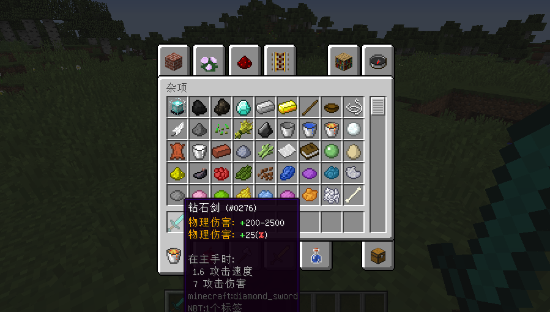
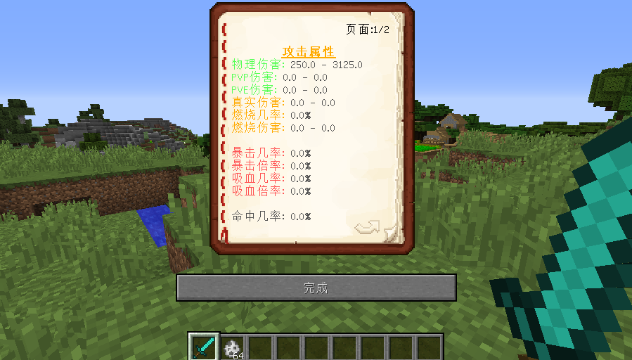

# 属性百分比读取格式

更方便的百分比读取方式，新版特色

## 说明

这里先恭喜下 **伤害加成、生命加成** 属性标签，退休了！\
　　\
百分比属性读取，也就是百分比增加属性值，这个格式支持 **所有的属性包括外部附属插件所注册的属性**\
你只需要在 **属性Lore** 上加上 **(%)** 符号，例如 "属性名: +<值> **(%)**"、"+10 **(%)** 属性名" 这样就可以做到百分比增加这个属性的属性值。\
\
在 2.X 版本我们需要通过 **"伤害加成"** 来百分比增加物理伤害属性值，现在你只需要 **"物理伤害 +10 (%)"** 即可。

!!! note
    但请不要这样做  ~~**"物理伤害 +10-100 (%)"**~~  那样子你来反馈有问题，你会被我骂 "S13"

