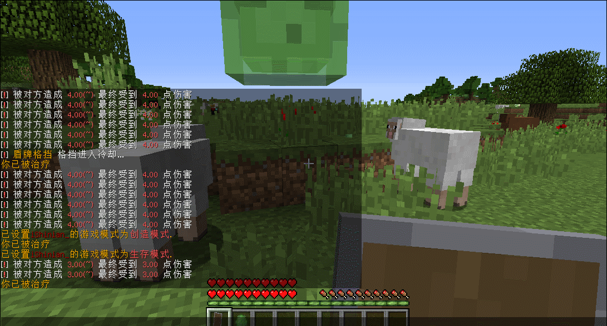

# 盾牌机制

1.9 +

## 说明

盾牌机制有两种处理方式，一种是**有冷却**，一种是**无冷却**\
\
**有冷却模式:** 每次冷却完毕，下次盾牌格挡是必定完全格挡此次伤害，冷却期间不会完全格挡伤害，但 盾牌格挡 属性会生效，可百分比格挡伤害。\
**无冷却模式:** 该模式下只能使用 盾牌格挡 属性来增加格挡伤害，如果没有这个属性则无论如何都会受到满额伤害。

## 机制属性

| 属性名  | 说明           |
| ---- | ------------ |
| 破盾几率 | 一定几率无视对方盾牌格挡 |
| 盾牌格挡 | 百分比格挡此次伤害    |

## 机制配置

```yaml
#支持版本: 1.9+
#盾牌格挡机制
shield:
  enable: true
  #right 则为无冷却模式
  right: false
  #right 为 false 时启用盾牌格挡冷却机制
  cd: 10
```


