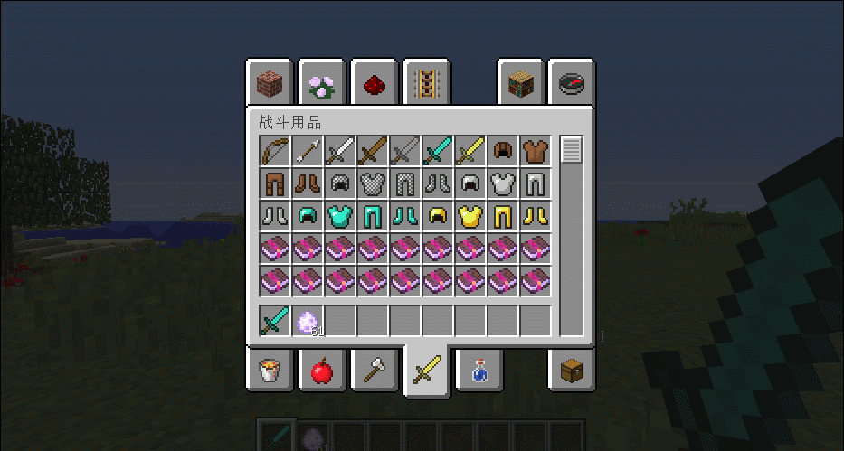

# 蓄力机制

1.9 +  (可能1.8也支持，可能就只支持弓箭)

## 蓄力说明

在 **1.9+** 剑的攻击只要攻击间隔足够够久，就会触发一次 **横扫攻击** 这就相当于 **蓄力满** 了，所以可以打出满额的伤害，如果你攻击态度过快，你的伤害也会越来越低。\
同理，弓箭也是，你拉弓需要蓄力到底才会打出满额的伤害。

## 机制属性

| 属性名  | 说明                    |
| ---- | --------------------- |
| 蓄力加成 | 增加蓄力强度，如果 100 则蓄力一直为满 |
| 蓄力干扰 | 减少对方蓄力强度              |

## 机制配置

```yaml
#支持版本: 1.9+
#蓄力伤害机制(近战&远程都会受到影响)
accumulateDamage: false
```


