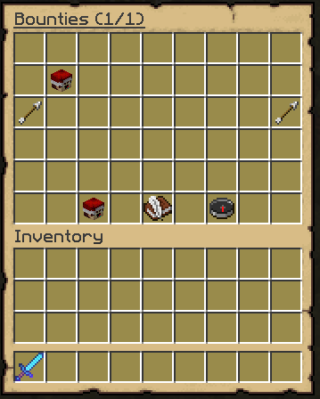
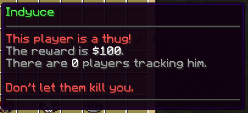
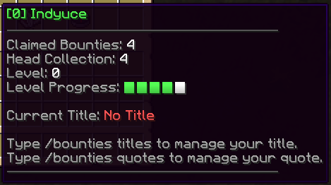

# 悬赏 {#📜-bounties}

## 创建悬赏 {#creating-a-bounty}

拥有 `bountyhunters.add` 权限的玩家可以使用 /bounty 命令，对其他玩家发布悬赏。发送者需要指定目标名称：`/addbounty <target> <reward>`。

即使玩家身上已经有悬赏，你也可以执行完全相同的命令，它只会将悬赏增加一定数量并再次在聊天中显示消息。玩家可以利用这一点让其他悬赏猎人更快地杀死其他人。

如果你有`bountyhunters.immunity`权限节点，则没有`bountyhunters.immunity.bypass`永久节点的玩家将无法为你设置悬赏。管理员可以使用此功能来防止其他玩家在其上设置悬赏。

可以使用`/bounties`访问悬赏列表。



## 悬赏列表界面 {#bounty-list-ui}

通过将不同的玩家头悬停在GUI中，你可以看到当前所有悬赏的信息。你可以看到当前的奖励是多少，目前有多少个玩家正在**跟踪**悬赏目标。你还可以通过阅读第一行来确定悬赏的创建者，悬赏是由玩家创建的，还是悬赏是由于非法杀死而自动生成的。



此菜单还会显示你的一些属性，例如你的等级、已领取/成功的悬赏、等级进度等。你可以通过将玩家头悬停在GUI左下角来查看这些属性。那里显示的所有属性也可以使用占位符进行访问。



## 编辑本段菜单 {#editing-this-menu}

物品名称、故事、材料、插槽...在`gui/bounty-list.yml`配置文件中完全可编辑。

<details markdown="1">

<summary>默认配置（可能已过时）</summary>

```yml
# GUI display name
name: 'Bounties ({page}/{max_page})'

# Number of slots in your inventory. Must be
# between 9 and 54 and must be a multiple of 9.
slots: 54

items:

  display_bounty:
    slots: [ 10,11,12,13,14,15,16,19,20,21,22,23,24,25,28,29,30,31,32,33,34 ]
    function: bounty

    # When there is no bounty in the given slot
    no_bounty:
      item: GRAY_STAINED_GLASS_PANE
      name: '&cNo Bounty'
      hide_tooltip: true

    # General language options
    last_update_date_format: 'dd/M/yyyy' # Date format used for date placeholders
    no_creator_placeholder: '&cServer'
    creator_line:
      self: '&7You created this bounty.'
      other: '&7{creator} created this bounty.'
      none: '&cThis player is a criminal!'
    action_line:
      target: '&cPeople are looking for you.'
      contributor: '&eRight click to take away your contribution.'
      none: '&eKill them to claim the bounty.'
    hunter_line:
      target: null # Hide line for target of bounty
      hunter: '&7▸ Click to stop &ctracking &7them.'
      none: '&7▸ Click to &ctrack &7them for ${target_tax}.'

    item: PLAYER_HEAD
    name: '&6{target}'
    # You can set custom model data int and string here
    #custom_model_data_string: 'something'
    #custom_model_data: 1234
    lore:
      - ''
      #- '{creator_line}'
      - '&f 💵&7 Reward of &f${reward}' # claim tax can be accessed {claim_tax}
      - '&f ⚔&7 Contributors: &f{contributors}'
      - '&f ☠ &7Hunters: &f{hunters}'
      - '&f ⏳ &7Last Update: &f{last_update}'
      - ''
      - '{action_line}'
      - '{hunter_line}'

  buy_bounty_compass:
    function: bounty_compass
    slots: [ 51 ]

    item: COMPASS
    name: '&6Bounty Compass'
    lore:
      - ''
      - '&eClick to buy the bounty compass for &6${price}'

  how_to_create_bounty:
    slots: [ 49 ]

    name: '&6How to create a bounty?'
    item: WRITABLE_BOOK
    lore:
      - 'Use /bounty <player> <reward>'
      - 'to create a bounty on a player.'
      - ''
      - '&6How to increase a bounty?'
      - 'Use /bounty <player> <amount>'
      - 'to increase an existing bounty.'
      - ''
      - '&6How to remove a bounty?'
      - 'Take off your contribution by right'
      - 'clicking the bounty item in this menu.'

  player_profile_item:
    function: player_profile
    slots: [ 47 ]

    no_title_placeholder: '&cNo Title'

    item: PLAYER_HEAD
    name: '&6[{level}] {name}'
    lore:
      - ''
      - 'Claimed Bounties: &f{claimed_bounties}'
      - 'Head Collection: &f{successful_bounties}'
      - 'Level: &f{level}'
      - 'Level Progress: {level_progress}'
      - ''
      - 'Current Title: &f{current_title}'
      - ''
      - 'Use /bounties titles to check your hunter titles.'
      - 'Use /bounties animations to check your death animations.'


  next_page_item:
    function: next_page
    slots: [ 26 ]

    item: PLAYER_HEAD
    texture: eyJ0ZXh0dXJlcyI6eyJTS0lOIjp7InVybCI6Imh0dHA6Ly90ZXh0dXJlcy5taW5lY3JhZnQubmV0L3RleHR1cmUvMTliZjMyOTJlMTI2YTEwNWI1NGViYTcxM2FhMWIxNTJkNTQxYTFkODkzODgyOWM1NjM2NGQxNzhlZDIyYmYifX19
    name: '&6Next Page'
    lore: { }

  prev_page_item:
    function: previous_page
    slots: [ 18 ]

    item: PLAYER_HEAD
    texture: eyJ0ZXh0dXJlcyI6eyJTS0lOIjp7InVybCI6Imh0dHA6Ly90ZXh0dXJlcy5taW5lY3JhZnQubmV0L3RleHR1cmUvYmQ2OWUwNmU1ZGFkZmQ4NGU1ZjNkMWMyMTA2M2YyNTUzYjJmYTk0NWVlMWQ0ZDcxNTJmZGM1NDI1YmMxMmE5In19fQ==
    name: '&6Previous Page'
    lore: { }
```

</details>

---

原文：[📜 Bounties](https://docs.phoenixdevt.fr/bounty-hunters/features/bounties) · 原文归档：2026-10-19
