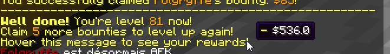

# 等级与奖励 {#🏅-levels-rewards}

玩家可以通过领取特定数量的悬赏来升级。升级时，玩家赚钱并可能解锁新的福利，例如猎人头衔（​​将显示在猎人排行榜上）和悬赏动画。



## 标题 {#titles}

```yml
reward:
    # The player title is displayed in the bounty
    # leaderboard as well as when the player claims a bounty.
    # It can also be obtained using a placeholder.
    title:
        HEAD_HUNTER:
            format: 'Head Hunter'
            unlock: 1
        HEAD_COLLECTOR:
            format: 'Head Collector'
            unlock: 2
        EXPERIENCED_HUNTER:
            format: 'Experienced Hunter'
            unlock: 3
        # ....
```

为了创建猎人标题，你必须指定标题格式（它在游戏中的外观）以及解锁的等级。像`HEAD_HUNTER`这样的字符串是标题ID，它不会显示在游戏中的任何地方，只是由BountyHunters在内部使用来区分所有标题。只需确保两个标题不共享相同的ID即可。

## 悬赏动画 {#bounty-animations}

悬赏动画由两部分组成：一个 **死亡引语**，这是每当你领取悬赏时在聊天中显示的一条消息，以及一个 **粒子效果**，它在被杀死的玩家周围召唤。

```yml
reward:
    # 'Bounty Animations' display a message in the chat
    # and play a particle effect around the killed player
    # when claiming a bounty.
    #
    # For no particle effect, remove the
    # 'effect: ..' line or leave it to NONE.
    #
    # For head hunting, the animation plays when killing
    # the player and collecting the head.
    #
    # You can access the bounty quote using a PAPI placeholder.
    animation:
        # ....
        SHEEP:
            format: 'Watch as I turn him into a sheep!'
            unlock: 12
            effect: METAMORPHOSE
        GIT_GUD:
            format: 'Git gud'
            unlock: 15
            effect: FLAME_VORTEX
        CENA:
            format: 'You can''t see me!!'
            unlock: 20
            effect: METEOR
```

为了设置悬赏动画，你必须指定死亡引用（即`format`部分）、解锁的等级以及粒子效果（必须是以下列表中的一个元素）。

|粒子效果|描述 |
| --- | --- |
| 图腾 | 召唤两股交织在一起的明亮粒子射流 |
| FLAME_VORTEX | 召唤两股交织的火焰喷射 |
| 黄金 | 从玩家的尸体中飞出许多金块 |
| 烟雾 | 在目标玩家周围召唤一个烟雾球 |
| 血战 | 召唤地上血迹 |
| 巫术 | 召唤三波黑暗能量席卷地面 |
| 变态 | 召唤一只小羊，目标名称为玩家 |
| 流星 | 召唤三颗流星飞向目标地点 |
| 无 | 无粒子效果。 |

## 其余配置 {#rest-of-config}

```yml
    # ....

    # Commands sent when leveling up.
    commands:
        '1':
        - "say %player% reached level 1!"
        
    # Currency earned when leveling up.
    # cash earned = <base> + ( <per-level> * <player level> )
    money:
        base: 50
        per-level: 6
        
# Bounties players need to claim to level up.
bounties-per-level: 5
```

`bounties-per-level`选项对应于悬赏玩家升级所需的金额。`commands`部分允许你设置每当玩家升级时控制台将执行的命令。这些命令支持PlaceholderAPI占位符。`money`部分可让你配置猎人升级时赚取的金钱。

## 禁用升级奖励 {#disabling-leveling-rewards}

要禁用升级奖励，请删除`levels.yml`配置文件的内容。不要删除文件本身，否则会恢复其默认内容。

---

原文：[🏅 Levels & Rewards](https://docs.phoenixdevt.fr/bounty-hunters/features/levels) · 原文归档：2026-10-19
