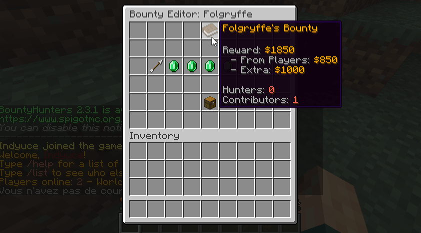

# 其他功能 {#🔧-miscellaneous}

## 悬赏编辑 {#bounty-editor}

该GUI可用于编辑当前的悬赏。它可用于可视化将资金投入悬赏的玩家以及由于 [自动悬赏](auto-bounties.md)] 而产生的悬赏部分。使用`/bounties edit <player>`打开该版本GUI。



“贡献者”是所有在悬赏中投入额外资金的玩家。使用该菜单，你可以更改每个玩家添加的金额。编辑此值是通过聊天输入完成的（使用GUI时，所有内容均已解释为in-game）。

与悬赏日志相结合，此菜单可让你完全操纵服务器上当前的悬赏。

## 冷却时间 {#cooldowns}

你可以选择在创建悬赏或向现有悬赏添加额外资金之前玩家需要等待的时间。

```yml
# Time to wait before using /bounty again. In seconds.
bounty-set-restriction: 120
```

你还可以使用悬赏菜单选择玩家在再次瞄准另一个玩家之前需要等待的时间。

```yml
# Player tracking lets players use a tracking compass to hunt
# down their bounty target. On the one hand, it gives an
# advantage to the hunters because they can find the player, but
# it also lets the target know how many players are tracking him.
player-tracking:
  # ...
  
  # Cooldowns players need to wait before tracking a player.
  cooldown: 240
```

## 悬赏命令 {#bounty-commands}

你可以将BountyHunters配置为在玩家声明悬赏以及玩家收到自动悬赏时执行命令。这些命令可以在config.yml配置文件中配置。

```yml
# Commands sent by the console when a player claims a bounty.
# {target} returns the target's name and {player} the claimer's
# name. Commands support PlaceholderAPI placeholders.
bounty-commands:

  # When a player claims a bounty.
  claim: [ ]
  # - '/give {player} minecraft:diamond 10'
  # - '/tell {target} Someone claimed your bounty.'

  # When a bounty is placed. {reward}
  place:
    player: [ ]
    console: [ ]
    # When a player kills another player illegally.
    auto-bounty: [ ]

  # When a bounty is increased by {amount}
  increase:
    player: [ ]
    console: [ ]
    # When a player kills another player illegally.
    auto-bounty: [ ]
```

这些命令支持来自 **PlaceholderAPI** 的占位符，但是你也可以使用`%player%`返回玩家/sender （声明/创建/增加悬赏的人）名称或%target%返回悬赏目标名称。

悬赏可以通过玩家或控制台（或通过 [auto悬赏](auto-bounties.md)功能）创建。当悬赏创建/增加原因不同时，可以执行不同的命令集。

---

原文：[🔧 Miscellaneous](https://docs.phoenixdevt.fr/bounty-hunters/features/misc) · 原文归档：2026-10-19
