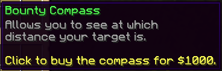

# 追踪玩家 {#🏃‍♀️-player-hunting}

为了激励玩家互相追捕悬赏，玩家可以使用 **跟踪罗盘** 来跟踪设置了悬赏的玩家。该指南针可以在悬赏菜单中购买，并将保留在玩家的物品栏中。



该指南针将指示你是否与目标位于同一个世界，如果是，它将指示到目标的距离，以及找到他的方向。  具有`bountyhunters.untargetable`永久节点的玩家无法被其他玩家跟踪，除非它们具有`bountyhunters.untargetable.bypass`永久节点。

## 配置 {#configuration}

你可以在主插件配置文件中配置跟踪罗盘。你可以禁用它并更改其价格以及玩家使用时用于显示距离数字小数的格式。最后但并非最不重要的一点是，你还可以更改玩家在定位新的玩家之前需要等待的延迟。将此冷却时间设置为0可能很危险，因为发送到目标玩家的警报如果发送多次，可能会向他的聊天和耳机发送垃圾邮件。

```yml
# Player tracking lets players use a tracking compass to hunt
# down their bounty target. On the one hand, it gives an
# advantage to the hunters because they can find the player, but
# it also lets the target know how many players are tracking them.
player-tracking:
  enabled: true

  # Set to true if you want players able to
  # target bounties which they contributed to
  can-track-own-bounties: true

  # Should the compass show the distance to
  # the target player
  show-distance: true

  # Price of the tracking compass.
  price: 1000

  # Time players need to wait when tracking some
  # player before tracking another player.
  cooldown: 240
```

---

原文：[🏃‍♀️ Player Hunting](https://docs.phoenixdevt.fr/bounty-hunters/features/player-hunting) · 原文归档：2026-10-19
