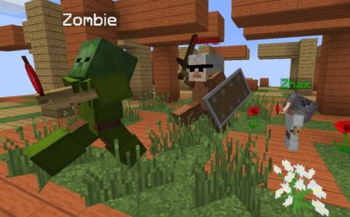
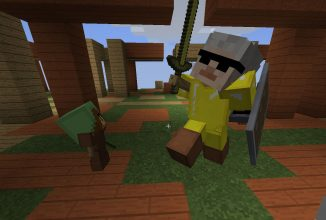
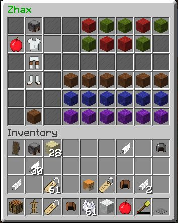

# 盔甲架编辑器

 

图中的场景是用盔甲架制作的。编辑器提供图形界面，可以进行以下操作：

- 编辑盔甲架上的物品，包括副手物品。
- 旋转底座。
- 调整头部朝向。
- 调整双臂和双腿的朝向。
- 移动盔甲架，让摆放更紧凑。
- 显示或隐藏底板。
- 在普通和小型之间切换大小。
- 显示或隐藏盔甲架。
- 开启或关闭重力，抬高或降低盔甲架及其部位。
- 显示或隐藏手臂、名称。
- 开启或关闭发光效果。
- 开启或关闭无敌状态，使盔甲架免受伤害。
- 开启或关闭交互。关闭后，玩家无法与盔甲架交互，也无法用潜行右键打开编辑界面。

以上操作都能在内置界面中完成。

左键或右键点击对应方块即可调整身体部位。按住 Shift 操作时，调整速度为原来的 10 倍。

原文列出 17 种操作，并为各项操作提供了以下权限节点：

- `cmi.command.armorstand.updateitems`
- `cmi.command.armorstand.plate`
- `cmi.command.armorstand.size`
- `cmi.command.armorstand.visible`
- `cmi.command.armorstand.arms`
- `cmi.command.armorstand.gravity`
- `cmi.command.armorstand.glow`
- `cmi.command.armorstand.invulnerable`
- `cmi.command.armorstand.name`
- `cmi.command.armorstand.interactable`
- `cmi.command.armorstand.head`
- `cmi.command.armorstand.body`
- `cmi.command.armorstand.torso`
- `cmi.command.armorstand.leftArm`
- `cmi.command.armorstand.rightArm`
- `cmi.command.armorstand.leftLeg`
- `cmi.command.armorstand.rightLeg`
- `cmi.command.armorstand.pos`

基础权限为 `cmi.command.armorstand`。

开始编辑有两种方式：看着盔甲架执行 `/cmi armorstand`，或对着它按住 Shift 右键点击。

如果想在编辑时同时看到盔甲架，可以将视角移向一边，再执行 `/cmi armorstand last`，继续编辑上一次操作的盔甲架。

盔甲架无法移入你没有建造权限的区域。其他玩家正在编辑的盔甲架也无法同时编辑。

---

[查看原文](https://www.zrips.net/cmi/armor-stand-editor/)
