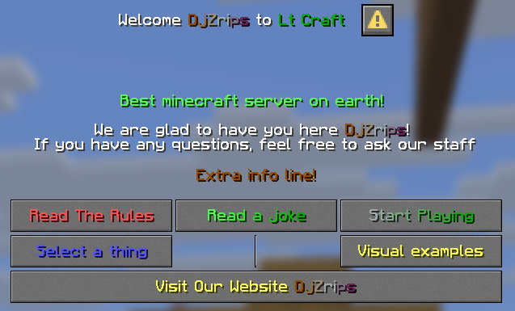

# 对话框

<span id="BasicShop"></span>

对话框命令支持**特殊指令**机制，详见[**这里**](specialized.md)。



需要注意，主 Label 可选，但始终位于顶部，之后依次是显示区域、输入项和自定义按钮。这一顺序由 Minecraft 对对话框窗口的处理方式决定，今后可能会改变。

以下是对话框窗口示例。可以使用多个文件，并在每个文件中定义多个对话框，方便整理。

```text
welcome:
  Enabled: true
  Label: '{#white}Welcome {#gray}%cmi_user_display_name% {#white}to {#edward}%cmi_user_world_formatted%'
  Description:
    Width: 300
    Lines: 
    - '{#green}Best minecraft server on earth!'
    - ''
    - '{#white}We are glad to have you here %cmi_user_display_name%{#white}!'
    - 'If you have any questions, feel free to ask our staff'
  VisualFields:
  - Width: 300
    Lines: 
    - '{#brown}Extra info line!'
  Buttons:
    Columns: 3 
    List:
    - Label: '{#red}Read The Rules' 
      Width: 100
      OpenDialog: license
      Tooltip: 
      - '{#red}Read it before starting to play!'
    - Label: '{#green>}Read a joke{#darkgreen<}'
      Width: 100
      OpenDialog: 'randomtext'
    - Label: '{#edward>}Start Playing{#darkgreen<}'
      Width: 100
      Commands: 
      - closeinv!
    - Label: '{#blue}Select a thing'
      Width: 100
      OpenDialog: inputexample
    - Label: ''
      Width: 1
    - Label: '{#yellow}Visual examples'
      Width: 100
      OpenDialog: visualexample
    - Label: '{#yellow}Visit Our Website %cmi_user_display_name%'
      Width: 304
      Url: www.zrips.net
  Close:
    Label: '{#pink>}Go Away!{#edward<}'
    Tooltip: 
    - '{#pink>}Lets go %cmi_user_display_name%!{#edward<}'
    Commands: 
    - 'cmi feed [playerName]'
    Width: 150
visualexample:
  Enabled: true
  Label: '{#white}Visual examples'
  Description:
    Width: 300
    Lines: 
    - '{#green}Descrption at the top!'
  VisualFields:
  - Width: 300
    Lines: 
    - '{#brown}Extra info line!'
  - Item: Stone;n{{#red}Custom name};e{sharpness:2}
    Text:
      Width: 150
      Lines: 
      - '{#green}Item text with some auto wrapping and'
      - ''
      - '{#white}Multiline'
    Width: 16
    Height: 16
    ShowTooltip: true
    ShowDecorations: false
  - Item: potato
    Text:
      Width: 150
      Lines: 
      - '{#green}No tooltip on item'
    Width: 16
    Height: 16
    ShowTooltip: false
  - Item: '[ItemInHand]'
    Text:
      Lines: 
      - '{#green}%cmi_iteminhand_displayname% {#white}is what you are holding in your hand!'
  Close:
    Label: '{#edward}Go Back!'
    OpenDialog: welcome
    Width: 250
inputexample:
  Enabled: true
  Label: '{#white}Example of inputs'
  Inputs:
  - Label: '{#brown}Pick one'
    Width: 150
    Options:
    - Label: Option A
      OpenDialog: 'randomtext'
    - Label: '{#red}Option B'
      Default: true
      Commands:
      - 'cmi heal [playerName]'
    - Label: Option C
  - Label: 'Select it and get healed on save!'
    OnTrue: 
      Commands:
      - cmi heal [playerName]
    OnFalse: 
      Commands:
      - msg! [playerName] No free heal for you!
  Buttons:
    Columns: 1 
    List:
    - Label: '{#yellow}Save'
      Width: 150
      Save: true
  Close:
    Label: '{#pink}Back'
    OpenDialog: welcome
license:
  Enabled: true
  Label: '{#white}User Agreement'
  VisualFields:
  - Width: 350
    Lines: 
    - 'By clicking “Agree with terms” or continuing to play on this server, you solemnly swear that:'
    - ''
    - ''
    - ''
    - '{#white}1. You will not grief, steal, or blow up someone’s house unless they literally begged you to. (And even then, record it for legal reasons.)'
    - '{#nobel}2. You will not hack, fly, X-ray, or teleport through walls like a haunted AI. We like our ghosts dead and our walls solid.'
    - '{#white}3. You agree that admins are always right, especially when they’re wrong. Disputes may be settled in a pit of lava.'
    - '{#nobel}4. You will not spam the chat, unless it’s with memes approved by the Ministry of Silly Blocks™.'
    - '{#white}5. You will build things, not just holes in the ground shaped like something inappropriate.'
    - '{#nobel}6. You will not summon the Wither inside spawn. Seriously. That’s a one-way ticket to banville.'
    - "{#white}7. You accept that lag may happen, creepers may explode, and your pet dog may randomly vanish. It’s Minecraft, not therapy."
    - "{#nobel}8. You promise not to ask for op, creative mode, free diamonds, or the admin’s credit card number."
    - '{#white}9. You accept that this is a game, not a substitute for real-world dominance, revenge, or romance.'
    - "{#nobel}10. You acknowledge that your building may be roasted — gently and with love — if it's a dirt cube."
    - ''
    - ''
    - '{#white}By accepting, you agree to play nice, have fun, and not become the reason we disable TNT again.'
    - ''
    - '{#yellow}Click to enter blocky paradise.'
    - 'Missclick to be gently kicked like a misbehaving parrot.'
  Inputs:
  - Type: Boolean
    Label: 'Agree with terms'
    OnTrue: 
      Commands:
      - asConsole! cmi heal [playerName]
      - closeinv!
    OnFalse:
      Commands:
      - asConsole! cmi kick [playerName] You disagreed! 
  Close:
    Label: 'Update!'
    Save: true
    Width: 150
```

```text
  Close:
    Label: 'Update!'
    Save: true
    Width: 150
```

随机文本 基础商店 随机文本

```text
randomtext:
  Enabled: true
  Description:
    Randomize: true
    Lines: 
    - "{#yellow}Why did the creeper break up with the skeleton?\n\n{#green}Because he felt blown away!"
    - "{#yellow}Why don't Endermen like jokes?\n\n{#green}They can't take things lightly!"
    - '{#yellow}Why did Steve get lost?\n\n{#green}He didn’t follow the chunky breadcrumbs!'
    - '{#yellow}How does a Minecraft player avoid sunburn?\n\n{#green}Stay in the shade biome!'
    - '{#yellow}Why was the Minecraft player a great musician?\n\n{#green}He had perfect block timing!'
    - '{#yellow}Why did the chicken cross the Nether?\n\n{#green}To get to the other biome!'
    - '{#yellow}How do you start a party in Minecraft?\n\n{#green}You block the creepers!'
    - '{#yellow}Why was the villager so good at trading?\n\n{#green}Because he had emerald standards!'
    - '{#yellow}What do you call a Minecraft celebration?\n\n{#green}A block party!'
    - '{#yellow}What’s a skeleton’s least favorite room?\n\n{#green}The living room!'
  Close:
    Label: 'Back'
    OpenDialog: 'welcome'
    Width: 150
```

基础商店

```text
buyItemExample:
  Enabled: true
  Label: '{#white}Shop'
  Description:
    Width: 300
    Lines: 
    - '<T>{#green}General store</T><H>Buy stuff</H>'
  VisualFields:
  - Item: "[material]"
    Width: 16
    Height: 16
    ShowTooltip: false  
  - Width: 250
    Lines: 
    - '<T>{#green}Buy %cmi_material_realname_[material]% for {#yellow}%cmi_worth_buy_[material]% {#green}each</T><H>Hover text</H>'
    - '{#green}You have %cmi_material_realname_[material]% X {#yellow}%cmi_user_itemcount_[material]% {#green}in your inventory'
    - '{#green}Your balance {#yellow}%cmi_user_balance_formated%'
  - Width: 300
    Placeholder: '%cmi_user_balance%<%cmi_worthc_buy_[material]%'
    Lines:
    - '{#red}No money!'
  - Width: 300
    Placeholder: '%cmi_worthc_buy_[material]%<=0' 
    Lines:
    - '{#yellow}Not for sale!'
  Buttons:
    Columns: 2
    List:
    - Label: 'Buy %cmi_material_realname_[material]% {#gray}x1' 
      Placeholder:
      - '%cmi_worthc_buy_[material]%>0'
      - '%cmi_user_balance%>=%cmi_worthc_buy_[material]%'
      Width: 200
      Tooltip:
      - '{#white}Price:{#yellow} %cmi_worth_buy_[material]%'
      - '{#gray}Click to buy %cmi_material_realname_[material]%'
      Commands:
      - moneycost:%cmi_worthc_buy_[material]%! cmi give [playerName] [material] 1
      - asConsole! cmi dialogs buyItemExample [playerName] material:[material]
    - Label: 'Sell %cmi_material_realname_[material]% {#gray}x1' 
      Placeholder:
      - '%cmi_worthc_sell_[material]%>0'
      - '%cmi_user_itemcount_[material]%>=1'
      Width: 200
      Tooltip:
      - '{#white}Price:{#yellow} %cmi_worth_sell_[material]%'
      - '{#gray}Click to sell %cmi_material_realname_[material]%'
      Commands:
      - exactitem:[material]! asConsole! cmi money give [playerName] %cmi_worthc_sell_[material]%
      - asConsole! cmi dialogs buyItemExample [playerName] material:[material]
    - Label: 'Buy %cmi_material_realname_[material]% {#gray}x10' 
      Placeholder:
      - '%cmi_worthc_buy_[material]%>0'
      - '%cmi_user_balance%>=%cmi_worthc_buy_[material]:10%'
      Width: 200
      Tooltip:
      - '{#white}Price:{#yellow} %cmi_worth_buy_[material]:10%'
      - '{#gray}Click to buy %cmi_material_realname_[material]%'
      Commands:
      - moneycost:%cmi_worthc_buy_[material]:10%! cmi give [playerName] [material] 10
      - asConsole! cmi dialogs buyItemExample [playerName] material:[material]
    - Label: 'Sell %cmi_material_realname_[material]% {#gray}x10' 
      Placeholder:
      - '%cmi_worthc_sell_[material]%>0'
      - '%cmi_user_itemcount_[material]%>=10'
      Width: 200
      Tooltip:
      - '{#white}Price:{#yellow} %cmi_worth_sell_[material]:10%'
      - '{#gray}Click to sell %cmi_material_realname_[material]%'
      Commands:
      - exactitem:[material]:10! asConsole! cmi money give [playerName] %cmi_worthc_sell_[material]:10%
      - asConsole! cmi dialogs buyItemExample [playerName] material:[material]
    - Label: 'Buy %cmi_material_realname_[material]% {#gray}x64' 
      Placeholder:
      - '%cmi_worthc_buy_[material]%>0'
      - '%cmi_user_balance%>=%cmi_worthc_buy_[material]:64%'
      Width: 200
      Tooltip:
      - '{#white}Price:{#yellow} %cmi_worth_buy_[material]:64%'
      - '{#gray}Click to buy %cmi_material_realname_[material]%'
      Commands:
      - moneycost:%cmi_worthc_buy_[material]:64%! cmi give [playerName] [material] 64
      - asConsole! cmi dialogs buyItemExample [playerName] material:[material]
    - Label: 'Sell %cmi_material_realname_[material]% {#gray}x64' 
      Placeholder:
      - '%cmi_worthc_sell_[material]%>0'
      - '%cmi_user_itemcount_[material]%>=64'
      Width: 200
      Tooltip:
      - '{#white}Price:{#yellow} %cmi_worth_sell_[material]:64%'
      - '{#gray}Click to sell %cmi_material_realname_[material]%'
      Commands:
      - exactitem:[material]:64! asConsole! cmi money give [playerName] %cmi_worthc_sell_[material]:64%
      - asConsole! cmi dialogs buyItemExample [playerName] material:[material]
```

## 基础设置

```text
textfieldtest:
  Enabled: true
  Label: '{#white}Title text'
  Close:
    Label: '{#pink}Back'
    OpenDialog: welcome
```

每个对话框配置都以名称开头，在命令中或从其他对话框打开它时会用到此名称。  
**Enabled:** 是否启用此对话框。设为 false 时，只有拥有 **cmi.command.dialogs.disabled** 权限的玩家才能看到它。  
**Label:** 对话框窗口顶部的文字。可以包含占位符，并根据查看窗口的玩家解析。  
**Permission**：使用此对话框所需的权限节点，可选。  
**Placeholder:** 占位符条件，可用于规定显示对话框、按钮、输入项或显示区域的要求。  
**Close:** 可选的关闭按钮配置，使用与普通按钮相同的选项。不设置时不会显示关闭按钮，但始终可以按键盘上的 ESC 关闭对话框。建议保留此项。请注意，按 ESC 时也会执行 Close 按钮的动作。

## 条件

对话框本身及其中的按钮、输入项和显示区域，都可以添加条件，决定玩家是否可以使用。可以要求特定的权限节点、特定的占位符值，或同时要求两者。

```text
  Placeholder: '%cmi_iteminhand_type%==stone'
  Permission: 'any.permission.node'
```

#### 占位符条件（Placeholder）

```text
 Placeholder: '%cmi_iteminhand_type%==stone'
```

```text
  Placeholder:
  - '%cmi_worthc_buy_[material]%>0'
  - '%cmi_user_balance%>=%cmi_worthc_buy_[material]%'
```

Placeholder 部分可填写占位符。返回值为以下任一默认值时，条件成立：**true, yes, on, enable, enabled, 1**；不匹配任何这些值时，条件不成立。返回值应为纯文本，不带任何颜色代码。也可以在 **==** 后指定要检查的自定义值，例如 **‘****%cmi_user_weather%==sunny’**，只允许玩家在晴天的世界中使用对话框。

Placeholder 字段也接受通过对话框命令传入的自定义变量。

可以将多个占位符设为要求，玩家必须全部满足才能看到该字段。

也可以使用数值，例如 **‘%cmi_user_stats_kill_entity:Zombie%>=20’** 会检查占位符返回值是否大于或等于 20。有效运算符：**>= <= > <**。

#### 权限条件（Permission）

```text
 Permission: 'any.permission.node'
```

指定玩家使用对话框或其中字段所需的任意权限节点。  
若权限节点以 **!** 开头，则检查玩家是否没有该权限节点。例如 **‘!cmi.command.heal’** 只会向没有此权限节点的玩家显示字段。

## 显示区域（VisualFields）

```text
  VisualFields:
  - Width: 300
    Lines: 
    - '{#brown}Extra info line!'
  - Item: Stone;n{{#red}Custom name};e{sharpness:2}
    Text:
      Width: 150
      Lines: 
      - '{#green}Item text with some auto wrapping and'
      - ''
      - '{#white}Multiline'
    Width: 16
    Height: 16
    ShowTooltip: true
    ShowDecorations: false
  - Item: potato
    Text:
      Width: 150
      Lines: 
      - '{#green}No tooltip on item'
    Width: 16
    Height: 16
    ShowTooltip: false
  - Item: '[ItemInHand]'
    Text:
      Lines: 
      - '{#green}%cmi_iteminhand_displayname% {#white}is what you are holding in your hand!'
```

#### 文本

```text
  - Width: 300
    Lines: 
    - '{#brown}Extra info line!'
```

**Width**：文本区域的宽度。文字放不下时，会自动换到下一行。  
    **Permission**：查看此文本所需的权限节点，可选。  
**Placeholder:** 查看此文本所需的占位符条件，可选。  
    **Randomize:** 启用时，从提供的文本行中随机选择一行。  
    **Lines**：向玩家显示的文本行列表，可以包含占位符。也可以使用 CText 格式显示带悬停效果的文本，并在点击时执行命令。

#### 物品

```text
  - Item: Stone;n{{#red}Custom name};e{sharpness:2}
    Text:
      Width: 150
      Lines: 
      - '{#green}Item text with some auto wrapping and'
      - ''
      - '{#white}Multiline'
    Width: 16
    Height: 16
    ShowTooltip: true
    ShowDecorations: false
  - Item: potato
    Text:
      Width: 150
      Lines: 
      - '{#green}No tooltip on item'
    Width: 16
    Height: 16
    ShowTooltip: false
  - Item: '[ItemInHand]'
    Text:
      Lines: 
      - '{#green}%cmi_iteminhand_displayname% {#white}is what you are holding in your hand!'
```

**Item:** 物品定义，支持 Stone;n{{#red}Custom name};e{sharpness:2} 这样的单行物品格式，也支持 [ItemInHand]，会自动使用玩家主手中的物品。这里可以使用返回正确物品描述格式的占位符。  
    **Permission**：查看此物品所需的权限节点，可选。  
**Placeholder:** 查看此物品所需的占位符条件，可选。  
**Width/Height:** 物品区域的大小。请注意，由于 Minecraft 的限制，这只会调整物品图标周围区域的大小，不会调整图标本身。因此，这两个选项目前没有实际用途。  
**ShowTooltip**：鼠标悬停时，显示或隐藏物品的提示信息。  
**ShowDecorations**：显示或隐藏物品提示中的装饰信息，包括物品耐久度条、物品数量等。  
**Text:** 包含通用文本区域的变量。可以使用 CText 格式显示带悬停效果的文本，并在点击时执行命令。  
    **Width**：文本区域的宽度。  
    **Lines**：显示在物品右侧的文本行，可以包含占位符。

## 输入项（Inputs）

```text
inputexample:
  Enabled: true
  Label: '{#white}Example of inputs'
  Inputs:
  - Label: '{#brown}Pick one'
    Width: 150
    Options:
    - Label: Option A
      OpenDialog: 'randomtext'
    - Label: '{#red}Option B'
      Default: true
      Commands:
      - 'cmi heal [playerName]'
    - Label: Option C
      Commands:
      - 'msg! [playerName] selected [value]'
  - Label: '{#brown}Select dialog to open'
    Width: 250
    OpenDialog: '[value]'
    Options:
    - Label: '{#white}None'
      Value: none
    - Label: '{#pink}Welcome'
      Value: welcome
    - Label: '{#green}License'
      Value: license
    - Label: '{#red}Visual Example'
      Value: visualexample
  - Label: 'Select it and get healed on save!'
    OnTrue: 
      Commands:
      - cmi heal [playerName]
      Value: accepted
    OnFalse: 
      Commands:
      - msg! [playerName] No free heal for you as you picked [value]!
      Value: deny!!!!
  - Label: 'Placeholder based'
    Default: '%cmi_maintenance_state%'
    OnTrue: 
      Commands:
      - cmi maintenance true
    OnFalse: 
      Commands:
      - cmi maintenance false
  - Label: 'Text over input'
    InitialText: 'Initial text to show'
    MaxLength: 256
    MaxLines: 5
    Height: 64
    Width: 350
    Commands:
    - 'msg! [playerName] &2[value]'
  - Type: Text
    Width: 500
    Commands:
    - 'msg! [playerName] &2[value]'
  - InitialText: '%cmi_user_nickname%'
    Width: 250
    MaxLines: 5
    Height: 64
    Commands:
    - 'cmi nick [value] [playerName]'
  - Label: 'Max players %server_max_players%'
    Width: 250
    Start: 0
    End: '%cmi_equationint_{server_max_players}*2%'
    Step: 1
    InitialValue: '%server_max_players%'
    Commands:
    - 'cmi maxplayers [value]'
  Buttons:
    Columns: 1 
    List:
    - Label: '{#yellow}Save'
      Width: 150
      Save: true
  Close:
    Label: '{#pink}Back'
    OpenDialog: welcome
```

多数情况下会自动判断输入项类型，但前提是至少配置一个该类型特有的字段。如果类型识别不正确，可以使用 **Type** 变量手动指定。有效选项：**Singleton, Boolean, Text, Slider**。例如：

```text
  - Type: Text
```

#### 单选（Singleton）

```text
  - Label: '{#brown}Pick one'
    Width: 150
    Options:
    - Label: Option A
      OpenDialog: 'randomtext'
    - Label: '{#red}Option B'
      Default: true
      Commands:
      - 'cmi heal [playerName]'
    - Label: Option C
      Commands:
      - 'msg! [playerName] selected [value]'
  - Label: '{#brown}Select dialog to open'
    Width: 250
    OpenDialog: '[value]'
    Options:
    - Label: '{#white}None'
      Value: none
    - Label: '{#pink}Welcome'
      Value: welcome
    - Label: '{#green}License'
      Value: license
    - Label: '{#red}Visual Example'
      Value: visualexample
```

Label：每个选项按钮显示的文字，可选。  
    **Permission**：查看和使用此输入项所需的权限节点，可选。  
**Placeholder:** 使用此输入项所需的占位符条件，可选。  
    Width：按钮宽度。  
    Options：玩家可以选择的选项列表。  
        Label：选择时显示的选项文字，可以包含占位符。  
        **Value**：此单选项的自定义值，可在命令或 OpenDialog 中通过 [value] 变量使用。  
        Commands：选中此项并按下保存按钮时执行的命令，可选。  
        Default：存在且设为 true 时，会作为初始显示的默认选项。此字段完全可选；不设置时使用第一项。此字段可以使用返回类似布尔值的占位符：**1 0 true false**。多个选项都返回 true 时，使用第一个；无法确定占位符状态时，也默认使用第一项。

#### 复选框（Boolean）

```text
  - Label: 'Select it and get healed on save!'
    OnTrue: 
      Commands:
      - cmi heal [playerName]
      Value: accepted
    OnFalse: 
      Commands:
      - msg! [playerName] No free heal for you as you picked [value]!
      Value: deny!!!!
  - Label: 'Placeholder based'
    Default: '%cmi_maintenance_state%'
    OnTrue: 
      Commands:
      - cmi maintenance true
    OnFalse: 
      Commands:
      - cmi maintenance false
```

Label：复选框旁边显示的文字，可以是一行或多行，可选。  
    **Permission**：查看和使用此输入项所需的权限节点，可选。  
**Placeholder:** 使用此输入项所需的占位符条件，可选。  
    OnTrue：  
        Commands：勾选复选框时执行的命令列表，可选。  
        Value：此单选项的自定义值，可在命令或 OpenDialog 中通过 [value] 变量使用。  
    OnFalse：  
        Commands：未勾选复选框时执行的命令列表，可选。

#### 文本

```text
  - Type: Text
    Width: 500
    Commands:
    - 'msg! [playerName] &2[value]'
  - InitialText: '%cmi_user_nickname%'
    Width: 250
    MaxLines: 5
    Height: 64
    Commands:
    - 'cmi nick [value] [playerName]'
```

Label：文本框上方显示的文字，可选。  
    **Permission**：查看和使用此输入项所需的权限节点，可选。  
**Placeholder:** 使用此输入项所需的占位符条件，可选。  
    **Initialtext**：文本框内显示的初始文字。可以包含占位符，例如用 %cmi_user_nickname% 插入玩家当前的昵称。  
    **MaxLength**：玩家可以在此字段中输入的最大字符数。  
    **MaxLines**：允许自动换为多行，在输入文字超过文本框宽度时，便于显示。  
    **Height**：输入框高度，可与 MaxLines 搭配，将输入框调整为合适的大小。  
    **Width:** 输入框宽度。不设置时，可能会根据 MaxLength 的值自动调整，最多为 512 单位。  
    **Commands/OpenDialog**：按下保存按钮时，执行指定命令或打开指定对话框。可使用 [value] 变量插入文本框中的值。

#### 滑块（Slider）

```text
  - Label: 'Max players %server_max_players%'
    Width: 250
    Start: 0
    End: '%cmi_equationint_{server_max_players}*2%'
    Step: 1
    InitialValue: '%server_max_players%'
    Commands:
    - 'cmi maxplayers [value]'
```

Label：数值左侧显示的文字，可选。  
    **Permission**：查看和使用此输入项所需的权限节点，可选。  
**Placeholder:** 使用此输入项所需的占位符条件，可选。  
    **Start**：滑块的起始值，可以是 2.5 这样的小数，也可以用返回数值的占位符定义。  
    **End**：滑块的结束值，可以用返回数值的占位符定义，例如 ‘%cmi_equationint_{server_max_players}*2%’。  
    **Step**：调整滑块时的步长，可以是小数，也可以基于占位符。  
    **InitialValue**：滑块的初始位置，应在 Start 和 End 范围内。可以使用 %server_max_players% 这样的占位符定义。  
    **Width:** 滑块宽度。  
    **Commands/OpenDialog**：按下保存按钮时，执行指定命令或打开指定对话框。可使用 [value] 变量插入文本框中的值。

## 按钮（Buttons）

```text
  Buttons:
    Columns: 3 
    List:
    - Label: '{#red}Read The Rules' 
      Width: 100
      OpenDialog: license
      Tooltip: 
      - '{#red}Read it before starting to play!'
    - Label: '{#green>}Read a joke{#darkgreen<}'
      Width: 100
      OpenDialog: 'randomtext'
    - Label: '{#edward>}Start Playing{#darkgreen<}'
      Width: 100
      Commands: 
      - closeinv!
    - Label: '{#blue}Select a thing'
      Width: 100
      OpenDialog: inputexample
    - Label: ''
      Width: 1
    - Label: '{#yellow}Visual examples'
      Width: 100
      OpenDialog: visualexample
    - Label: '{#yellow}Visit Our Website %cmi_user_display_name%'
      Width: 304
      Url: www.zrips.net
```

**Columns:** 按钮的列数，默认为 1。  
    **Permission**：使用此按钮所需的权限节点，可选。如果玩家没有指定权限节点，按钮会被完全移除，或替换为宽 1 像素、没有任何功能的按钮。宽 1 像素的替代按钮只用于有多列按钮的情况，以保留界面的格式和外观。  
**Placeholder:** 使用此按钮所需的占位符条件，可选。  
    **List:** 按指定顺序排列的按钮列表。按钮会严格按此顺序放置，每行按钮的数量由前面的 Columns 选项固定。只有最后一行按钮数量不足时，才会居中显示。  
**Label:** 按钮文字，可以包含占位符。  
        **Tooltip:** 鼠标悬停在按钮上时显示的提示，可以包含颜色代码和占位符。支持多行，可用 \n 分隔，也可以定义为列表。  
        **Width:** 按钮宽度，不小于 1，未设置时默认为 250。  
        **Commands:** 点击此按钮时执行的一条或多条命令，支持特殊指令。需要在命令中使用玩家名称时，可以用 [playerName] 变量。  
        **OpenDialog:** Commands 的替代选项，用于从当前对话框打开另一个对话框。  
        **Url:** Commands 的替代选项，用于打开给定的 URL 链接。  
        **Save**：设为“true”，例如“Save: true”时，点击按钮会处理输入字段中的值。请注意，此动作默认还会重新打开当前对话框，因此应避免在同一项中定义 OpenDialog，以免出现不可预期的行为。点击保存按钮时，除了保存，也仍可执行命令。

## 命令

```text
/cmi dialogs buyitemexample [material]:oakwood
```

命令中可以包含在对话框内部使用的自定义变量。变量必须采用 **[customName]:variable** 这样的格式，即将所有出现的 **[customName]** 替换为 **variable**。

参见**基础商店**示例。需要时可以定义多个变量。

---

[查看原文](https://www.zrips.net/cmi/commands/dialogs/)
