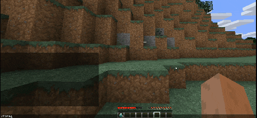
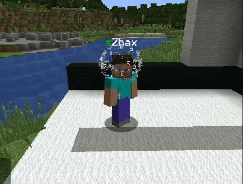

# 指令预热



任何命令都可以添加预热计时。需要避免立即执行命令时就可以使用，例如防止玩家在 PvP 中立刻传送离开。为 CMI 命令设置预热时，要使用完整命令名称。例如，warp 命令的预热应写成：

```text
cmi warp :7:false
```

其中，“**cmi warp** ”是命令路径，末尾带有空格，避免玩家执行 **/cmi warp** 却未指定目的地时也触发预热。**7** 是预热时长，本例为 7 秒。**False** 表示预热期间玩家不可移动，但仍可转动视角。这同样适用于 PvP：敌方玩家的攻击会使玩家发生位移，从而取消预热计时。

管理人员拥有 **cmi.command.[comandName].warmupbypass** 权限节点时，可以跳过预热。这里的命令名称是预热配置中使用的命令，本例为 **warp**。

还可以指定额外变量，在预热期间显示粒子效果，让周围的人知道玩家正在等待命令预热。用法如下：

```text
cmi warp :7:false:GlyphHead
```

一些配置示例：

```text
WarmUps:
  Enabled: true
  InformOnNoMove: true
  List:
  - tp:7:false
  - back:7:true
  - cmi spawn:7:false
  - cmi home :7:false
  - spawn:7:false
  - cmi home :7:false
  - cmi warp :7:false:GlyphHead
  - cmi warp spawn:7:false:GlyphHead
  - rtp:7:false:GlyphHead
```

[](../assets/images/6934e78acb-2019-02-21_16-27-39.gif)

---

[查看原文](https://www.zrips.net/cmi/commands/warmups/)
