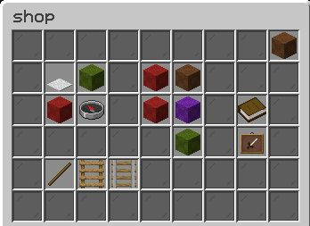
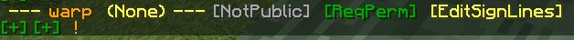
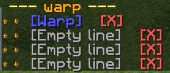
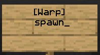
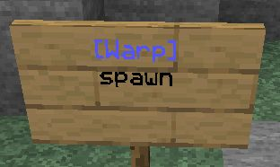

# 传送点

## CMI 传送点功能

参数：‘cmi setwarp [warpName] (true/false) (hand) (slot)’  
使用所需权限：**cmi.command.setwarp**

为 **/cmi warp** 命令设置传送点列表。  
设置传送点需要 **cmi.command.warp** 权限。

一个简单的传送点。

`cmi setwarp test`

所有传送点都可以通过图形界面编辑，使用 **/cmi editwarp [warpName]** 打开。在此示例中，执行 **/cmi editwarp test**，会打开类似下图的界面：

[](../assets/images/92beae8633-editwarp.jpg)

在这个界面中可以设置：

- 玩家有权使用该传送点时，在传送点列表界面中显示的自定义物品（**cmi.command.warp.[warpname]**）。
- 玩家无权使用该传送点时，在传送点列表界面中显示的自定义物品（**cmi.command.warp.[warpname]**）。
- 使用该传送点所需的权限。
- 玩家无权使用时，是否仍显示该传送点。
- 是否自动生成物品描述（true/false），显示该传送点的目标位置。
- 该传送点在界面中的自定义槽位。
- 该传送点在界面中的自定义页码。这样可以设置多页传送点，让每页各有侧重。
- 将传送点位置重新设为当前位置。
- 传送点的自定义显示名称，用于反馈消息，同时不影响命令本身。
- 传送点所属的分组。可以将多个传送点归为一组，在界面中查看指定分组时将各组分开显示。
- 为一个传送点设置多个位置，将玩家随机传送到其中一个位置。
- 多位置传送点是可以重复选择同一位置，还是尽量轮流使用所有位置后，再次选择已使用的位置。

创建传送点，并要求玩家拥有 **cmi.command.warp.[warpname]** 权限才能使用。在此示例中，权限为 **cmi.command.warp.test**。

`cmi setwarp test true`

创建传送点，并将手持物品用作该传送点在界面中显示的物品。

`cmi setwarp test hand`

创建传送点，并设置它在界面中使用的槽位（1–54）。

`cmi setwarp test 13`

在一条命令中完成以上所有设置。

`cmi setwarp test true hand 13`

**补充说明**

- 将其他玩家传送到传送点需要 **cmi.command.warp.others** 权限。
- 可以像出生点一样，在配置文件中启用 BlackListedItems。
- 可以将传送点用作 Respawn 选项的条件。
- 可以将传送点用作 WarmUps 选项的条件。
- 拥有 **cmi.command.removewarp** 权限即可删除传送点。参数：‘cmi removewarp (warpName)’。
- 可以在配置文件中修改传送点设置。

## 传送点告示牌

如果希望创建点击后就能前往指定传送点的告示牌，可以按以下步骤设置：

使用 **/cmi ic new warp** 创建新的交互命令，会出现如下内容：



点击 **[NotPublic]**，将其切换为 **[Public]**，使所有人都能使用。这样，所有人都可以创建首行符合指定格式的告示牌，用来执行这条交互命令。

接着，决定玩家创建这种告示牌时是否需要权限。可以借此设置 VIP 或等级专属权益。如果需要，点击 [ReqPem]，玩家就需要拥有 **cmi.interactivesign.warp** 权限。注意，这是本示例对应的权限。将鼠标悬停在该选项上，随时可以查看所需权限。

然后添加实际要执行的命令。点击 ! 进入命令编辑窗口，再点击 [+]，输入类似 **asConsole! cmi warp $1 [playerName]** 的命令。这表示玩家点击告示牌时，以控制台身份执行命令，读取告示牌上的第一个变量（忽略首行）来替换 **$1**，再用实际点击告示牌的玩家名称替换 **[playerName]**。输入命令并按回车后，应看到类似结果：


接下来可以进一步调整外观和自定义设置。打开配置文件，将相关行改为：

```text
InteractiveCommands:
  SignRegex: (\[([a-zA-Z0-9]+)\])
```

这样，告示牌首行的格式就会从 [ic:warp] 改为简单的 [warp]。

回到游戏中，点击 **[EditSignLines]** 打开文本编辑器。点击第一行，输入类似 **&9[Warp]** 的内容，应看到类似结果：



完成上述设置后，可以放置一块告示牌，写入如下内容来测试：



最终会得到如下效果：



设置完成后，点击这块告示牌，就会被传送到 spawn 传送点。

## 命令、权限与占位符

命令：

```text

> cmi checkcommand warp
--------------------------------------------------
 /cmi warp (warpName) (playerName) (-s) (-g:[groupName]) (-p:[pageNumber])
 /cmi editwarp (warpName) (newName)
 /cmi removewarp (warpName)
 /cmi warpgroups
 /cmi importfrom [essentials/hd] [home/warp/nick/logoutlocation/money/mail]
 /cmi setwarp [warpName] (reqPermission) (hand) (slot) (autoLore) (-g:[groupName]) (world;x;y;z;yaw;pitch)
>
```

权限：

```text

> cmi checkperm warp
 --------------------------------------------------
 cmi.command.warp.diffdisplayname - Allows to define different warp display name
 cmi.command.removewarp.bypass - Allows to remove warps which belong to anoher player
 cmi.command.setwarp.unlimited - Allows to have unlimited amount of warps
 cmi.command.setwarp - Sets warp location
 cmi.command.warp.redefine - Allows to redefine warps
 cmi.command.editwarp.others - Edit warps
 cmi.command.setwarp.[anypositivenumber] - Allows to have defined amount of warps
 cmi.command.warp.showlist - Allows to see warp list in chat or gui
 cmi.command.setwarp.multiloc - Allows to set more than one location for warp point
 cmi.command.removewarp - Remove warp
 cmi.command.warp - Teleports to warp location
 cmi.command.editwarp - Edit warps
 cmi.command.warp.[warpname] - Allows to use particular warp if warp requires permission node
 cmi.command.warp.specificlocation - Allows to define warps specific location
 cmi.command.warp.others - Teleports to warp location
 cmi.command.warpgroups - Lists warp groups
>
```

占位符：

```text

There are no relative placeholders
```

---

[查看原文](https://www.zrips.net/cmi/commands/warps/)
