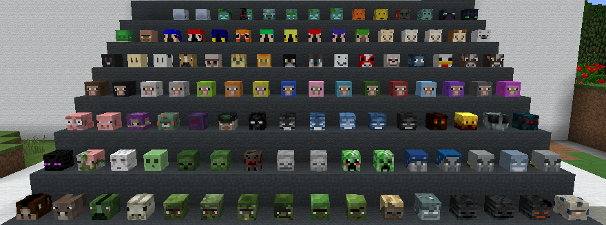
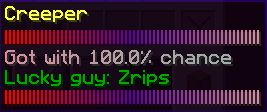
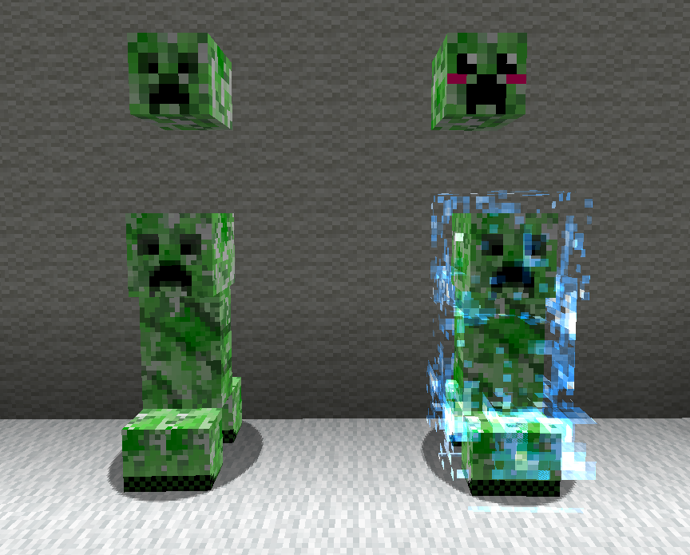

# 自定义生物头颅



CMI 可以在击杀实体时掉落自定义生物头颅。要自定义掉落的头颅，请编辑 `~/plugins/CMI/Settings/CustomHeads.yml`。

掉落概率通常以百分比设置。例如，击杀绵羊时有 **5%** 的概率掉落绵羊头颅，击杀苦力怕时则只有 **1%** 的概率掉落苦力怕头颅。

```text
  creeper:
    DropChance: 1.0
  sheep:
    DropChance: 5.0
```

还可以设置：每名玩家获得某种生物的头颅后，下一次获得该种头颅的概率降低多少。这有助于防止通过大量击杀生物来刷取头颅。此限制会在每次服务器重启后恢复到初始状态。

在下面的示例中，玩家最初有 5% 的概率获得绵羊头颅。每获得一个头颅，下一次的掉落概率就会在上一次的基础上降低 50%。因此，初始概率为 5%，第二次为 2.5%，之后为 1.25%、0.625%，依此类推。

```text
  sheep:
    DropChance: 5.0
    LowerWithEachDrop: 50.0
```

自定义头颅的数量没有硬性上限，但建议保持在合理范围内。添加新头颅时，只需新增一行包含材质字符串的文本。可以在提供自定义头颅数据库的网站上找到这些字符串，例如 https://minecraft-heads.com/。

自定义头颅的材质行需要以数字开头，用于指定这一头颅的掉落概率。这样，即使是同一种实体，也可以让某些头颅比其他头颅更稀有。例如：

```text
    - 100:eyJ0ZXh0dXJlcyI6eyJTS0lOIjp7InVybCI6Imh0dHA6Ly90ZXh0dXJlcy5taW5lY3JhZnQubmV0L3RleHR1cmUvMzI2NTIwODNmMjhlZDFiNjFmOWI5NjVkZjFhYmYwMTBmMjM0NjgxYzIxNDM1OTUxYzY3ZDg4MzY0NzQ5ODIyIn19fQ==
```

在这个示例中，如果随机算法先于其他头颅检查到这一项，就有 100% 的概率选中它。如果概率低于 100%，例如只有 10%，算法就会进行一次随机判定，检查是否选中这个头颅。如果没有选中，就会从列表中随机选取另一个头颅，再次尝试。因此，要避免玩家本应获得头颅却没有任何头颅掉落，应在每种生物的头颅列表中至少保留一个概率为 100% 的头颅。

也可以将自定义名称插入材质字符串，为头颅设置物品名称。例如：

```text
    - 100:&2Custom Head Name:eyJ0ZXh0dXJlcyI6eyJTS0lOIjp7InVybCI6Imh0dHA6Ly90ZXh0dXJlcy5taW5lY3JhZnQubmV0L3RleHR1cmUvMjZhNDExMmRmMWU0YmNlMmE1ZTI4NDE3ZjNhYWZmNzljZDY2ZTg4NWMzNzI0NTU0MTAyY2VmOGViOCJ9fX0=
```

这样得到的头颅会以 **Custom Head Name** 作为物品名称。名称完全可选；不设置时会使用默认名称。

最后，还可以为某个头颅设置条件，格式为 `c-[criteria1],[criteria2],[criteria3]`。条件可以是生物是否被驯服、是否为某种颜色，或者是否为某种村民类型等。例如：

```text
  creeper:
    DropChance: 2.0
    LowerWithEachDrop: 50.0
    Heads:
    - 100:c-unpowered:eyJ0ZXh0dXJlcyI6eyJTS0lOIjp7InVybCI6Imh0dHA6Ly90ZXh0dXJlcy5taW5lY3JhZnQubmV0L3RleHR1cmUvZjQyNTQ4MzhjMzNlYTIyN2ZmY2EyMjNkZGRhYWJmZTBiMDIxNWY3MGRhNjQ5ZTk0NDQ3N2Y0NDM3MGNhNjk1MiJ9fX0=
    - 100:c-powered:eyJ0ZXh0dXJlcyI6eyJTS0lOIjp7InVybCI6Imh0dHA6Ly90ZXh0dXJlcy5taW5lY3JhZnQubmV0L3RleHR1cmUvYTNmMTcyZDI5Y2Y5NGJjODk1NjA4YjdhNWRjMmFmMGRlNDljNzg4ZDViZWNiMTYwNWYxZjUzNDg4YTAxNzBiOCJ9fX0=
```

## 头颅描述

要为掉落的头颅添加自定义描述，可以使用 `lore:{“Some text in here”}`。多行之间用逗号 `,` 分隔。一个完整的基础示例如下：

```text
     - '100:{#edward>}DjCreeper{#cancan<}:lore{"{#red>}||||||||||||||||||||||||||||||||{#purple<>}||||||||||||||||||||||||||||||||{#cancan<}","{#cancan>}Got
      with [chance]% chance{#edward<}","&2Lucky guy: %cmi_user_name%","{#red>}||||||||||||||||||||||||||||||||{#purple<>}||||||||||||||||||||||||||||||||{#cancan<}"}:YTNmMTcyZDI5Y2Y5NGJjODk1NjA4YjdhNWRjMmFmMGRlNDljNzg4ZDViZWNiMTYwNWYxZjUzNDg4YTAxNzBiOCJ9fX0='
```

生成的头颅描述如下：



## 示例



这里有 2% 的概率掉落苦力怕头颅，具体掉落哪一个头颅取决于苦力怕是否已充能。

可以同时使用多个条件。例如：

```text
    - 100:c-baby,tamed,angry:eyJ0ZXh0dXJlcyI6eyJTS0lOIjp7InVybCI6Imh0dHA6Ly90ZXh0dXJlcy5taW5lY3JhZnQubmV0L3RleHR1cmUvZTk1Y2JiNGY3NWVhODc2MTdmMmY3MTNjNmQ0OWRhYzMyMDliYTFiZDRiOTM2OTY1NGIxNDU5ZWExNTMxNyJ9fX0=
```

这个示例只会在实体是处于愤怒状态的幼年狼时掉落头颅。！？谁会杀掉一只凶狠的幼年狼啊！？

所有可用的条件如下：

`Tamed`

仅在被击杀的实体已被驯服时掉落头颅。

`Untamed`

仅在生物可以被驯服，但死亡时尚未被驯服的情况下掉落头颅。

`Baby`

仅在生物处于幼年状态时掉落头颅。不适用于史莱姆和岩浆怪，它们使用其他条件。

`Adult`

仅在实体具有年龄状态且处于成年状态时掉落头颅。不适用于苦力怕等没有年龄状态的生物。

`Angry`

仅在狼被击杀时处于愤怒状态的情况下掉落头颅。

`Pasive`

狼处于平静状态时掉落头颅。

`Red_cat`

仅在实体是 Red_cat 类型的猫时掉落头颅。仅用于豹猫。

`Siamese_cat`

仅在实体是暹罗猫时掉落头颅。仅用于豹猫。

`Wild_ocelot`

仅在实体是野生猫时掉落头颅。仅用于豹猫。

`Black_cat`

仅在实体是黑猫时掉落头颅。仅用于豹猫。

`White`

用于标识绵羊、潜影盒或其他具有这种颜色标记的类似实体的颜色。

`Orange`

用于标识绵羊、潜影盒或其他具有这种颜色标记的类似实体的颜色。

`Magenta`

用于标识绵羊、潜影盒或其他具有这种颜色标记的类似实体的颜色。

`Light_Blue`

用于标识绵羊、潜影盒或其他具有这种颜色标记的类似实体的颜色。

`Yellow`

用于标识绵羊、潜影盒或其他具有这种颜色标记的类似实体的颜色。

`Lime`

用于标识绵羊、潜影盒或其他具有这种颜色标记的类似实体的颜色。

`Pink`

用于标识绵羊、潜影盒或其他具有这种颜色标记的类似实体的颜色。

`Gray`

用于标识绵羊、潜影盒或其他具有这种颜色标记的类似实体的颜色。

`Light_Gray`

用于标识绵羊、潜影盒或其他具有这种颜色标记的类似实体的颜色。

`Cyan`

用于标识绵羊、潜影盒或其他具有这种颜色标记的类似实体的颜色。

`Cyan`

用于标识绵羊、潜影盒或其他具有这种颜色标记的类似实体的颜色。

`Blue`

用于标识绵羊、潜影盒或其他具有这种颜色标记的类似实体的颜色。

`Brown`

用于标识绵羊、潜影盒或其他具有这种颜色标记的类似实体的颜色。

`Green`

用于标识绵羊、潜影盒或其他具有这种颜色标记的类似实体的颜色。

`Red`

用于标识绵羊、潜影盒或其他具有这种颜色标记的类似实体的颜色。

`Black`

用于标识绵羊、潜影盒或其他具有这种颜色标记的类似实体的颜色。

`Rainbow`

仅适用于名为 `jeb_` 的彩虹羊。

`Chestnut`

马的类型标记。

`Creamy`

马的类型标记。

`Dark_brown`

马的类型标记。

`Size1 - Size10`

`Size1 Size2 Size3 Size4 …. Size10`

用于识别史莱姆和岩浆怪的大小。

`Powered`

仅在苦力怕已充能时掉落头颅。

`Unpowered`

仅普通苦力怕掉落头颅。

`Normal`

村民类型。

`Farmer`

村民类型。

`Librarian`

村民类型。

`Priest`

村民类型。

`Blacksmith`

村民类型。

`Butcher`

村民类型。

`Nitwit`

村民类型。

## 抢夺加成

还可以为带有抢夺附魔的武器增加额外掉落概率，让掉落更有变化，也提高这类武器的价值。  
默认只检查 3 个等级，因为原版抢夺附魔最多为 3 级。如果需要支持更多等级，可以在 `customHeads.yml` 中添加配置行，例如：

```text
LootMobBonus:
  Enabled: true
  Lvl1: 5.0
  Lvl2: 15.0
  Lvl3: 30.0
  Lvl4: 35.0
  Lvl5: 40.0  
  Lvl6: 45.0
```

这些值并不是直接加到掉落概率上，而是按指定幅度提高当前概率。例如，头颅的掉落概率为 1%，使用抢夺 3 附魔时，最终概率为 1.3%。

---

[查看原文](https://www.zrips.net/cmi/extra/custom-mob-heads/)
