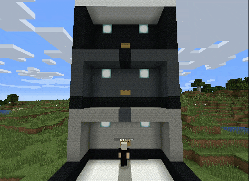
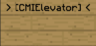

# 电梯

CMI 电梯通过告示牌实现上下传送。放置告示牌，并把第一行设为指定文字即可。默认第一行如下图所示：

在它的正上方或正下方再放一块第一行相同的告示牌，电梯就建好了。右键点击向上传送，Shift + 右键点击向下传送，前提是对应方向有可用的电梯告示牌。

创建电梯告示牌需要 `cmi.elevator.create`，使用电梯需要 `cmi.elevator.use`。

还可以把告示牌第二行设为 `[*]`，将其设为固定位置类型。`[*]` 是默认值，可以在配置文件中修改。这种告示牌会把玩家传送到告示牌前方，而不是保留玩家原来的 `x` 和 `z` 坐标。

---

[查看原文](https://www.zrips.net/cmi/extra/elevator/)
