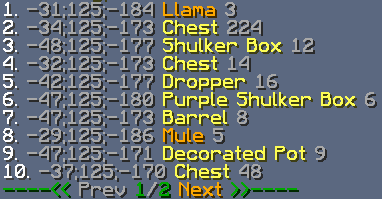

# 扫描容器物品

适用于 CMI **9.7.13.0** 及以上版本。

该指令用于在周围指定范围或整个世界的方块、实体容器中查找物品。它不检查玩家背包；查找玩家物品请用 [查找玩家物品](search.md)。


结果分为方块位置和实体两组。动作栏会持续显示已找到的位置、已扫描区块数、待检查总数、跳过区块数和扫描速度。

总区块数根据指定范围内已生成区块的快速检查结果计算，可能略有偏差。服务器可能保留了某些区块的记录，但它们尚未完整生成，没有物品可查，这类区块会被跳过并单独计数。

扫描速度会根据服务器当前负载自动调整。显示的速度只是每 tick 扫描区块数的参考值，实际速度可能波动。



结果只提供物品的大致位置，具体物品仍需自行查找。点击结果行可传送到对应位置。

## 用法示例

```text
/cmi scan diamondsword
```

按材质查找容器中的钻石剑，自定义名称、描述和附魔不影响匹配。

```text
/cmi scan diamondsword r:g
```

默认扫描玩家周围的 9 个区块，即 3×3。`r:[range/g]` 可以改变范围；`r:g` 表示扫描整个世界。

区块数量按 `((range * 2) – 1) ^ 2` 计算。范围为 2 时，检查 3×3，也就是 9 个区块；范围为 1 时，只检查玩家所在区块。较大范围的实际扫描区块数可能少于计算值，因为未生成区块会在开始时排除。

```text
/cmi scan diamondsword c:-2;1
```

指定扫描中心。这里使用**区块坐标**，不是位置坐标。执行 `/cmi pos`，再将鼠标悬停在输出消息上，可查看当前区块坐标。

```text
/cmi scan diamondsword w:LT_Craft
```

指定要扫描的世界，可以与玩家当前世界不同。

```text
/cmi scan diamondsword;n{Some_Custom_Name}
```

按名称查找，格式见[一行创建物品](../commands/icwol.md)。名称只需包含指定文字，无需完整匹配；颜色会被忽略，只比较文字。

```text
/cmi scan diamondsword;l{Some_Custom_Lore}
```

按物品描述查找，只需包含指定文字，无需完整匹配。

```text
/cmi scan diamondsword;e{sharpness:5}
```

除了检查材质，还要求物品具有锋利 5 或更高等级。可同时指定多个附魔，例如 `diamondsword;e{sharpness:3,luck:2}`。

```text
/cmi scan diamondsword;cm{123456}
```

按指定的自定义模型数据查找。

```text
cmi scan diamondsword:3
```

按数量查找，统计整个容器内的数量，匹配超过指定数量的结果。结果提供该位置的物品总数，可能包含潜影盒或收纳袋里的物品。

```text
/cmi scan hand
```

以主手物品为样本查找。有自定义名称就比较名称，有附魔就比较附魔；若是普通物品，则只比较材质。

```text
/cmi scan oversize
```

查找堆叠数量超过默认上限的物品堆。

```text
/cmi scan lead;e{thorns:1} diamondsword;e{sweeping:1}
```

用空格分开各个物品条件，可以同时查找多种物品。示例查找带指定附魔的拴绳和钻石剑。

同时查找多种物品时，结果只显示数量，不区分具体匹配了哪种物品。同一个物品可能符合多个条件，例如同时查找“指定附魔的钻石剑”和“所有钻石剑”，此时可能重复计数，结果高于实际数量。

```text
/cmi scan results
```

显示当前或上一次扫描结果。

```text
/cmi scan cancel
```

取消当前扫描。

```text
/cmi scan pause
```

暂停当前扫描，稍后再继续。

```text
/cmi scan resume
```

继续当前扫描。

### 自定义物品匹配条件

以手持物品查找时，可以只比较部分属性。例如，`/cmi scan hand material name` 只比较材质和名称，忽略其他属性。

`/cmi scan hand enchant` 只比较附魔，附魔书也会被视为有效结果。

可用条件：`material, name, lore, enchant, modeldata`。

---

[查看原文](https://www.zrips.net/cmi/extra/scan/)
