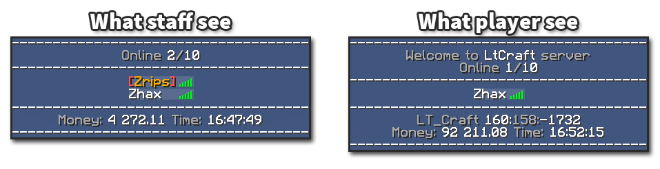

# Tab 列表


支持多行文本。  
经过优化，可在异步模式下运行，避免影响服务器主线程的操作。  
完整支持 PlaceholderAPI，可在 Tab 列表中使用所需的变量。  
同时支持 CMI 占位符。  
页脚和页眉可以分别自定义。  
支持按指定间隔自动更新，例如显示时钟时可以每分钟左右更新一次；也支持在指定事件发生时更新，例如玩家登录后更新玩家数量。  
可以自定义列表中玩家名称的格式。  
统计在线玩家数量时会排除隐身玩家，图片中有相应示例。  
支持为不同玩家设置不同格式。例如，工作人员看到的布局可以与普通玩家不同，工作人员的名称格式也可以与普通玩家不同。  
分组格式的数量没有限制，默认提供 2 组。  
如需提高性能，可以禁用分组格式的权限检查。  
分组格式通过 `cmi.tablist.[groupId]` 权限指定，例如 `cmi.tablist.1`。与其他带数字的权限节点一样，如果玩家拥有多个分组权限，数值较大的优先。



设置 Tab 列表的更新间隔时，应在满足所用占位符更新需求的前提下尽量设大。避免使用小于 5 秒的更新间隔；也可以设为 -1，仅在指定事件发生时更新。

要创建**动态** Tab 列表，需要复制相应的配置部分。例如：

```text
    Header:
      '1':
      – '&f————————————'
      – '&7Online &f%server_online%&7/&f%server_max_players%'
      – '&f————————————'
      '2':
      – '&7————————————'
      – '&7Online &f%server_online%&7/&f%server_max_players%'
      – '&7————————————'
      '3':
      – '&8————————————'
      – '&7Online &f%server_online%&7/&f%server_max_players%'
      – '&8————————————'
```

每次更新 Tab 列表时，会按顺序切换这些配置。  
同一个 Tab 列表可以设置不同数量的页眉和页脚。

## 默认配置

```text
# To disable tablist handling visit Modules.yml file
TabList:
  # Defines if we want to run tablist updater in async mode
  # While enabled it can increase overall performance but some plugins can have same issues handling async placeholder requests
  Async: true
  UpdateTabListNames: true
  # Enable or disable grouped format tablist's
  # You can save some resources by disabling this if you are not interested in grouped format tablist feature
  # If disabled then this will use only default format and will skip checking for custom one to save some resources if needed
  GroupedEnabled: true
  Updates:
    # automatically updates tab list every x seconds for ALL online players
    # If you are using static Footer and Header you can disable this by setting to -1
    # Consider setting this to -1 if its completely enough to update on player events
    AutoInterval: 60
    OnJoin: true
    OnLeave: true
    afkStateChange: true
    OnWorldChange: true
    OnDeath: false
    OnTeleport: false
    OnNickChange: true
  # When set to false we will not add header text to tablist
  addTabListHeader: true
  # When set to false we will not add footer text to tablist
  addTabListFooter: true
  # PlaceholderAPI supported for any custom variable you want to insert into this
  # In addition CMI will handle some placeholders without PlaceHolderAPI
  # Full list can be checked ingame with /cmi placeholders
  GeneralFormat:
    PlayerName: '[playerDisplayName]'
    Header:
      '1':
      - '&f------------------------------------'
      - '&7Welcome'
      - '&7Online &f%server_online%&7/&f%server_max_players%'
      - '&f------------------------------------'
    Footer:
      '1':
      - '&f------------------------------------'
      - '&7%player_world% &f%player_x%:&7%player_y%:&f%player_z%'
      - '&7Money: &f%vault_eco_balance_formatted% &7Time: &f%server_time_HH:mm:ss%'
      - '&f------------------------------------'
  useGeneralName: false
  # When this set to true, in case you dint defined PlayerName, Header or Footer in GroupFormat, then default one from GeneralFormat will be used
  useGeneralHeader: false
  useGeneralFooter: false
  # Defines custom formats to be used for players.
  # Any player which have cmi.tablist.[number] permission node will use defined grouped format in tablist
  # Id should be a number and in case player has more than one, bigger number id will be used
  # You can have as many groups as you want by increasing increment
  GroupFormat:
    '1':
      PlayerName: '&2{&r[playerDisplayName]&2}'
      Header:
        '1':
        - '&f------------------------------------'
        - '&7Online &f%server_online%&7/&f%server_max_players%'
        - '&f------------------------------------'
      Footer:
        '1':
        - '&f------------------------------------'
        - '&7%player_world% &f%player_x%:&7%player_y%:&f%player_z%'
        - '&7Time: &f%server_time_HH:mm:ss%'
        - '&f------------------------------------'
    '2':
      PlayerName: '&c[&r[playerDisplayName]&c]'
      Header:
        '1':
        - '&f------------------------------------'
        - '&7Online &f%server_online%&7/&f%server_max_players%'
        - '&f------------------------------------'
      Footer:
        '1':
        - '&f------------------------------------'
        - '&7Money: &f%vault_eco_balance_formatted% &7Time: &f%server_time_HH:mm:ss%'
        - '&f------------------------------------'
```

---

[查看原文](https://www.zrips.net/cmi/extra/tablist/)
