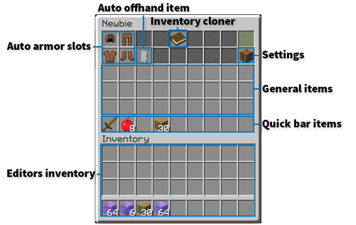
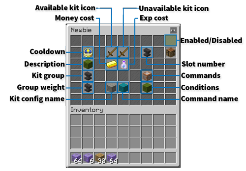

# 礼包



## 礼包可以设置什么？

- 启用或关闭礼包。
- 添加礼包物品，最下面一行是快捷栏。
- 添加盔甲栏物品。
- 添加副手物品。
- 将自己的背包直接复制到礼包中。

物品显示名或描述中的 `{USERNAME}`、`{DISPLAYNAME}`、`{KITNAME}`、`{WORLDNAME}`、`{RANDOMPLAYER}`、`{DATE}` 会在玩家领取礼包时自动替换为对应值。

## 创建礼包

1. 执行 `/cmi kiteditor new [kitname]`，然后直接跳到第 5 步。
2. 若要通过聊天界面创建，执行 `/cmi kiteditor`。
3. 点击绿色 `+` 图标，创建新礼包。
4. 按提示输入礼包名称，之后仍可修改。
5. 输入名称后，就可以编辑礼包物品。

## 高级设置

点击标为“settings”的工作台图标，打开设置界面。可以调整：

- **冷却时间**：通过“Delay”设置。
- **名称与描述**：包括显示名称和配置中的名称。
- **分组与权重**：玩家会获得同一组中自己有权使用的、权重最高的礼包。CMI 会根据玩家的权限自动判断；你只需分配允许使用的礼包权限，它会比较权限与权重，确定可用礼包。
- 礼包可用和不可用时在界面中显示的物品。
- 领取需要的经验和金钱。
- 礼包在 `/kit` 界面中的槽位。
- 领取礼包时执行的指令。
- 领取条件，即玩家领取这个礼包时必须拥有的权限节点列表。

## 常见问题

**玩家看不到礼包？**

检查是否分配了正确的礼包权限，并确认礼包已经启用。编辑界面右上角应显示绿色染色玻璃板。

**如何打开礼包编辑器？**

执行 `/cmi kiteditor`，点击要编辑的礼包。

**如何设置礼包分组和权重？**

打开设置，点击“Kit group:”，然后在聊天中输入分组名称。礼包会加入该组。给其他礼包重复操作，就能把它们放入同一组。

在设置界面找到 weight，调整礼包权重。权重的作用见上面的高级设置说明。

**如何给礼包排序？**

可以指定槽位，让礼包尽可能出现在固定位置，但礼包数量经常变化时不太方便。

也可以使用权重，从低到高排序，避免中间留下空槽位。

## 指令、权限与占位符

**指令：**

```text
> cmi checkcommand kit

 /cmi kitusagereset (kitName) (playerName)
 /cmi kitcdreset (kitName) (playerName/all)
 /cmi kiteditor
 /cmi kit [kitName] (playerName) (-s)
>
```

**权限：**

```text
> cmi checkperm kit

 cmi.command.kitusagereset.others - Reset kit usage counter
 cmi.kit.bypass.time - Allows to bypass kit time limitations
 cmi.command.kit.others - Gives predefined kit.
 cmi.kit.bypass.onetimeuse - Allows to bypass kit onetimeuse limitations
 cmi.kit.[kitname].preview - Allows to preview kit without having access to kit
 cmi.command.kit - Gives predefined kit.
 cmi.command.kitcdreset.others - Reset kit timer
 cmi.kit.bypass.money - Allows to bypass kit money requirement
 cmi.command.kiteditor.admin - Allows to define more dangerous aspects of kits, like commands
 cmi.command.kitusagereset - Reset kit usage counter
 cmi.command.kitcdreset - Reset kit timer
 cmi.kit.bypass.exp - Allows to bypass kit exp requirement
 cmi.command.kiteditor - Kit editor.
 cmi.kit.[kitname] - Allows to use kit
>
```

**占位符：**

```text
> cmi placeholders

 %cmi_user_kitcd_[kitName]%
 %cmi_user_kit_available%
 %cmi_user_kit_available_[kitName]%
 %cmi_user_kit_hasaccess_[kitName]%
>
```

---

[查看原文](https://www.zrips.net/cmi/kits/)
