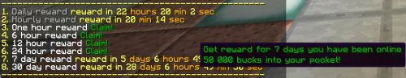

# 在线时长奖励

**在线时长奖励**系统可以在玩家在服务器上的累计在线时长达到指定数值时执行命令。

可以每在线 X 秒执行一次命令，也可以在累计在线 X 秒时执行。因此，可以每在线 1 小时定期发放金钱，并在累计在线 6 小时甚至 24 小时时发放更高的奖励。

默认命令 `/cmi prewards` 的别名 **/prewards** 默认已启用。执行后会显示在线时长奖励列表，可以查看即将获得的奖励，并领取部分奖励。



默认示例：

```text
hourly1:
  DisplayName: "&7Hourly reward"
  AutoClaim: true
  Description:
  - "&2Get reward for every hour you are online"
  - "&2Free heal and 20 bucks into your pocket"
  PayEvery: 3600
  Commands:
  - asConsole! cmi heal [playerName] -s
  - asConsole! cmi money give [playerName] 20
daily1:
  DisplayName: "&7Daily reward"
  AutoClaim: true
  Description:
  - "&2Get reward for every 24 hours of playtime"
  - "&22000 bucks into your pocket!"
  PayEvery: 86400
  Commands:
  - asConsole! cmi money give [playerName] 2000
1hour:
  DisplayName: "&fOne hour reward"
  AutoClaim: false
  Description:
  - "&2Get reward for 1 hour you have been online"
  - "&2500 bucks into your pocket!"
  PayFor: 3600
  Commands:
  - asConsole! cmi money give [playerName] 500
6hour:
  DisplayName: "&f6 hour reward"
  AutoClaim: false
  Description:
  - "&2Get reward for 6 hour's you have been online"
  - "&22 000 bucks into your pocket!"
  PayFor: 21600
  Commands:
  - asConsole! cmi money give [playerName] 2000
12hour:
  DisplayName: "&f12 hour reward"
  AutoClaim: false
  Description:
  - "&2Get reward for 12 hour's you have been online"
  - "&25 000 bucks into your pocket!"
  PayFor: 43200
  Commands:
  - asConsole! cmi money give [playerName] 5000
24hour:
  DisplayName: "&f24 hour reward"
  AutoClaim: false
  Description:
  - "&2Get reward for 24 hour's you have been online"
  - "&215 000 bucks into your pocket!"
  PayFor: 86400
  Commands:
  - asConsole! cmi money give [playerName] 15000
7days:
  DisplayName: "&f7 day reward"
  AutoClaim: false
  Description:
  - "&2Get reward for 7 days you have been online"
  - "&250 000 bucks into your pocket!"
  PayFor: 604800
  Commands:
  - asConsole! cmi money give [playerName] 50000
30days:
  DisplayName: "&f30 day reward"
  AutoClaim: false
  Description:
  - "&2Get reward for 30 days you have been online"
  - "&2500 000 bucks into your pocket!"
  PayFor: 2592000
  Commands:
  - asConsole! cmi money give [playerName] 500000
```

在上述示例中，“**hourly1**”是该在线时长奖励的唯一标识，后文将在线时长奖励简称为 PTR。标识可以自行命名，但每个 PTR 都必须使用不同的标识。避免使用扩展字符、空格或下划线，唯一标识应简短易懂。

**DisplayName** — 定义奖励列表中显示的名称。可以使用颜色代码，将它与其他奖励区分开来。名称可以自行填写。

**AutoClaim** — 定义玩家达到目标时，是自动获得奖励，还是需要手动领取。如果需要手动领取，玩家每隔 X 分钟就会收到一次待领取奖励提醒，间隔可在配置文件中设置。玩家需要 **cmi.prewards.notification** 权限才能看到提醒消息。

**Description** — 定义奖励描述，在鼠标悬停于奖励列表时显示。可以添加任意行数，也可以按需要使用颜色代码。

**PayFor** — 定义发放奖励所需的时间，单位为秒。这类奖励只会在玩家累计在线时长达到指定数值时发放一次。

**PayEvery** — 每在服务器上在线 x 秒，就重复发放一次奖励。

**StackRewards** — True 或 False。未设置时默认为 True。定义奖励是否可以累积，以及玩家累积奖励后，是否可以一次领取多份。

**Commands** — 领取奖励时执行的命令列表，支持[**专用命令**](commands/specialized.md)。

## 命令、权限与占位符

**命令**：

```text
> cmi checkcommand reward
 --------------------------------------------------
 /cmi prewards (playerName)
>
```

**权限**：

```text
> cmi checkperm reward
 --------------------------------------------------
 cmi.command.prewards.others.claim - Allows to claim rewards for others
 cmi.command.prewards - Check playtime rewards
 cmi.command.prewards.others - Check playtime rewards
 cmi.prewards.[preward] - Allows to get particular playtime reward
 cmi.prewards.notification - Allows to see playtime rewards notifications
>
```

**占位符**：

```text
%cmi_user_prewards_count%
```

---

[查看原文](https://www.zrips.net/cmi/playtime-rewards/)
