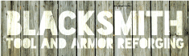

# Blacksmith

 

<strong>Blacksmith</strong>

<table>
<thead>
<tr>
<th></th>
<th></th>
</tr>
</thead>
<tbody>
<tr>
<td><strong>作者</strong></td>
<td>一拳</td>
</tr>
<tr>
<td><strong>版本</strong></td>
<td>???</td>
</tr>
<tr>
<td><strong>Citizens 构建</strong></td>
<td>2.0.x</td>
</tr>
<tr>
<td><strong>其他依赖项</strong></td>
<td>Vault，以及经济系统</td>
</tr>
<tr>
<td><strong>下载</strong></td>
<td><a href="http://ci.citizensnpcs.co/view/Add-ons/job/Blacksmith/">链接</a></td>
</tr>
<tr>
<td><strong>Description:</strong> 高度可定制的工具和装甲重铸</td>
<td></td>
</tr>
</tbody>
</table>

Blacksmith is a Citizens 2.0 character trait that gives Citizens NPCs the ability to:

<ul>
<li>付费修理武器、工具和盔甲。</li>
</ul>

此处提供最新的源代码：<a href="https://github.com/mcmonkey4eva/Blacksmith">https://github.com/mcmonkey4eva/Blacksmith</a>

<h2 id="updates">更新</h2>

v1.13 2018年10月12日

<ul>
<li>HurricanKai 缺失，因此 mcmonkey 已执行极简更新，现在可在此处 <a href="https://github.com/mcmonkey4eva/Blacksmith">https://github.com/mcmonkey4eva/Blacksmith</a></li>
</ul>

??? ?/?/2017

<ul>
<li>现在由 HurricanKai 维护，截至此消息与 Minecraft 1.12 兼容。请参阅 github 以获取提交日志。 <a href="https://github.com/HurricanKai/Blacksmith">https://github.com/HurricanKai/Blacksmith</a></li>
</ul>

??? 2/17/2015

<ul>
<li>update to latest everything.</li>
</ul>

v1.3 8/5/2013

<ul>
<li>Fix blacksmith not returning items.</li>
</ul>

v1.2 2012年8月15日

<ul>
<li>Added price-per-durability-point option on a per-item basis.</li>
<li>dded session timeout if player asks for price and does not reforge item.</li>
<li>Fixed Random-enchant algorithm.</li>
</ul>

v1.1 8/8/2012

<ul>
<li>与 C2 1.3.1 版本兼容</li>
</ul>
<h2 id="how-to-use">如何使用</h2>
<h2 id="installation">安装</h2>
<ul>
<li>安装 Citizens 2</li>
<li>将 Blacksmith.jar 文件放在 /plugins 目录中。</li>
<li>启动服务器</li>
<li>创建 NPC 并赋予 Blacksmith 特征。</li>
</ul>

<pre>/npc create Smithy --trait blacksmith 
</pre>

或

<pre>/npc create Smithy
/trait blacksmith 
</pre>

<h3 id="general-information">一般信息</h3>

Blacksmiths have a variety of settings that can be per-NPC or global.配置文件中“defaults”下的设置是铁匠创建时的默认设置。您可以使用下面命令部分中的命令覆盖这些设置。您甚至可以使用命令配置铁匠能够在游戏中重铸哪些物品。默认情况下，铁匠能够重铸所有物品。

<h3 id="interaction">互动</h3>

Interacting with a blacksmith is simple:

<ul>
<li>用手中的工具或盔甲右键点击 NPC。它会告诉您重铸它所需的价格。</li>
<li>10秒内再次右键点击，铁匠将开始重铸该物品。</li>
<li>根据配置的不同，重铸有机会附魔或损坏物品。</li>
</ul>
<h2 id="prices">价格</h2>

价格由物品的损坏、附魔的数量和类型以及配置文件中定义的价格决定。基本上，确定重铸价格的公式是 <em>basePrice + durabilityRemaining + enchantments</em>。

<h3 id="base-price">基本价格</h3>

重铸的默认基本价格是配置文件中的 <em>base-prices.default</em> 值。要为每个单独的商品添加新的基本价格，请将商品添加到 <em>基本价格</em> 下的配置文件中

<h3 id="durability">耐用性</h3>

耐用性是指物品受到的损坏程度。一般来说，物品损坏越严重，重铸的成本就越便宜。尝试在没有损坏的情况下重铸一件物品将会更加昂贵。配置中每个耐久点的价格为<em>price-per-durability-point.default</em>。可以通过添加到此部分来设置每个项目的值。

这些是与自定义基本价格和按耐久点价格一起使用的项目名称。

<strong>有效物品</strong>

木镐

木铲

锄头

木剑

木斧

石镐

石铲

石锄

石剑

石斧

金镐

金锹

金锄头

金剑

金斧头

铁镐

铁铲

铁锄头

铁剑

铁斧

金刚石镐

钻石铲

金刚石锄头

金刚石斧头

弓

打火石

钓鱼竿

剪刀

皮革头盔

皮革胸甲

皮革打底裤

皮靴

链甲头盔

链甲胸甲

链甲护腿

链甲靴子

金头盔

金胸甲

金色打底裤

金靴子

铁盔

铁胸甲

铁护腿

铁靴

钻石头盔

钻石胸甲

钻石护腿

钻石靴子

Example:

<pre>base-prices:
  default: 10
  diamond-sword: 45
price-per-durability-point:
  default: 1
  diamond-sword: 3
</pre>

<h3 id="enchantments">结界</h3>

重铸带有附魔的物品的价格比没有附魔的物品要贵。对于每个结界，总价格中会根据 "enchantment-modifier" 和结界等级添加一定金额。可以通过在 <em>结界修饰符</em> 部分中添加附魔名称和值来在配置文件中配置附魔修改器。如果未找到结界名称，则使用默认修饰符 <em>enchantment-modifiers.default</em>。以下是附魔修饰符的有效且区分大小写的名称：

<ul>
<li><em>arrow-damage</em> - 从弓射箭时提供额外伤害</li>
<li><em>arrow-fire</em> - 当被弓射出的箭击中时使实体着火</li>
<li><em>arrow-infinite</em> - 射弓时提供无限箭</li>
<li><em>arrow-knockback</em> - 当实体被弓箭击中时提供击退</li>
<li><em>damage-all</em> - 增加对所有目标的伤害</li>
<li><em>damage-arthropods</em> - 增加对节肢动物目标的伤害</li>
<li><em>damage-undead</em> - 增加对不死目标的伤害</li>
<li><em>dig-speed</em> - 提高采矿/挖掘的速度</li>
<li><em>durability</em> - 降低工具失去耐用性的速度</li>
<li><em>fire-aspect</em> - 攻击目标时，有几率使其着火</li>
<li><em>knockback</em> - 对其他目标的所有伤害都会在击中时将其击退</li>
<li><em>loot-bonus-blocks</em> - 摧毁方块时有机会获得额外战利品</li>
<li><em>loot-bonus-mobs</em> - 杀死怪物时有机会获得额外战利品</li>
<li><em>oxygen</em> - 降低水下空气损失率</li>
<li><em>protection-environmental</em> - 提供针对环境损害的保护</li>
<li><em>protection-explosions</em> - 提供针对爆炸损坏的保护</li>
<li><em>protection-fall</em> - 提供跌落损坏保护</li>
<li><em>protection-fire</em> - 提供火灾损害保护</li>
<li><em>protection-projectile</em> - 提供针对弹丸损坏的保护</li>
<li><em>silk-touch</em> - 允许块自行掉落而不是碎片（例如，石头而不是鹅卵石）</li>
<li><em>water-worker</em> - 提高玩家水下采矿的速度</li>
</ul>
<h2 id="permissions">权限</h2>

如果您希望玩家能够使用铁匠，请给他们

<ul>
<li><em>blacksmith.reforge</em>权限节点。</li>
</ul>
<h2 id="configuration">配置</h2>

铁匠的配置文件位于 <em>/plugins/Blacksmith/config.yml</em> 中，如果不存在，则会自动生成。

<h3 id="default-configuration">默认配置</h3>

铁匠 config.yml 包含 <strong>新的</strong> 铁匠的默认设置。所有这些选项都可以在 Citizens/saves.yml 中的现有铁匠上进行更改。
将鼠标悬停在每个部分上可查看其说明。 <em>默认值</em> 下的所有设置都可以由 Citizens 2 saves.yml 中的各个铁匠覆盖。

<pre># Blacksmith Configuration
base-prices:
 default: 10
price-per-durability-point:
 default: 1
defaults:
 messages:
   busy-with-player: &lt;c&gt;I'm busy at the moment. Come back later!
   busy-with-reforge: &lt;c&gt;I'm working on it. Be patient!
   cooldown-not-expired: &lt;c&gt;You've already had your chance! Give me a break!
   cost: &lt;e&gt;It will cost &lt;a&gt;&lt;price&gt; &lt;e&gt;to reforge that &lt;a&gt;&lt;item&gt;&lt;e&gt;! Click again to reforge!
   fail-reforge: &lt;c&gt;Whoops! Didn't mean to do that! Maybe next time?
   insufficient-funds: &lt;c&gt;You don't have enough money to reforge that item!
   invalid-item: &lt;c&gt;I'm sorry, but I don't know how to reforge that!
   start-reforge: &lt;e&gt;Ok, let's see what I can do...
   successful-reforge: &lt;a&gt;There you go! All better!
 drop-item: true
 percent-chance-to-fail-reforge: 10
 percent-chance-for-extra-enchantments: 5
 maximum-enchantments: 3
 delays-in-seconds:
   maximum: 30
   minimum: 5
   reforge-cooldown: 60
enchantment-modifiers:
 default: 5
</pre>

<table>
<thead>
<tr>
<th>快速导航</th>
<th></th>
</tr>
</thead>
<tbody>
<tr>
<td><a href="category-usage.md" title="Category:Usage">用途</a></td>
<td><a href="installation.md" title="Installation">安装</a>  · <a href="frequently-asked-questions.md" title="Frequently Asked Questions">常见问题</a>  · <a href="commands.md" title="Commands">命令</a>  · <a href="editors.md" title="Editors">编辑器</a>  · <a href="characters.md" title="Characters">角色类型</a>  · <a href="https://wiki.citizensnpcs.co/API" title="API">API</a>  ·</td>
</tr>
<tr>
<td><a href="category-configuration.md" title="Category:Configuration">配置</a></td>
<td><a href="configuration.md" title="Configuration">配置</a>  · <a href="text-syntax.md" title="Text Syntax">文本语法</a>  · <a href="permissions.md" title="Permissions">权限</a>  · <a href="waypoints.md" title="Waypoints">路径点</a>  · <a href="data-storage.md" title="Data Storage">数据存储</a></td>
</tr>
</tbody>
</table>

