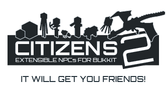

# Citizens Wiki

欢迎来到 Citizens 维基！

<table cellpadding="0" cellspacing="3" style="border: 0; background-color: #ffffff" width="300">
<tbody><tr>
<td style="width: 300; vertical-align: top; border:1px solid #ccc; background-color: #ffffff">

<b> </b>

<table cellpadding="0" cellspacing="3" width="100%">
<tbody><tr>
<td align="left" valign="top" width="100%">
<figure class="mw-default-size mw-halign-center" typeof="mw:File">&lt;figcaption&gt;</figure>

<b>Citizens</b> 是一个利用 <a class="external text" href="http://www.bukkit.org/" rel="nofollow">Bukkit API</a> 的 Minecraft 服务器插件。它添加了各种非玩家角色（NPC）功能。 Citizens 还为插件开发人员提供了易于使用的 <a href="https://wiki.citizensnpcs.co/API" title="API">API</a>。

<b>Downloads:</b> <a href="downloads.md" title="Downloads">下载</a>

<b>Spigot 页码：</b> <a class="external text" href="https://www.spigotmc.org/resources/citizens.13811/" rel="nofollow">Spigot</a>

<b>Developers:</b> fullwall

<b>Source:</b> <a class="external text" href="https://github.com/CitizensDev/Citizens2" rel="nofollow">吉图布</a>

<b>支持tickets:</b> 在“#citizens”频道中询问 <a class="external text" href="https://discord.gg/Q6pZGSR" rel="nofollow">不和谐</a>，或在 <a class="external text" href="https://github.com/CitizensDev/Citizens2/issues" rel="nofollow">吉图布</a> 上发布问题，但请先查看 <a href="troubleshooting.md" title="Troubleshooting">故障排查</a>。

<b>Discord:</b> <a class="external text" href="https://discord.gg/Q6pZGSR" rel="nofollow">不和谐</a>

<b>Donate: <a class="external text" href="https://www.github.com/sponsors/fullwall" rel="nofollow">fullwall</a></b>
 

</td></tr></tbody></table>

</td></tr></tbody></table>

Citizens 是一个流行的 Minecraft 服务器插件，允许您创建非玩家角色 (NPCs) 为您的服务器提供各种游戏玩法和功能，例如基本雕像、店主、守卫、可编写脚本的 NPCs 等等。

<table>
<thead>
<tr>
<th>快速导航</th>
<th></th>
</tr>
</thead>
<tbody>
<tr>
<td>用途</td>
<td><a href="installation.md" title="Installation">安装</a>  · <a href="frequently-asked-questions.md" title="Frequently Asked Questions">常见问题</a>  · <a href="commands.md" title="Commands">命令</a>  · <a href="waypoints.md" title="Waypoints">路径点</a>  · <a href="shops.md" title="Shops">商店</a>  · <a href="templates.md" title="Templates">模板</a>  · <a href="editors.md" title="Editors">编辑器</a>  · <a href="behaviors.md" title="Behaviors">行为</a>  · <a href="https://wiki.citizensnpcs.co/API" title="API">API</a></td>
</tr>
<tr>
<td><a href="configuration.md" title="Configuration">配置</a></td>
<td><a href="data-storage.md" title="Data Storage">数据存储</a>  · <a href="permissions.md" title="Permissions">权限</a>  · <a href="translations.md" title="Translations">多语言翻译</a></td>
</tr>
<tr>
<td><a href="characters.md" title="Characters">角色类型</a></td>
<td><a href="denizen.md" title="Denizen">Denizen</a>  · <a href="sentinel.md" title="Sentinel">Sentinel</a>  · <a href="dtltraders.md" title="DtlTraders">DtlTraders</a>  · <a href="builder.md" title="Builder">Builder</a></td>
</tr>
<tr>
<td>信息</td>
<td><a href="downloads.md" title="Downloads">下载</a>  · <a href="https://discord.gg/Q6pZGSR">不和谐</a></td>
</tr>
<tr>
<td>特别信息</td>
<td><a href="minecraft-1.8.md" title="Minecraft 1.8">Minecraft 1.8</a>  · <a href="cracks.md" title="Cracks">Cracks</a>  · <a href="skins.md" title="Skins">皮肤</a>  · <a href="npc-commands.md" title="NPC Commands">NPC 点击命令</a></td>
</tr>
</tbody>
</table>
<h2 id="features">特点</h2>
<ul>
<li>NPCs 可以自然地行走、站立并与玩家交谈。</li>
<li>易于开发人员使用 <a href="https://wiki.citizensnpcs.co/API" title="API">API</a>，允许为特定功能构建 <a href="traits.md" title="Traits">特征</a>。</li>
<li><a href="types.md" title="Types">支持所有生物类型</a> 包括玩家、猪，甚至非生命体，例如掉落的物品或箭头射弹。</li>
<li><a href="commands.md" title="Commands">命令</a> 用于自定义 NPCs 的丰富命令。</li>
<li><a href="controllable-npcs.md" title="Controllable NPCs">可骑乘 NPCs</a>.</li>
<li>文本编辑。</li>
<li>基本的 GUI 商店。</li>
<li>Pathing.</li>
<li>更多。</li>
</ul>

