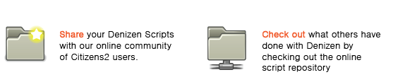
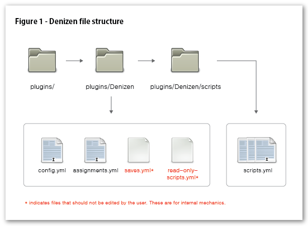

# Denizen / 0.6

有关特定功能（例如单个命令或标签）的更多最新信息和完整详细信息，请查看 <a href="https://meta.denizenscript.com/">元文档</a>。

如果您需要完整的教程来帮助您进行设置，请访问 <a href="https://guide.denizenscript.com/">初学者指南</a> 文本网站。

如果您需要快速帮助，请访问我们的 <a href="https://discord.gg/Q6pZGSR">不和谐组</a>。

此 wiki 已过时，请查看教程视频/指南、元文档或 Discord 小组（均在上面链接）以获取最新信息！

<s>

</s>

<b>版本警告:</b> 该文档适用于 Denizen 0.6，并且已过时。

Denizen 0.6 与最新版本的 C2 或 Bukkit 1.3.1 不兼容。

请参阅此链接获取 Denizen 0.7 的最新下载。
<a class="external text" href="http://ci.citizensnpcs.net/job/Denizen" rel="nofollow">链接</a><b></b>

Denizen 0.7 的初步文档已发布 <a href="denizen-0.7.md" title="Denizen/0.7">这里</a> <b>请注意此页面可能包含错误。</b>

<strong>Denizen</strong>

<table>
<thead>
<tr>
<th></th>
<th></th>
</tr>
</thead>
<tbody>
<tr>
<td><strong>作者</strong></td>
<td>奥夫德姆兰德</td>
</tr>
<tr>
<td><strong>版本</strong></td>
<td>0.6 构建 #124</td>
</tr>
<tr>
<td><strong>Citizens 构建</strong></td>
<td>2.0 测试版</td>
</tr>
<tr>
<td><strong>其他依赖项</strong></td>
<td>Vault</td>
</tr>
<tr>
<td><strong>下载</strong></td>
<td><a href="http://ci.citizensnpcs.net/view/Characters/job/Denizen/124/artifact/target/denizen-0.6.jar">链接</a></td>
</tr>
<tr>
<td><strong>下载示例 scripts:</strong></td>
<td><a href="http://dl.dropbox.com/u/44002922/Start-up%20Kit.zip">链接</a></td>
</tr>
<tr>
<td></td>
<td></td>
</tr>
</tbody>
</table>

<strong>Description:</strong> 可编写脚本的交互式公民！

<s>

</s>

<s>

</s>

Denizens 是将 <a class="external text" href="http://en.wikipedia.org/wiki/MUD" rel="nofollow">MUD风格</a> RPG Citizens（以及一些其他功能）添加到服务器的好方法。 Denizen NPCs 使用带有步骤和事件的迷你脚本与玩家和世界进行交互。想象一下互动的看门人、神奇的巫师、经验培训师、银行家、会说话的城镇居民等等！它们可以以数千种不同的方式使用，从教程、探索到管理……您的想象力几乎是极限！

<s>
<h2 id="Script_Repository">脚本库</h2>
</s>

~~~~

<s>
<h2 id="Change_Log">变更日志</h2>
</s>

<s>

</s>

这是新内容！

<b>预构建 98 测试版用户请注意：</b> 文件结构在过去的几个版本中发生了变化，最多可达 98。<code>Denizens:</code> 节点现在有自己的 YML 文件，称为指派。您将需要创建此文件并从 config.yml 剪切/粘贴节点。还建议您下载新的 <a href="https://wiki.citizensnpcs.co/Denizen_config.yml" title="Denizen config.yml">Denizen config.yml</a>，因为某些节点已更改或扩展。 Denizen 位置和块书签现在也存储在 saves.yml 中。您需要将它们迁移到那里，或者在使用使用书签的脚本之前重新创建它们。有关新文件结构的更多信息，请参阅 <a href="#File_Structure">#文件结构</a>。

<b>0.6 构建 #104</b>

<ul><li>添加了 PLAYERTASK 命令。地点任务！ （这是给你的，Ratkoon）</li></ul>

<b>0.6 构建#98</b>

<ul><li>更新文件结构。 saves.yml 现在包含 denizen 插件写入的所有信息。这包括玩家的进步/完成/等等。信息、居民位置书签等。如果手动编辑，最好先关闭服务器。 players: 节点中的任何现有信息和居民位置书签信息都需要重新创建或迁移到 saves.yml 中。</li>
<li>添加了 HEAL 和 HURT 命令。使用 HEAL [# of health] 或 HURT [# of health]。</li>
<li>添加了 CHANGE 命令来更改块书签处的块类型。使用更改[块书签] [#:#|MATERIAL_TYPE]。</li>
<li>添加了攻击命令。像FOLLOW一样使用。</li>
<li>GIVE 和 TAKE 现在还应该接受 #:# 格式以及 MATERIAL_TYPE。</li>
<li>添加了 ENGAGE 和 DISENGAGE 命令。当 Denizen 处于 ENGAGE 状态时，在 DISENGAGED 之前不会注册与 NPC 的任何其他交互。这对于防止玩家在脚本中间“重复步骤”很有用。在脚本开头使用 ^ENGAGE，在结尾使用 DISENGAGE。</li>
<li>使用项目的要求现在可以使用 #:# 语法来检查项目 typeId 和数据。</li>
<li>要求 WORLD、POTION_EFFECT、NAME、PERMISSION 和 GROUP 可以检查多个名称/节点。</li>
<li>FINISHED 现在可以检查玩家完成的具体次数。使用：FINISHED # [脚本名称]。</li>
<li>脚本组合器现在应该只选取 .yml 文件。</li>
<li>各种其他错误修复。</li></ul>

<b>0.6 构建 #82</b>

<ul><li>需求代码重新格式化已完成，感谢您在观看 Jenkins 时的耐心等待！</li>
<li>FINISH 命令现在会增加一个计数器，以便您可以检查一定数量的 FINISH。用途：<code>FINISHED (# of times) [name of script]</code>。 # 是可选的，如果未指定，则假定为 1。这有可能破坏您的配置中可能存在的任何记录的完成。对此感到抱歉。您可以手动将它们从 True 更改为 1 来解决此问题。新的饰面将毫无问题地覆盖。</li>
<li>除了白天和夜晚之外，时间要求现在还可以检查黎明和黄昏。</li>
<li>使用项目的要求现在可以使用#:# (typeId:data) 格式。因此，对于灰色羊毛，比例为 35:7。您仍然可以仅指定 WOOL，任何颜色都可以。</li>
<li>脚本组合器现在仅读取 .yml 文件，这修复了脚本文件中隐藏文件损坏组合 read-only-scripts.yml 的问题。</li>
<li>NAME、WORLD、PERMISSION、GROUP、POTION_EFFECT 现在都可以使用多个参数。例如，如果列出的世界之一匹配，<code>WORLD world_1 world_2 world_3 world_4</code> 将返回 true。您最多可以使用 24 个参数。</li></ul>

<b>0.6 构建 #71</b>

<ul><li>开始代码重新格式化，这将使其更容易扩展。</li>
<li>增加了使用多个脚本的能力！ Denizen 将读取 /plugins/Denizen/scripts/ 文件夹中的任何 .yml 文件。您需要将现有的 scripts.yml 放入该文件夹中。 Denizen 将生成一个 read-only-scripts.yml 到主 Denizen 文件夹中。这应该不管。还使 config.yml 在启动时自动生成。</li>
<li>添加了配置节点 chat_globally_if_no_chat_triggers</li></ul>

 
您可以在完整的 <a href="denizen-changelog.md" title="Denizen changelog">Denizen 更新日志</a> 中查看更多信息。

<s>
<h2 id="Known_caveats">已知注意事项</h2>
</s>

<s>

</s>

我们已经了解 Denizen 的一些“问题”，并且认为您也应该了解。请记住，我们正在努力尽快解决这些问题。

<ul><li>我在将 NPCs 移动到远处的书签位置时遇到问题。</li>
<li>当靠近正在重生的 Denizen 时，它有时不会真正重生，直到您远离它。</li>
<li>多行聊天会丢失第二行的颜色代码。</li></ul>

<s>
<h2 id="Before_using_Denizens">使用居民之前</h2>
</s>

<s>

</s>

居民处于测试阶段！预计会有一些错误！对于包含错误语法的脚本几乎没有错误处理，因此如果在处理脚本时遇到错误，您应该做的第一件事就是检查脚本语法。我正在努力捕获错误，但每隔一段时间您就会发现需要 /reload 或服务器重新启动的错误。如果您确实遇到语法错误之外的任何错误，请将其报告给 <a class="external text" href="http://www.github.com/aufdemrand/Denizen/issues" rel="nofollow">Denizens 的 Github 问题页面</a>。如果有的话，您还可以从我 (aufdemrand) 处获得 <a class="external text" href="irc://irc.esper.net" rel="nofollow">EsperNET 上的 #citizens IRC 频道</a> 上的 Denizens 帮助。我通常会努力添加出色的功能并消除错误。

Denizen 不是拖放类型的插件。事实上，除非您向 NPCs 分配和定义脚本，否则 Denizen 不会执行任何操作。它是高度可定制的，您应该期望能够编写脚本，建议您阅读本 wiki 文档的全部内容。我总是在 IRC 附近提供帮助，但请不要询问基础知识，除非您先在这里咨询过。

居民 <b>REQUIRES</b> 您已安装 <a class="external text" href="http://dev.bukkit.org/server-mods/vault/" rel="nofollow">Vault</a>。为了获得最佳结果，您还应该有一个权限系统和经济系统。

<s>
<h2 id="Getting_started_with_Denizen">Denizen 入门</h2>
</s>

<s>

</s>

首次使用 Denizen 最简单的方法是下载 <a class="external text" href="http://dl.dropbox.com/u/44002922/Start-up%20Kit.zip" rel="nofollow">启动套件</a> 以及示例 .yml 配置文件和脚本。这包括默认配置文件、示例脚本和示例分配以帮助您入门。 Denizen 依赖于几个文件才能正常运行，所以我们首先回顾一下文件结构。

<s>
<h3 id="File_Structure">文件结构</h3>
</s>

~~

Denizen 文件结构~~

<s>

</s>

Denizen 需要使用几个不同的 YML 文件才能正常运行。这包括 config.yml、assignments.yml、脚本和 saves.yml。 

<s>
<h4 id="config.yml">config.yml</h4>
</s>

<s>

</s>

Denizen config.yml 包含用于更改 Denizen 的库存行为和外观的节点。您会注意到 Denizen 不会创建自己的 config.yml。这是为什么呢？ Denizen 将其整个配置存储在内存中，因此不需要在 Denizen 文件夹中保存副本，除非您需要更改默认值。您可以使用 config.yml 覆盖这些默认值。不让 Denizen 写入 config.yml 本身（以及脚本文件和 assignments.yml）可确保在 <code>/denizen reload</code> 上，在保存和重新加载之间，config.yml 在您不希望的情况下永远不会更改。这也使 YML 文件内的代码注释保持完整，与上次编辑时留下的方式完全相同，允许您为自己和其他人留下详细的注释和想法。

使用 <code>/denizen reload</code> 可以随时将该文件从磁盘重新加载到 Denizen 内存中。

有关所有可用选项的库存副本和说明，请参阅：<a href="https://wiki.citizensnpcs.co/Denizen_config.yml" title="Denizen config.yml">Denizen config.yml</a>。

<s>
<h4 id="assignments.yml">assignments.yml</h4>
</s>

<s>

</s>

您可以在此 YML 中定义 Denizen NPCs 的所有选项和信息。本文档将对此进行进一步解释，但此文件中最常见的信息是 [交互脚本分配]、[活动脚本计划] 和 [自定义交互文本]。

使用 <code>/denizen reload</code> 可以随时将该文件从磁盘重新加载到 Denizen 内存中。

有关如何开始作业的信息，请参阅：<a href="#A_basic_assignment">#基本任务</a>。

<s>
<h4 id="saves.yml">saves.yml</h4>
</s>

<s>

</s>

该文件不适合手动编辑，Denizen 将根据需要自动创建并填充该文件。它存储重要信息，例如玩家进度、Denizen 位置和区块书签、活动脚本进度等。如果您绝对需要手动进行更改，最好停止服务器，进行编辑，然后重新启动服务器，因为 Denizen 会不断写入此文件，这将覆盖您所做的任何更改。

该文件会在进程进行和服务器停止时定期自动保存。

<s>
<h4 id="read-only-scripts.yml">read-only-scripts.yml</h4>
</s>

<s>

</s>

这是 Denizen 创建的另一个文件，不应手动编辑。这是 Denizen 从中读取的脚本文件夹中包含的文件的组合。 

该文件在服务器重新启动时填充，或使用 <code>/denizen reload</code> 命令填充。

<s>
<h4 id="/scripts/_folder">/脚本/文件夹</h4>
</s>

<s>

</s>

Denizen将从该文件夹读取所有脚本信息。当服务器加载或 <code>/denizen reload</code> 时，文件将被合并并放入 read-only-scripts.yml 中，以供 Denizen 读取。这可以更好地维护脚本的组织，因为脚本的数量很容易达到三位数。

plugins/Denizen/scripts/ 文件夹中的文件可以随意命名，只要它们以 <code>.yml</code> 结尾即可。确保不要在文件之间重复脚本名称，因为这会导致问题。

有关如何开始使用脚本的信息，请参阅：<a href="#A_basic_trigger_script">#一个基本的触发脚本</a>。

<s>
<h2 id="Writing_Scripts_and_Assignments">编写脚本和作业</h2>
</s>

<s>

</s>

还在读书吗？伟大的！您正在编写一些精彩的脚本。让我们从 basics: 触发器脚本和分配开始。 Denizen 需要两件事才能发挥作用。一个剧本，一个作业。显然，脚本包含触发时执行的命令。分配包含有关哪些脚本应触发以及何时触发的信息。请耐心等待，继续阅读！

<s>
<h4 id="A_basic_trigger_script">基本的触发脚本</h4>
</s>

<s>

</s>

首先，我们需要一个脚本。 Denizen 脚本的优点在于，它可以简单或高级、短或长，这要归功于您可以使用的大量命令和函数。脚本可以相互协作、扩展和依赖，以创建丰富的交互式游戏玩法。每个脚本至少有 2 个部分：要求和步骤。现在，我们以这个非常简单的脚本为例。稍后我们会进行更详细的介绍。

请记住：脚本在 <code>plugins/Denizen/scripts/</code> 文件夹中定义。它们可以放入该目录中包含的任何 YML 文件中。如果尚不存在脚本，您可能需要自己创建该目录。

<pre>'Daytime in the City':   
  Type: Trigger
  Requirements:
    Mode: All
    List:
    - TIME Day
  Steps:
    1:
      Click Trigger:
        Script:
        - CHAT Welcome to the city! Isn't it beautiful in the daytime?
</pre>

那么那里刚刚发生了什么？快速直译：该脚本名为 <code>'Daytime in the City'</code>。当分配 Denizen NPCs 其脚本时使用此名称。当脚本被触发器（在本例中为 <code>'Click Trigger'</code>）调用时，必须满足其激活要求集，更具体地说是 <code>ALL</code> 的要求集。在此示例中，唯一的要求是 <code>TIME DAY</code>，它要求世界上的当前时间为白天。如果满足要求，则发送 <code>'Click Trigger'</code> 中定义的脚本来运行。它将有 Denizen NPC 与玩家聊天“欢迎来到城市！”白天不是很漂亮吗？

但在触发脚本之前，需要对其进行赋值。

<s>
<h4 id="A_basic_assignment">基本作业</h4>
</s>

<s>

</s>

为了使 Denizen 与脚本关联，需要将其分配给该脚本。下面显示了一个简单的作业格式。 

分配在plugins/Denizen/assignments.yml 中的 Denizens 节点中定义，并且必须手动完成。编辑 config.yml 后，立即保存并在游戏中使用 /denizen reload。

<pre>Denizens:                         
  'Steve':                        
    Interact Scripts:                      
    - 10 Daytime in the City  
    Texts:
      No Requirements Met: 'Come back during the day!'
</pre>

让我们再次分解一下。此任务适用于名为 <code>'Steve'</code> 的居民。涉及此 NPC 的触发器（例如 <code>'Click Trigger'</code>）将调用名为 <code>'Daytime in the City'</code> 的脚本。名称之前的 <code>10</code> 是脚本优先级，在分配多个脚本时很有用，但我们接下来会讨论它。如果没有脚本满足要求（在本例中，如果点击 Steve 时不是白天，则为 --），则将触发 <code>Texts:</code> 节点中定义的名为“未满足要求”的文本。因此重申一下，如果玩家在白天点击史蒂夫，玩家将收到一条包含“欢迎来到这座城市！”的聊天内容。白天不是很漂亮吗？如果玩家在夜间点击，由于不满足脚本要求，玩家会看到一条包含“白天回来！”的聊天内容。请注意，默认的 <code>No Requirements Met</code> 文本可以在 <code>config.yml</code> 中更改。

<s>
<h4 id="Multiple_Script_Assignments">多个脚本分配</h4>
</s>

<s>

</s>

Denizens 动态的关键在于他们能够在不同情况下处理多个脚本。这是通过为脚本分配分配优先级来完成的。让我们通过下面的示例配置来了解如何处理脚本优先级。以下代码引用 <code>assignments.yml</code> 和 <code>script.yml</code>。

<pre>---- assignments.yml ----

Denizens:                         
  'Steve':                        
    Interact Scripts:                      
    - 0 Regular Joe
    - 10 Joe the Builder  

---- script.yml ----

'Regular Joe':
  Type: Trigger   
  Requirements:
    Mode: None
  Steps:
    1:
      Click Trigger:
        Script:
        - CHAT Hello &lt;PLAYER&gt;! I supply builders only!

'Joe the Builder':
  Type: Trigger   
  Requirements:
    Mode: All
    List:
    - PERMISSION modifyworld.*
  Steps:
    1:
      Click Trigger:
        Script:
        - ENGAGE
        - CHAT Hello &lt;PLAYER&gt; the Builder! Take this shovel!
        - GIVE WOOD_SPADE 1
        - FINISH
        - DISENGAGE
</pre>

Denizen <code>Steve</code> 已分配两个脚本。在玩家交互时，将检查每个脚本是否满足要求。如果只有一个脚本满足其要求，则很清楚将返回哪个脚本。但如果两者都满足要求呢？这就是分配的每个脚本之前的数字的来源。较高的优先级总是获胜。为了分解这种具体情况，如果具有“modifyworld.*”权限的玩家点击Steve，则两个脚本都满足要求，但由于脚本“Joe the Builder”的优先级为10，而“Regular Joe”的优先级仅为0，因此“Joe the Builder”发送其脚本。 “普通乔”被简单地忽略了。居民可以根据需要发布任意数量的脚本。  如果两个脚本具有相同的优先级，并且两个脚本都满足其要求，则列表中的第一个脚本将被触发。

<s>
<h4 id="Things_to_Note,_Thus_Far">到目前为止需要注意的事项</h4>
</s>

<s>

</s>

具有相同名称的居民使用相同的脚本分配。这样做的好处是能够快速制作“通用 NPCs”，例如“城镇居民”或“矿工”。

所有脚本和配置节点都在YAML中。记住！处理 YAML 文件时，间距至关重要。每个父节点和同级节点应遵循 YAML 1.0 标准规定的间距和格式指南。

在本指南中使用的所有示例中，均使用 2 个空格进行缩进。  一般来说，无论您选择什么，都应该通过 YAML 文档进行维护。 YAML 文件中不允许使用制表符。

在YAML文件中，节点区分大小写！ “脚本：”会起作用。 “scripts:”不会！所有节点的首字母大写，其余单词小写。脚本名称也遵循这个规则！ 

YAML 教程可能会令人生畏，但 <a class="external text" href="http://wiki.ess3.net/wiki/YAML_Tutorial" rel="nofollow">Essentials wiki 上的这个小教程</a> 对于基本 YAML 非常有用，这是 Denizens 使用的范围。

<s>
<h2 id="Assignments_in_Detail">详细作业</h2>
</s>

<s>
<h2 id="Trigger_Scripts_in_detail">触发脚本详细信息</h2>
</s>

<s>

</s>

脚本的一般结构应始终包含“名称”、“类型”、“要求”和“步骤”节点。这些是必需的。

脚本在plugins/Denizen/scripts/文件夹中定义。该目录中的任何 .yml 文件都将加载到 Denizen 中。出于本网站的示例目的，引用了 script.yml。

<s>
<h4 id="General_layout_of_a_Trigger_Script">触发器脚本的总体布局</h4>
</s>

<s>

</s>

<pre>'Name of script':   # Name Node
  Type: Trigger     # Type Node
  Requirements:     # Requirements Node
    ...:
    ...:
      - ...
      - ...
  Steps:            # Steps Node
    ...:
      - ...
    ...:
  Options:          # Options Node
    ...:
</pre>

<s>
<h4 id="Name_Node">名称节点</h4>
</s>

<s>

</s>

该节点非常不言自明，但这里有一些需要记住的事情。

<ul><li>名称，就像节点一样区分大小写！ <code>'This script name'</code> 与 <code>'THIS SCRIPT NAME'</code> 不同。</li>
<li>包含空格的名称必须用单引号或双引号引起来。即：<code>"This script":</code> 或 <code>'This script':</code> 是可以接受的。</li>
<li>如果名称中包含单引号，则必须在其周围使用双引号，或者 'escape' 将引号与另一个引号一起使用。即：<code>"John's Script":</code> 或 <code>'John''s Script':</code></li></ul>

<s>
<h4 id="Type_Node">类型节点</h4>
</s>

<s>

</s>

我们先来了解一下Denizen脚本的类型。对于触发器脚本，如本节所述，使用 <code>TYPE: TRIGGER</code>。

<s>
<h4 id="Requirements_Node">需求节点</h4>
</s>

<s>

</s>

该节点设置玩家获得脚本资格的规则。使用需求时您应该了解几个不同的选项。对于例如：

<pre>  Requirements:
    Mode: All
    List:
    - TIME Night
    - MONEY 1000000
    - STORMY
</pre>

当然，这将是一个很难获得的脚本。要触发，时间必须在 16000 之后，但在 0 之前，玩家需要手头有 100 万美元（或者你使用的任何经济体），并且天气必须是暴风雨！但它显示了需求的灵活性。首先是“模式”。目前有三种不同的类型。其次是需求类型，如果适用的话带有参数。

<s>
<h5 id="Mode_Types">模式类型</h5>
</s>

<s>

</s>

<code>[] indicates required field
</code>

<code>
</code><ul><code></code><li><code>ALL
</code><dl><code></code><dd><code></code> 要求满足列出的所有要求。<code></code></dd></dl></li><code>
</code><li><code>ANY [#]
</code><dl><code></code><dd><code></code> 要求在列出的要求总数中满足指定数量的要求。<code></code></dd></dl></li><code>
</code><li><code>NONE
</code><dl><code></code><dd><code></code> 无需满足任何要求。<code></code></dd></dl></li></ul><code>
</code>
<code></code>

<s>
<h5 id="Requirements_Types">需求类型</h5>
</s>

<s>

</s>

<code>[] indicates required field, () indicates an optional field, OR indicates alternative usage.
</code>

<code>
</code><ul><code></code><li><code>NAME [Player Name] (or this Player Name) ...
</code><dl><code></code><dd><code></code>需要特定玩家。<code></code></dd></dl></li></ul><code>
</code><ul><code></code><li><code>ITEM [<a href="item-name.md" title="ITEM NAME">#:#</a>] (# of that item, or more)
</code><dl><code></code><dd><code></code>要求玩家的库存中有一个物品。  您还可以指定金额。<code></code></dd></dl></li></ul><code>
</code><ul><code></code><li><code>WEARING [<a href="item-name.md" title="ITEM NAME">#</a>]
</code><dl><code></code><dd><code></code>要求玩家穿戴特定的盔甲。<code></code></dd></dl></li></ul><code>
</code><ul><code></code><li><code>HOLDING [<a href="item-name.md" title="ITEM NAME">#:#</a>] (# of that item, or more)
</code><dl><code></code><dd><code></code>要求玩家手中有一个物品。您还可以指定金额。<code></code></dd></dl></li></ul><code>
</code><ul><code></code><li><code>TIME [Day|Night|Dusk|Dawn]  OR  TIME [0-23999] [1-24000]
</code><dl><code></code><dd><code></code>需要白天或晚上。或者，您可以指定时间窗口。<code></code></dd></dl></li></ul><code>
</code><ul><code></code><li><code>HUNGER [Full|Hungry|Starving]
</code><dl><code></code><dd><code></code>需要特定的饥饿状态。<code></code></dd></dl></li></ul><code>
</code><ul><code></code><li><code>PRECIPITATION
</code><dl><code></code><dd><code></code>需要下雨或下雪。<code></code></dd></dl></li></ul><code>
</code><ul><code></code><li><code>SUNNY
</code><dl><code></code><dd><code></code>需要晴朗的天空。  注意：这仍然可以在晚上触发，因为它不检查时间。<code></code></dd></dl></li></ul><code>
</code><ul><code></code><li><code>WORLD [World Name] (or this World Name) (or this World Name) ...
</code><dl><code></code><dd><code></code>要求玩家处于一个或多个特定世界中。  一行可查看任意数量。<code></code></dd></dl></li></ul><code>
</code><ul><code></code><li><code>PERMISSION [this.permission.node] (or this permission.node) ...
</code><dl><code></code><dd><code></code> 需要列出的权限节点之一。只需要一个。如果需要多个权限节点，请使用多个条目。<code></code></dd></dl></li></ul><code>
</code><ul><code></code><li><code>LEVEL [This Level # or higher]  OR  LEVEL [At least this Level #] [But no more than this Level #]
</code><dl><code></code><dd><code></code>需要特定的 Minecraft XP 级别或一系列级别。<code></code></dd></dl></li></ul><code>
</code><ul><code></code><li><code>FINISHED (# of times) [Script Name]
</code><dl><code></code><dd><code></code>需要特定脚本来进行<code>FINISH</code>ed。请记住：脚本名称区分大小写！您也可以指定一定的次数。将此作为负面要求是限制玩家可以执行脚本的次数的好方法。<code></code></dd></dl></li></ul><code>
</code><ul><code></code><li><code>FAILED [Script Name]
</code><dl><code></code><dd><code></code>需要特定脚本来进行<code>FAIL</code>ed。请记住：脚本名称区分大小写！<code></code></dd></dl></li></ul><code>
</code><ul><code></code><li><code>GROUP [Name of Group] (or this Group) ...
</code><dl><code></code><dd><code></code>要求玩家是团体的成员。需要允许组的权限系统，例如 PermissionsEX.<code></code></dd></dl></li></ul><code>
</code><ul><code></code><li><code>MONEY [Amount of Money, or more]
</code><dl><code></code><dd><code></code>要求玩家手头至少有一定数量的金钱。需要经济型系统，例如iConomy.<code></code></dd></dl></li></ul><code>
</code><ul><code></code><li><code>POTIONEFFECT [POTION_EFFECT]
</code><dl><code></code><dd><code></code>要求玩家受到特定药水的影响。您可以使用 'ANY' 来指定玩家只是受到药水的影响，而不具体指定哪种类型。</dd></dl></li></ul>

<s>
<h5 id="Negative_Requirements_Types">负面需求类型</h5>
</s>

<s>

</s>

要求也可以是“消极”要求。在需求列表中，只需在需求前面放置一个“-”即可反转其逻辑。例如，“HOLDING IRON_SWORD”将要求玩家持有一把铁剑。 “-HOLDING IRON_SWORD”将要求玩家不持有铁剑。所有要求都有一个消极的选择，即使是功能重叠的要求，例如“-WEATHER Precipitating”和“WEATHER Sunny”在技术上是同一件事。如果有的话，它可以增加脚本的可读性。

<pre>  Requirements:
    Mode: All
    List:
    - -TIME Night
    - -MONEY 1000000
    - -STORMY
</pre>

负面需求完全改变了我们原来的例子。要触发此脚本，时间必须为 Day，当前世界的天气不得为暴风雨，并且玩家身上的货币不得超过 1000000 单位。

<s>
<h4 id="Steps_Node">步骤节点</h4>
</s>

<s>

</s>

步骤是脚本的核心。他们控制要听什么以及要采取什么行动。每个脚本可以有多个步骤，每个步骤都有多个触发器。让我们举个例子。

<pre>'Welcome to Harbortown':
  Type: Trigger
  Requirements:
    Mode: NONE
  Steps:
    '1':
      Click Trigger:
        Script:
        - CHAT What's your name, stranger?
      Chat Trigger:
        '1':
          Trigger: My name is /&lt;PLAYER&gt;/.
          Script:
          - CHAT Ah ha, your name sounds familiar! 
          - CHAT Are you from around this area?
          - ZAP
    '2':
      Click Trigger:
        Script:
        - HINT
      Chat Trigger:
        '1':
          Trigger: /Yes/, I grew up in Harbortown!
          Script:
          - CHAT I thought so, welcome back! 
            Have you heard about Tom the Taylor? 
            Isn't that just horrible?
          - ZAP 3 
        '2':
          Trigger: /No/, you must be mistaken. 
          Script:
          - CHAT Oh, sorry about that. 
          - CHAT Hey, if you're looking for some work, 
            Bill the Baker is understaffed! 
            This is the bakery's busy season.
          - ZAP 4
    '3':
      Click Trigger:
        Script:
        - CHAT I wonder if Tom the Taylor is doing any better.
        - NARRATE Perhaps you should check on Tom the Taylor.
    '4':
      Click Trigger:
        Script:
        - CHAT Oh, nice to see you again &lt;PLAYER&gt;!
        - CHAT Have you stopped by the bakery?
</pre>

以下小节引用了此示例。

<s>
<h5 id="Trigger_Types">触发类型</h5>
</s>

<s>

</s>

步骤使用触发器处理命令和消息流。

<b>Denizen 触发器</b> 与居民互动触发。它们在步骤：节点中定义。

<ul><li>点击 Denizen 时，<b>点击触发</b> 会激活。</li></ul>
<pre>Click Trigger:
  Script:
  - CHAT Scripts are nested as a list.
  - CHAT You can use any command that
    you'd wish.
</pre>

 

<ul><li>当玩家与居民聊天时，<b>聊天触发器</b> 会激活。可配置范围内的玩家聊天将定向到 Denizen，而不是全局聊天。聊天也遵循配置设置 <code></code></li></ul>

<code></code>

<pre>Chat Trigger:
  '1':
    Trigger: The word needed to /Trigger/ is inside slashes. 
    Script:
    - CHAT Scripts are nested as a list.
    - CHAT You can use any command that
      you'd wish.
</pre>

<code></code>
有关命令列表，请参见 <a href="#Script_Commands">#脚本命令</a>

<s>
<h2 id="Task_Scripts_in_detail">任务脚本详细信息</h2>
</s>

<s>

</s>

任务脚本是由 RUNTASK 命令或 PLAYERTASK 命令调用的脚本。这些比触发器脚本更基本，因为它们没有要求或步骤节点。命令的类型也受到更多限制，因为没有与脚本关联的 NPC Denizen，但对于某些情况很有用。

<s>
<h4 id="General_layout_of_a_Trigger_Script_2">触发器脚本的总体布局</h4>
</s>

<s>

</s>

<pre>'Name of script':   # Name Node
  Type: Task        # Type Node
  Script:           # Script Node
  - ...
  - ...
</pre>

<s>
<h4 id="Using_a_Task_Script_with_RUNTASK">将任务脚本与 RUNTASK 结合使用</h4>
</s>

<s>

</s>

想象一下您想要检查多个来源的单个结果的场景。举例来说，您有多个“任务”，但它们都有相同的结果。您可以检查每个任务的完成情况，或者，您可以让所有任务调用任务脚本并进行检查。

这是一个非常基本的示例，理论上可能非常复杂。想象力，呵呵！

<pre>'Apple Reward': 
  Type: Task    
  Script:       
  - NARRATE You've received some APPLES. Nice!
  - GIVE APPLE 10
  - FINISH

'Apple Quest 1':
  Type: Trigger
  Requirements:
    Mode: All
    List:
    - -FINISHED Apple Reward
  Steps:
    '1':
      Click Trigger:
        Script:
        - CHAT Welcome to my house, have some apples!
        - RUNTASK Apple Reward
  
'Apple Quest 2':
  Type: Trigger
  Requirements:
    Mode: All
    List:
    - -FINISHED Apple Reward
  Steps:
    '1':
      Click Trigger:
        Script:
        - CHAT Welcome to my orchard, have some apples!
        - RUNTASK Apple Reward
</pre>

<s>
<h4 id="Using_a_Task_Script_with_PLAYERTASK">将任务脚本与 PLAYERTASK 结合使用</h4>
</s>

<s></s>

与 PLAYERTASK 命令一起使用时，任务脚本非常简单。当“玩家任务”完成时调用的脚本是任务脚本。

<pre>'Graveyard Investigation':
  Type: Trigger
  Requirements:
    Mode: NONE
  Steps:
    '1':
      Click Trigger:
        Script:
        - CHAT Go investigate the graveyard for me!
        - PLAYERTASK LOCATION graveyard 20 120 Graveyard Search

'Graveyard Search': 
  Type: Task    
  Script:       
  - NARRATE You are thoroughly spooked out. Maybe you should return to Dave.
  - FINISH

'Graveyard Investigated Complete':
  Type: Trigger
  Requirements:
    Mode: All
    List:
    - FINISHED Graveyard Search
  Steps:
    '1':
      Click Trigger:
        Script:
        - CHAT Ahhh, dang. You couldn't find anything? Ah well, thanks for your help!
</pre>

<h2 id="Script_Commands">脚本命令</h2>

注意：还有更多内容即将推出，请耐心等待，还会有更多内容！有好的指挥的想法吗？让我知道！

<code>[] indicates required field, () indicates an optional field, OR indicates alternative usage.
</code>
<code>
</code><ul><code></code><li><code>ZAP (Step #)
</code><dl><code></code><dd><code></code> 让玩家逐步完成步骤。单独使用 ZAP 将进入下一步。后面带有数字的 ZAP 将使玩家前进到特定步骤。<code></code></dd></dl></li></ul><code>
</code><ul><code></code><li><code>FINISH
</code><dl><code></code><dd><code></code> 将脚本标记为已完成，以检查需求类型 'FINISHED'.<code></code></dd></dl></li></ul><code>
</code><ul><code></code><li><code>ENGAGE
</code><dl><code></code><dd><code></code>阻止玩家交互触发NPC.<code></code></dd></dl></li></ul><code>
</code><ul><code></code><li><code>DISENGAGE
</code><dl><code></code><dd><code></code> 打开 NPC 备份以进行玩家交互。<code></code></dd></dl></li></ul><code>
</code><ul><code></code><li><code>PLAYERTASK LOCATION [Location Bookmark] [Duration in seconds] [Block leeway] [Task Script to trigger]
</code><dl><code></code><dd><code></code> 启动 Denizen 位置书签的玩家任务，其中玩家必须在特定的持续时间内停留在一定数量的区块（区块余量）内。完成后，将调用任务脚本。<code></code></dd></dl></li></ul><code>
</code><ul><code></code><li><code>FAIL
</code><dl><code></code><dd><code></code> 将脚本标记为无法根据需求类型 'FAILED' 检查。注意：脚本可以完成也可以失败！<code></code></dd></dl></li></ul><code>
</code><ul><code></code><li><code>RESET [FINISHED|FAILED] [Name of Script]
</code><dl><code></code><dd><code></code> 将指定脚本的 FINISHED 或 FAILED 设置为 False。请记住：脚本名称区分大小写！<code></code></dd></dl></li></ul><code>
</code><ul><code></code><li><code>WAIT [# of seconds]
</code><dl><code></code><dd><code></code>将保留玩家的命令队列特定的秒数。您可以使用它在脚本中添加延迟。保留后的脚本的所有行将在时间过去后执行。<code></code></dd></dl></li></ul><code>
</code><ul><code></code><li><code>LOOK [CLOSE|AWAY] or LOOK [Location Bookmark]
</code><dl><code></code><dd><code></code> 在 Denizen 上切换 'lookclose'。交替使用指定位置书签中的俯仰/偏航。<code></code></dd></dl></li></ul><code>
</code><ul><code></code><li><code>GIVE [ITEM_NAME] (Quantity)
</code><dl><code></code><dd><code></code>Denizen 将掉落指定物品。<code></code></dd></dl></li></ul><code>
</code><ul><code></code><li><code>TAKE [ITEM_NAME|MONEY] (Quantity)
</code><dl><code></code><dd><code></code>从玩家处获取特定物品或金钱。<code></code></dd></dl></li></ul><code>
</code><ul><code></code><li><code>CHAT [The text to chat.]
</code><dl><code></code><dd><code></code> 使 Denizen 与玩家对话。长消息将自动格式化为多行。<code></code></dd></dl></li></ul><code>
</code><ul><code></code><li><code>NARRATE [The text to narrate.]
</code><dl><code></code><dd><code></code> 向玩家发送文本，而不标记 Denizen。长消息将自动格式化为多行。<code></code></dd></dl></li></ul><code>
</code><ul><code></code><li><code>FOLLOW [PLAYER|NOBODY]
</code><dl><code></code><dd><code></code> 使Denizen跟随玩家，或停止跟随玩家。<code></code></dd></dl></li></ul><code>
</code><ul><code></code><li><code>WALKTO [Location Bookmark]
</code><dl><code></code><dd><code></code> 使Denizen行走到指定位置。<code></code></dd></dl></li></ul><code>

Note: I've been having problems getting the NPCs to WALKTO a bookmarked location that is far away, perhaps in a different chunk? Working on it with the C2 team. I may have another workaround as well.

</code><ul><code></code><li><code>WALK [Z] [X] [Y]   Note: Z(-NORTH(2)/+SOUTH(0)) X(-WEST(1)/+EAST(3)) Y (+UP/-DOWN)
</code><dl><code></code><dd><code></code> 使 Denizen 行走。这不是为了将 Denizen 制作到特定坐标。 X Y 和 Z 的值将从 Denizen 的当前位置中添加或减去。<code></code></dd></dl></li></ul><code>
</code><ul><code></code><li><code>RETURN
</code><dl><code></code><dd><code></code>可以在发起WALK命令后使用。  这将使居民返回到之前的位置。<code></code></dd></dl></li></ul><code>
</code><ul><code></code><li><code>EXECUTE [ASPLAYER|ASNPC|ASSERVER] [command to execute]    Ex: EXECUTE ASSERVER toggledownfall
</code><dl><code></code><dd><code></code> 执行从玩家、NPC 或服务器发出的命令。不需要 /.<code></code></dd></dl></li></ul><code>
</code><ul><code></code><li><code>STRIKE
</code><dl><code></code><dd><code></code>用闪电击中玩家。<code></code></dd></dl></li></ul><code>
</code><ul><code></code><li><code>WEATHER [Sunny|Stormy|Precipitating]
</code><dl><code></code><dd><code></code>设置世界天气。<code></code></dd></dl></li></ul><code>
</code><ul><code></code><li><code>RESPAWN [Location Bookmark]
</code><dl><code></code><dd><code></code>Despawns Denizen 并将其重生到已添加书签的位置。<code></code></dd></dl></li></ul><code>

Note: There is something funny going on with NPCs spawning to a location you are very near to. You sometimes have to back away before they show up. This seems to be an issue with Craftbukkit and/or Minecraft Server.

</code><ul><code></code><li><code>TELEPORT [Location Bookmark]
</code><dl><code></code><dd><code></code>将正在交互的玩家传送到Denizen的指定位置书签/<code></code></dd></dl></li></ul><code>
</code><ul><code></code><li><code>SPAWN [ENTITY_TYPE] [AMOUNT] (Location Bookmark)
</code><dl><code></code><dd><code></code>生成指定数量的实体。如果位置书签丢失，它们将在 Denizen.<code></code> 附近生成</dd></dl></li></ul><code>
</code><ul><code></code><li><code>PERMISS [permission.node.to.add]
</code><dl><code></code><dd><code></code>给予当前世界交互指定权限节点的玩家。<code></code></dd></dl></li></ul><code>
</code><ul><code></code><li><code>REFUSE [permission.node.to.take]
</code><dl><code></code><dd><code></code>取自与当前世界指定权限节点交互的玩家。<code></code></dd></dl></li></ul><code>
</code><ul><code></code><li><code>CAST [POTION_TYPE] [Duration in seconds] [Amplifier]
</code><dl><code></code><dd><code></code>给予玩家交互药水效果。注意：<a href="alchemist.md#Valid_Effects" title="Alchemist"> 有效药水类型与 Alchemist 相同。</a> 增幅器指定“等级、强度或持续时间”，具体取决于药水效果的类型。对于大多数类型尝试 1-5。<code></code></dd></dl></li></ul><code>
</code><ul><code></code><li><code>SWITCH [Block Bookmark]
</code><dl><code></code><dd><code></code>如果在块位置找到控制杆，它将打开或关闭。<code></code></dd></dl></li></ul><code>
</code><ul><code></code><li><code>PRESS [Block Bookmark]
</code><dl><code></code><dd><code></code>如果在块位置找到按钮，则会按下该按钮。注意：您可能需要 - 等待 1 和第二次 - 按 [阻止书签]，否则 Denizen 将按住按钮。<code></code></dd></dl></li></ul><code>
</code>
<code></code>

<h2 id="Denizen_in-game_bukkit_commands">Denizen 游戏内 bukkit 命令</h2>

<code>/denizen reload|save</code>

<ul><li>重新加载|保存 config.yml 和 scripts.yml。对于测试脚本很有用，无需重新启动服务器。</li></ul>

<code>/denizen bookmark location [name]</code>

<ul><li>将位置存储到选定的 Denizen，以便与 RESPAWN 和 WALKTO 等脚本命令一起使用。注意：名称只能是一个单词，并且对于 Denizen 来说是唯一的。</li></ul>

<code>/denizen bookmark block [name]</code>

<ul><li>将玩家十字线的块位置存储到选定的 Denizen 以便与 SWITCH 等脚本命令一起使用。注意：名称只能是一个单词，并且对于 Denizen 来说是唯一的。</li></ul>

<code>/denizen adddata|decdata|getdata</code>

<ul><li>实际上与 Denizens 无关，但可以方便地检查/切换块数据。在树上尝试一下。</li></ul>

<code>/denizen version</code>

<ul><li>为您提供您正在使用的构建的近似值。如果您来#citizens 寻求任何技术支持，我可能会问您这个问题。</li></ul>

