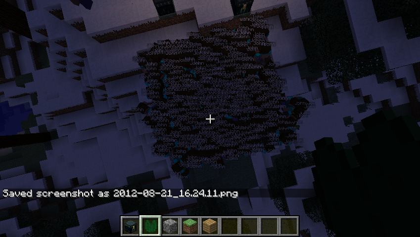

# Denizen / 0.7 / 附加内容 / 图片

有关特定功能（例如单个命令或标签）的更多最新信息和完整详细信息，请查看 <a href="https://meta.denizenscript.com/">元文档</a>。

如果您需要完整的教程来帮助您进行设置，请访问 <a href="https://guide.denizenscript.com/">初学者指南</a> 文本网站。

如果您需要快速帮助，请访问我们的 <a href="https://discord.gg/Q6pZGSR">不和谐组</a>。

此 wiki 已过时，请查看教程视频/指南、元文档或 Discord 小组（均在上面链接）以获取最新信息！

只是为了好玩，这里有一些我们从用户那里看到的图片。

850 Denizen NPCs 在 7x7 平台上徘徊。拍摄者：tenowg。

<h4 id="850-wandering-denizens">第850章 流浪居民</h4>

850 Denizen NPCs 在 7x7 平台上使用带有 WANDER 命令的活动脚本。服务器保持了 20TPS，尽管它确实使用了一点 CPU。拍摄者：tenowg。  

&lt;tenowg&gt; 本来想尝试 1000 但我的手指累了

