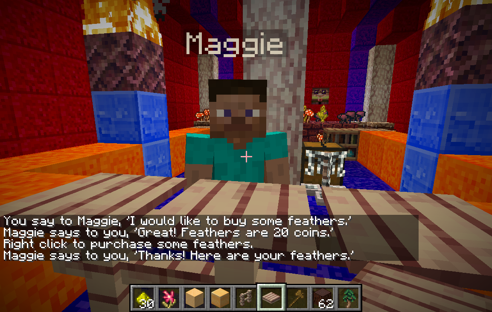
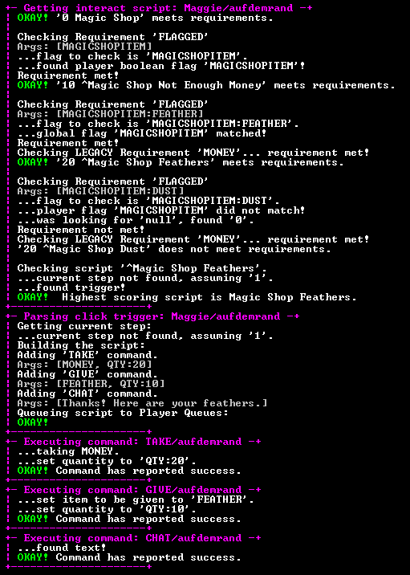

# Denizen / 0.7 / 脚本示例 / 高级脚本

有关特定功能（例如单个命令或标签）的更多最新信息和完整详细信息，请查看 <a href="https://meta.denizenscript.com/">元文档</a>。

如果您需要完整的教程来帮助您进行设置，请访问 <a href="https://guide.denizenscript.com/">初学者指南</a> 文本网站。

如果您需要快速帮助，请访问我们的 <a href="https://discord.gg/Q6pZGSR">不和谐组</a>。

此 wiki 已过时，请查看教程视频/指南、元文档或 Discord 小组（均在上面链接）以获取最新信息！

这些脚本使用 Denizen 的所有强大功能来完成一些非常酷的事情。

<h4 id="maggies-magic-shop">玛吉的魔法店</h4>

玛吉出售魔法零碎物品。这组脚本模拟供应商。她会向玩家打招呼，提供她的商品，并检查是否有适当的金额。这是如何使用标志的一个很好的例子。

玛吉的剧本：你想买什么？

玛吉的剧本：买羽毛游戏画面

玛吉的脚本：购买羽毛调试屏幕

<pre># Maggie sells some magic items for money.
# Version 1.1

# ASSIGNMENTS
#
#  Maggie:
#    Interact Scripts:
#    - 0 Magic Shop
#    - 10 ^Magic Shop Not Enough Money
#    - 20 ^Magic Shop Feathers
#    - 20 ^Magic Shop Dust
    
# MAGGIES MAGIC SHOP.YML ----

'Magic Shop':
  Type: Interact
  Requirements:
    Mode: None
  Steps:
    1:
      Proximity Trigger:
        Script:
        - CHAT 'Welcome to my shop! Have a look around!'
      Click Trigger:
        Script:
        - CHAT 'What would you like to buy?'
        - HINT
      Chat Trigger:
        1:
          Trigger: I would like to buy some /feathers/
          Script:
          - CHAT 'Great! Feathers are 20 coins.'
          - ^NARRATE 'Right click to purchase some feathers.'
          - FLAG 'MAGICSHOPITEM:FEATHER' 'DURATION:15'
        2:
          Trigger: I would like to buy some /glowstone dust/
          Script:
          - CHAT 'Great! Glowstone dust is 50 coins.'
          - ^NARRATE 'Right click to purchase some glowstone dust.'
          - FLAG 'MAGICSHOPITEM:DUST' 'DURATION:15'
        3:
          Trigger: I would like to buy some /*/
          Script:
          - CHAT "Ah! Sorry, I don't sell any of that!"

          
'Magic Shop Not Enough Money':
  Type: Interact
  Requirements:
    Mode: All
    List:
    - FLAGGED 'MAGICSHOPITEM'
  Steps:
    1:
      Click Trigger:
        Script:
        - ^NARRATE "Erm... seems you don't have enough money."
        - RESET 'FLAG:MAGICSHOPITEM'

        
'Magic Shop Feathers':
  Type: Interact
  Requirements:
    Mode: All
    List:
    - FLAGGED 'MAGICSHOPITEM:FEATHER'
    - MONEY 20
  Steps:
    1:
      Click Trigger:
        Script:
        - ^TAKE MONEY QTY:20
        - ^GIVE FEATHER QTY:10
        - CHAT 'Thanks! Here are your feathers.'  
        - NARRATE 'You bought 10 Feathers for 20 coins! Sweet!'
        - NARRATE 'Right click again to buy some more.'

        
'Magic Shop Dust':
  Type: Interact
  Requirements:
    Mode: All
    List:
    - FLAGGED 'MAGICSHOPITEM:DUST'
    - MONEY 50
  Steps:
    1:
      Click Trigger:
        Script:
        - ^TAKE MONEY QTY:50
        - ^GIVE GLOWSTONE_DUST QTY:10
        - CHAT "Thanks! Here's your dust."
        - NARRATE 'You bought 10 Glowstone Dust for 50 coins! Sweet!'
        - NARRATE 'Right click again to buy some more.'
</pre>

<h2 id="to-do">待办事项</h2>

