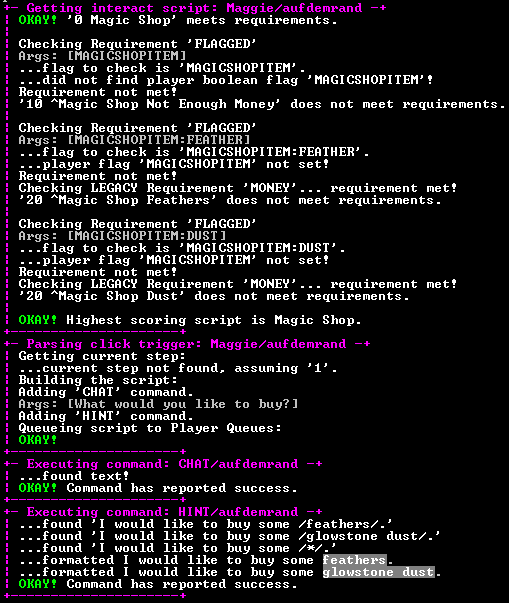

# Denizen / 0.7 / 游戏内命令

有关特定功能（例如单个命令或标签）的更多最新信息和完整详细信息，请查看 <a href="https://meta.denizenscript.com/">元文档</a>。

如果您需要完整的教程来帮助您进行设置，请访问 <a href="https://guide.denizenscript.com/">初学者指南</a> 文本网站。

如果您需要快速帮助，请访问我们的 <a href="https://discord.gg/Q6pZGSR">不和谐组</a>。

此 wiki 已过时，请查看教程视频/指南、元文档或 Discord 小组（均在上面链接）以获取最新信息！

~~== 游戏内命令 ====

<s>

</s>

Denizen 有一些游戏内命令可以帮助管理 Denizen NPCs 和脚本。有些命令需要 Denizen 其他部分的额外知识，但我首先将其包括在内，以消除它们的干扰。注意：使用 Denizens 的玩家没有任何命令。命令仅供 OP 使用。这些将与所有核心 <a href="commands.md" title="Commands">C2 NPC 命令</a> 一起使用，因此您也应该了解这些。

<s>
<h4 id="Denizen_NPC_Creation">Denizen NPC 创建</h4>
</s>

<s>

</s>

创建 Denizen NPC 很容易！只需使用核心 C2 命令 such:

<pre>/npc create 'Name of NPC'
/trait denizen

or

/npc create 'Name of NPC' --trait denizen
</pre>

就是这样！当然，您可以使用任何核心 C2 命令来更改生物类型和其他特征，这些特征在 <a href="commands.md" title="Commands">Citizens2 命令页</a> 中引用。鸡宝宝居民？太酷了！被指控的苦力怕居民？更酷！

<s>
<h4 id="Info-Click">信息点击</h4>
</s>

<s>

</s>

<pre>/denizen info</pre>

获取有关 Denizen NPC 的信息的最佳方法是使用 Info-Click。如果您是 OP，只需右键点击 NPC 即可获取 NPC 统计信息、脚本分配、块书签、文本和触发器状态的列表。还可以通过选择 NPC（C2 核心功能，通常通过用棒右键点击）并使用 <tt>/denizen info</tt> 命令来获取此信息。

<s>
<h4 id="Debug_Mode">调试模式</h4>
</s>

~~

调试屏幕示例。~~

<s>

</s>

<pre>/denizen debug
/denizen stacktrace</pre>

我已尽力捕获错误并以友好且信息丰富的方式输出它们。这可以通过使用 <tt>/denizen debug</tt> 来启用。如果您的脚本出现不可预测的行为，建议您使用此选项。如果您遇到的问题似乎超出了错误的命令语法，我可能会要求您结合使用 <tt>/denizen stacktrace</tt> 命令和调试模式。这将启用严重错误的堆栈跟踪，帮助我找到代码中问题的位置。

<s>
<h4 id="Trigger_Toggles">触发开关</h4>
</s>

<s>

</s>

<pre>/denizen trigger list
/denizen trigger toggle [trigger_name]</pre>

创建后，居民会打开点击和聊天触发器。要切换或检查其他触发器的状态，请使用这些命令。您还可以在 Info-Click 中查看触发器状态。

<s>
<h4 id="Script_Assignment">脚本分配</h4>
</s>

~~当前未实现，必须手动完成。参见<a href="denizen-0.7-assignments.md" title="Denizen/0.7/Assignments">脚本分配</a>~~

<s>
<del>

</del></s>

<pre>/denizen assign [#] [(^)Name of Script]
/denizen remove [Name of Script]
/denizen list</pre>

脚本分配始终可以通过简单地编辑 assignments.yml 并使用 <tt>/denizen reload</tt> 来手动完成（这是我个人更喜欢的），但如果您更愿意使用游戏中的命令，我们会提供它们。脚本分配需要优先级和脚本名称。您还可以在脚本名称开头使用“^”来指示覆盖脚本分配。这一切都在作业 section.s 中进行了介绍，并在文档的后面进行了介绍。

<s>
<h4 id="Bookmark_Creation">书签创建</h4>
</s>

<s>

</s>

<pre>/denizen bookmark block [name]
/denizen bookmark location [name]
/denizen bookmark remove [name]
/denizen bookmark list</pre>

书签是 Denizen 在脚本中引用的“保存位置”。目前有两种类型：位置书签和块书签。书签是处理位置的一种更简单的方法，因为 X、Y 和 Z 坐标很容易失控。您始终可以通过使用信息点击或选择 Denizen NPC 并键入 <tt>/denizen bookmark list</tt> 来检查 Denizen NPC 具有哪些书签。

<h5 id="Block_Bookmarks">块书签</h5>

创建块书签的方法是，首先选择您想要为其分配书签的 Denizen，然后将十字准线指向块并键入 <tt>/denizen bookmark block [name]</tt>。请记住，名称只能是一个单词，并且区分大小写。 CHANGE 和 SWITCH 等命令需要块书签。 POWERED 要求还需要块书签。列出书签时，您可以轻松查看方块的材质以及当前是否由红石供电。可能的场景：需要检查脚本中红石火把的状态？简单的！在该位置创建一个块书签，并使用 POWERED [书签] 要求使脚本交互基于火炬的状态。任何可以供电的块都可以使用。

<h5 id="Location_Bookmarks">位置书签</h5>

位置书签存储 X、Y 和 Z 坐标以及玩家的俯仰/偏航，有多种用途。首先，它们存储精确的 X、Y、Z 位置，可用于 TELEPORT、SPAWN 和 WALKTO 等命令。位置书签中的第二组信息是俯仰和偏航，这对于 LOOK 命令很有用。创建后，将存储玩家的位置、俯仰和偏航信息。可能的场景：需要 Denizen 来查看线索？简单的！在查看该地点时创建位置书签，然后使用“查找”[书签] 让 NPC Denizen 查看同一方向。

位置书签还用于定义位置触发器中的“触发器：节点”。

