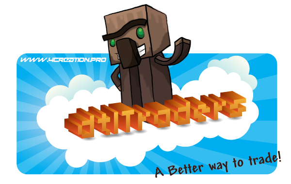

# DtlTraders

<table cellpadding="0" cellspacing="3" style="border: 0; background-color: #ffffff" width="275">
<tbody><tr>
<td style="width: 275; vertical-align: top; border:1px solid #CCC; background-color: #ffffff">

<b> 
dtl商人
 </b>

<table cellpadding="0" cellspacing="3" width="100%">
<tbody><tr>
<td align="left" valign="top" width="100%">

创建 <b> dtl商人 </b> 是为了轻松地为您的服务器设置管理商店。
使用 GUI 创建和管理您的商店。说真的，配置和命令没有麻烦；）

<b> 原装license: </b> MIT 许可证

<b> Version: </b> 3.0.8

<b> Author: </b> 丹迪洛

<b> Status: </b> 废弃。

<b> Source: </b> 原始源代码可以在<a class="external text" href="https://github.com/Dandielo/dtlTraders" rel="nofollow">GitHub</a>上找到

</td></tr></tbody></table>

</td></tr></tbody></table>
<h2 id="about">关于</h2>

此页面已过时，外部作者在 <a href="https://www.spigotmc.org/resources/dtltraders.35890/">Spigot</a> 上维护一个分支，他们在 <a href="https://discord.gg/fyabsMF">不和谐</a> 上提供支持

<strong>dtl商人</strong> 是 Citizens2 的一个特征，允许使用 NPCs 作为商人。

创建一个基本商人并管理他的股票非常容易，您只需要知道一个简单的命令（/trait trader），所有其他事情都可以通过使用提供的 <strong>GUI</strong> 来实现。

然而，如果您不愿意，您也不会被迫使用商人界面，该插件附带了一堆命令和一个名为 <strong>模式</strong> 的模板功能，这允许您以任何您想要的方式创建、更改、扩展、合并商店！
您还可以使用权限管理商店中的物品和价格，允许您根据玩家何时拥有所需权限来更改商店内容！

此外，如果您愿意，您可以将插件的每个最终用户部分翻译成您的语言，因此，该插件还附带了一些语言的现成内置翻译。

<h2 id="features">特点</h2>

所有工作功能，均可与 <strong>3.0.8</strong> 版本一起使用

<ul>
<li><strong>销售</strong> 给玩家的物品</li>
<li><strong>求购</strong> 玩家物品</li>
<li>轻松添加、编辑和删除商人库存中的商品</li>
<li>简单的价格设定机制</li>
<li>允许打开并设置 <strong>子库存</strong> 以及更具体的项目金额选择</li>
<li>设定的价格可以适用于一个单位或整个堆栈</li>
<li>始终自动动态计算每个添加金额 <em>（在子库存中）</em> 的价格</li>
<li>支持<strong>ALL 定制项目</strong>的bukkit API提供！</li>
<li>配套<strong>4个属性修饰符</strong>描述的<a href="http://minecraft.gamepedia.com/Attribute">这里</a>！</li>
<li>很多<strong>设置</strong>，您可以根据您的需要进行更改</li>
<li><strong>先进的翻译系统</strong> 几乎可以翻译所有内容！</li>
<li>模式允许 <strong>更快地设置商人并且特定于权限</strong>！</li>
<li>模式系统与 <strong>默认模式</strong> 一起允许使用 <strong>只需一个命令</strong> 创建商店！</li>
<li>该插件有自己的 API 允许创建自定义商人类型和项目属性！</li>
<li>还有更多进来！</li>
</ul>
<h2 id="getting-started">开始使用</h2>

要使此插件正常工作，您需要获取以下 plugins:

<ul>
<li><strong>Citizens2</strong></li>
<li><strong>Vault</strong></li>
<li>Vault 支持经济插件，如 <strong><em>BOSEconomy，铁</em></strong></li>
<li>Vault 支持的权限插件，如 <strong><em>PermissionEx，群组经理</em></strong></li>
</ul>

获得所有这些后，您只需将 <strong>dtlTradersx.x.x.jar</strong> 放入插件目录即可开始使用此插件。

对于最基本的设置，您只需要知道一个命令，即创建商人的 <strong>/trader create &lt;name&gt;</strong> 或简单地创建一个 NPC 并将 <strong>/trait trader</strong> 添加到其中。

<h2 id="how-to">如何 to:</h2>

这里有一些有用的教程和链接，可以帮助您建立商人。您还可以在这里找到有关此插件的高级设置的信息。

如果您缺少一些信息，您可以随时向我们发送邮件至 support@4Creation.pro

<h3 id="basic-setup">基本设置</h3>

此 <a href="dtltraders-basics.md">教程</a> 展示了如何从头开始创建商人，如何添加、编辑和删除项目。
它向您展示如何设置价格、管理库存商品标志以及如何使用 <strong>多个金额</strong> 功能。

我还将描述一些配置值，它们如何影响游戏和商人的 <strong>游戏内管理</strong> 以及其中哪些是特定于商人的。

<h3 id="configuration">配置</h3>

<a href="dtltraders-config.md">http://wiki.citizensnpcs.co/DtlTraders/config</a>

<h3 id="commands-and-permissions">命令与权限</h3>

<a href="dtltraders-commands.md">http://wiki.citizensnpcs.co/DtlTraders/Commands</a>

<a href="dtltraders-permissions.md">http://wiki.citizensnpcs.co/DtlTraders/permissions</a>

<h3 id="language-and-translations">语言和翻译</h3>
<h3 id="advanced-setup">高级设置</h3>
<h3 id="patterns">图案</h3>
<h3 id="extending">延伸</h3>
<h2 id="credits-and-thanks">致谢与致谢</h2>

