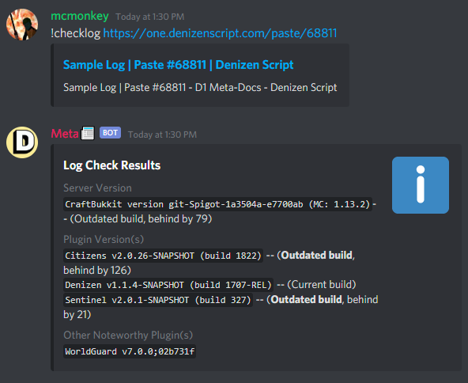

# 日志

此页面解释了有关发布服务器日志以获得支持的一些信息。

<h2 id="how-to-post-logs">如何发布日志</h2>
<ul>
<li>进入服务器文件，找到 <code>logs</code> 文件夹，然后在其中找到 <code>latest.log</code>。</li>
<li>这是一个简单的文本文件，因此只需在任何文本编辑器中打开它即可。</li>
<li>复制文件的内容。</li>
<li>转到 <a href="https://paste.denizenscript.com/New/Log">服务器日志 Pastebin</a> 并粘贴复制的数据。</li>
<li>如果在 Pastebin 上，请点击“创建新粘贴”。如果在 /Haste 上，点击“服务器日志”，然后点击“提交”。</li>
<li>然后，复制您现在所在页面的 URL，并将该 URL 粘贴回要求您发布日志的频道或问题中。</li>
<li>如果您使用 Denizen&amp;Citizens Discord，您可以使用 <code>!checklog</code> 命令和您提供的链接来自动检查日志中的常见问题（例如过时的插件版本等），如下所示：</li>
</ul>

<h2 id="why-post-logs">为什么要发布日志？</h2>

当用户报告可能与常见问题相关的问题时，例如过时的插件或服务器版本，或与其他插件不兼容，我们经常要求人们发布日志（例如，如果 NPC 战斗不起作用，日志将在服务器上显示类似 WorldGuard 的内容，这通常是战斗被阻止的原因）。

<h2 id="whats-in-a-log">日志里有什么？</h2>

完整的启动日志包含以下几段information:

<ul>
<li>完整服务器版本（在上面的示例中，即 <code>CraftBukkit version git-Spigot-1a3504a-e7700ab (MC: 1.13.2)</code>）</li>
<li>所有已安装插件的完整版本（在上面的示例中我们看到 <code>Citizens v2.0.26-SNAPSHOT (build 1822)</code> 等）</li>
<li>我们在 Discord 上的元机器人会将服务器版本和一些插件版本与已知的当前可供下载的版本进行比较，并报告某个版本落后了多远（如果有的话）。</li>
<li>任何错误消息。如果您不经常查看日志，那么在您第一次检查日志时，发现一堆插件无法加载或生成错误消息的情况并不少见。</li>
<li>即使错误看起来与问题无关，但它通常与问题相关。作为一般经验法则，如果您的日志中有任何错误，那么这些错误绝对是要修复的首要任务。</li>
<li>大量的次要加载数据通常并不重要，但在极少数情况下，它们对于诊断相关问题非常有帮助。</li>
<li>您输入的命令。当您的问题与命令的使用相关时，将该命令的文本与您键入的内容完全一致通常会很有帮助（通常，问题只是由拼写错误或轻微的格式错误引起的！）。</li>
</ul>
<h2 id="should-i-edit-or-trim-the-logs">我应该编辑或修剪日志吗？</h2>

不，永远不要编辑或修剪您的日志。始终提供 <code>latest.log</code> 的完整内容，不受影响。

如果其中充满了不相关的数据（例如数小时的日常 Minecraft 服务器活动日志），请在复制日志之前重新启动服务器（并加入它并复制问题）。

一般来说，启动日志（以及相关的基本问题复制）是最重要的部分。

<h2 id="do-logs-contain-private-information">日志中是否包含隐私信息？</h2>

我们有时会看到用户担心他们的日志包含他们可能不想发布的私人信息。

一般来说：<strong>不，日志不包含私人信息</strong>。

如果您从实时和活动的公共服务器复制日志，您可能会在日志中包含玩家 IP 和/或聊天消息，您可能更喜欢安全，而不是后悔（当然：IP 通常被视为公共数据，希望玩家不会在 Minecraft 服务器上共享秘密）。如果这适用于您，上面链接的日志粘贴箱有一个选项，可以在您进行粘贴时自动过滤掉 IP 或聊天。或者，您可以 <a href="https://guide.denizenscript.com/guides/first-steps/local-test-server.html">启动本地测试服务器</a> 或重新启动服务器，将 latest.log 重置为仅启动信息以及您为演示问题（如果需要）而进行的任何快速测试，而无需随机玩家加入。 （如果您选择后两个选项中的任何一个，请确保在发布日志之前复制该问题）。

