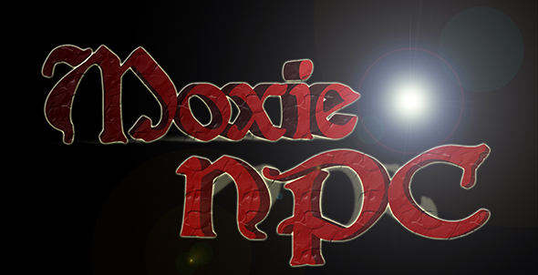

# MoxieNPC

<table cellpadding="0" cellspacing="3" style="border: 0; background-color: #ffffff" width="275">
<tbody><tr>
<td style="width: 275; vertical-align: top; border:1px solid #ccc; background-color: #ffffff">

<b> </b>

<table cellpadding="0" cellspacing="3" width="100%">
<tbody><tr>
<td align="left" valign="top" width="100%">
<figure class="mw-halign-center" typeof="mw:File/Frameless">&lt;figcaption&gt;图片</figure>

<b>MoxieNPC</b> 是 MoxieSkills 的扩展，允许服务器向玩家出售能力和技能 XP。

<b>当前版本：</b> 1.5 发布

<b>Developers:</b> x3nec

<b>Source:</b> <a class="external text" href="https://github.com/x3nec/MoxieNPC" rel="nofollow">吉图布</a>

<b>最新版本：</b> <a class="external text" href="http://dev.bukkit.org/server-mods/moxienpc/files/3-moxie-npc-v1-5/" rel="nofollow">布基特开发公司</a>

<b>支持tickets:</b> <a class="external text" href="http://dev.bukkit.org/server-mods/moxienpc/tickets/" rel="nofollow">BukkitDev 上的门票</a>

<b>感谢 to:</b> aufdemrand 用于此信息框！
 

</td></tr></tbody></table>

</td></tr></tbody></table>

图像

<h3 id="what-is-it">它是什么？</h3>

MoxieNPC 是 <a href="http://dev.bukkit.org/server-mods/moxieskills">莫西技能</a> 的扩展，允许管理员设置 NPC 商店而不是标志商店。为了使该插件运行，您需要在服务器上运行 <a href="http://dev.bukkit.org/server-mods/citizens">Citizens 2.0</a> 和 <a href="http://dev.bukkit.org/server-mods/moxieskills">莫西技能</a>。

<h3 id="how-to-use-it">如何使用</h3>

MoxieNPC 不是一个独立的插件 - 它是从 Citizens 2.0 扩展的角色特征。因此，为了使用它，您必须首先创建一个NPC，然后执行'/trait moxienpc'。完成后，您可以继续按照以下说明进行操作。

<ul>
<li>要向玩家出售能力，该能力必须在 abilities.yml 文件中将可购买设置为 true（对于 MoxieSkills|RPG）</li>
<li>要将 XP 出售给玩家，技能的拼写必须正确。 N.B。请记住，您指定的成本仅为 1 XP。</li>
<li>为了了解如何使用MoxieNPCs，只需在游戏中输入/mnpc，并使用Citizens选择的MoxieNPC，就这么简单！</li>
<li>MoxieNPC 是可以交谈的，因此玩家只需右键点击它们即可给出指示！</li>
</ul>

<h3 id="permissions">权限</h3>

<pre>  moxienpc.usenpc.ability - Buy abilities from the NPC shop.
  moxienpc.makenpc.ability - Add abilities to sell at NPC shop.
  moxienpc.usenpc.xp - Buy skills XP from the NPC shop.
  moxienpc.makenpc.xp - Add skills XP to sell at NPC shop.
</pre>

