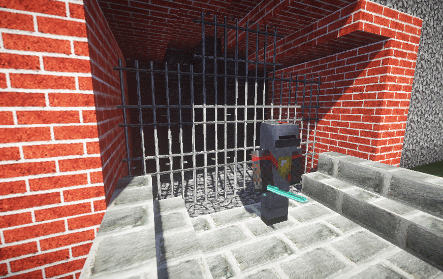

# Sentinel

<h1 id="information-on-sentinel-combat-npcs-for-citizens-can-be-found-at-httpsgithubcommcmonkey4evasentinelblobmasterreadmemd">有关Sentinel的信息：Citizens的战斗NPCs，可以在：<a href="https://github.com/mcmonkey4eva/Sentinel/blob/master/README.md">https://github.com/mcmonkey4eva/Sentinel/blob/master/README.md</a>找到</h1>

