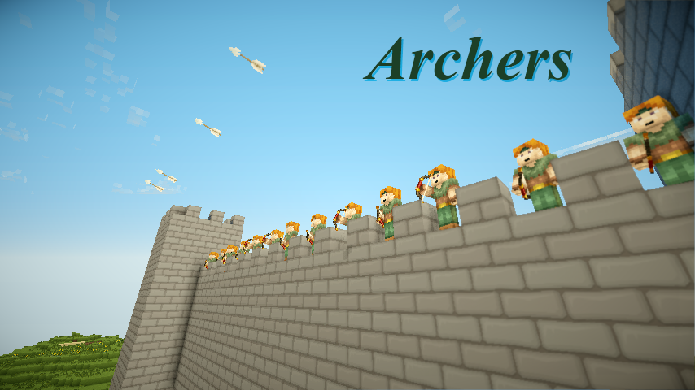
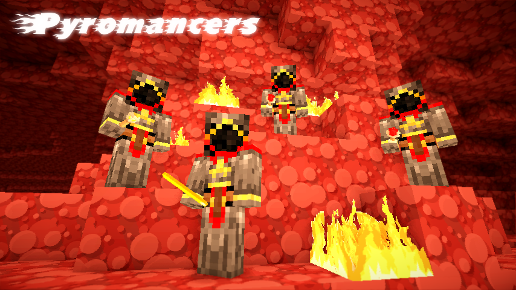
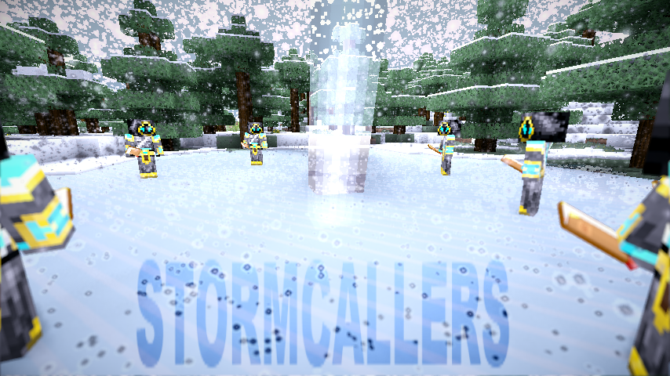
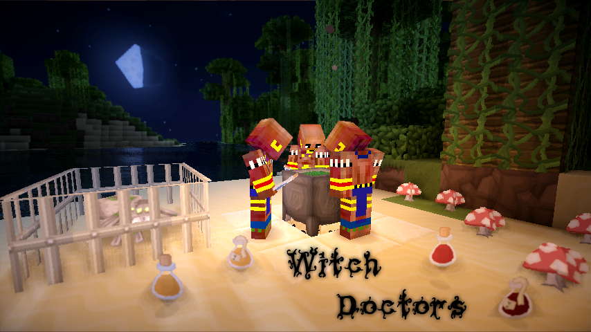

# Sentry

 

<strong>Sentry</strong>

<table>
<thead>
<tr>
<th></th>
<th></th>
</tr>
</thead>
<tbody>
<tr>
<td><strong>作者</strong></td>
<td>奥夫德姆兰德报</td>
</tr>
<tr>
<td><strong>版本</strong></td>
<td>1.8.6</td>
</tr>
<tr>
<td><strong>Citizens 构建</strong></td>
<td><a href="http://ci.citizensnpcs.co/job/Citizens2/">2.0.16</a>（与CraftBukkit 1.8.6配合使用）</td>
</tr>
<tr>
<td><strong>其他依赖项</strong></td>
<td>不需要，Vault 和建议的权限插件。</td>
</tr>
<tr>
<td><strong>下载</strong></td>
<td><a href="http://ci.citizensnpcs.co/job/Sentry/28/artifact/target/sentry.jar">链接</a></td>
</tr>
<tr>
<td><strong>Description:</strong> Citizens NPCs 攻击怪物并且可以被杀死。已替换为<a href="sentinel.md" title="Sentinel">Sentinel</a>！</td>
<td></td>
</tr>
</tbody>
</table>

<strong>SENTRY</strong> 已被 <a href="sentinel.md" title="Sentinel">Sentinel</a> 取代！

<strong>SENTRY</strong> 已被 <a href="sentinel.md" title="Sentinel">Sentinel</a> 取代！

<strong>SENTRY</strong> 已被 <a href="sentinel.md" title="Sentinel">Sentinel</a> 取代！

老page:

<strong>Sentry</strong> 是 Citizens 2.0 <a href="characters.md" title="Characters">性格特征</a>，它使 NPCs 能够：

<ul>
<li>自动攻击特定的怪物、玩家或群体。</li>
<li>杀死玩家、怪物和环境，以及被它们杀死。</li>
<li>守卫位置、路径、玩家或其他 NPCs。</li>
<li>使用远程或近战武器。</li>
<li>配置力量、护甲、速度和夜视等统计数据。</li>
<li>坐骑！</li>
<li><a href="sentry-sentry-and-denizen.md" title="Sentry/Sentry and Denizen">与 Denizen 合作</a> 创建在死亡时运行脚本的 NPCs。</li>
</ul>

开发版本现已位于：<a href="http://ci.citizensnpcs.co/job/Sentry/">http://ci.citizensnpcs.co/job/Sentry/</a>

官方源代码仓库是 <a href="https://github.com/jrbudda/Sentry">Github/jrbudda/Sentry</a>，尽管 Sentry 目前维护为 <a href="https://github.com/mcmonkey4eva/Sentry">Github/mcmonkey4eva/Sentry</a>

我可以看看你的大厅通行证吗？

<h2 id="deprecation">DEPRECATION</h2>

弃用通知：

Sentry 已替换为 Sentinel，信息此处：<a href="https://github.com/mcmonkey4eva/Sentinel/blob/master/README.md">https://github.com/mcmonkey4eva/Sentinel/blob/master/README.md</a>

<h2 id="updates">更新</h2>
<table>
<thead>
<tr>
<th></th>
<th></th>
</tr>
</thead>
<tbody>
<tr>
<td><strong>v.1.8.6</strong> 05/25/15 <a href="http://ci.citizensnpcs.co/job/Sentry/28/artifact/target/sentry.jar">下载</a> - MC 1.8.6 更新 <strong>v.1.8.5</strong> <a href="http://ci.citizensnpcs.co/job/Sentry/27/artifact/target/sentry.jar">下载</a> - MC 1.8.3 更新 <strong>v.1.8.4 构建 2</strong> <a href="http://ci.citizensnpcs.co/job/Sentry/24/artifact/target/sentry.jar">下载</a> - 更新以配合使用Denizen 更新。   <strong>v.1.8.4</strong> <a href="http://ci.citizensnpcs.co/job/Sentry/23/artifact/target/sentry.jar">下载</a> - 更新以与派系配合使用和 Denizen 更新。   <strong>v.1.8.3</strong> <a href="http://ci.citizensnpcs.co/job/Sentry/19/artifact/target/sentry.jar">下载</a> - 更新以与适用于 MC 1.8 的 Bukkit 配合使用 <strong>v.1.8.2 构建 3</strong> <a href="http://ci.citizensnpcs.co/job/Sentry/14/artifact/target/sentry.jar">下载</a> - 更新以与适用于 MC 1.7.10 的 Bukkit 配合使用 <strong>v.1.8.2 构建 2</strong> 06/13/14 <a href="http://ci.citizensnpcs.co/job/Sentry/13/artifact/target/sentry.jar">下载</a> - 与最新 Denizen 开发版本 <strong>v.1.8.2</strong> 的补丁兼容性的小型更新 03/24/14 <a href="http://ci.citizensnpcs.co/job/Sentry/12/artifact/target/sentry.jar">下载</a> - 更新以与 MC 1.7.8 的 Bukkit 配合使用 -&gt; （编辑：然后到1.7.9 以及）<strong>v.1.8.1</strong> 03/24/14 <a href="http://ci.citizensnpcs.co/job/Sentry/8/artifact/target/sentry.jar">下载</a> - 更新以与 Bukkit 一起用于 MC 1.7.5 <strong>v.1.8.0</strong> 12/10/13 <a href="http://www.sendspace.com/file/t2aky8">下载</a> - 重新设计防护目标。设置时，守卫目标不再需要位于 Sentry 的范围内（如果是玩家）。如果你们走散并退出，您将不再需要去找保镖。 - 修复安装哨兵无法正确攻击的问题。 - 添加对《我的世界》记分板团队的定位支持。 （通过 TEAM:NAME）（战队现在通过 WARTEAM:NAME 指定） - 使用 /npc 副本时移动重生位置。 - 修复了在世界守卫或其他 PVP 保护情况下事件目标不开火的问题。   <strong>v.1.7.1</strong> 11/07/13 <a href="https://dl.dropboxusercontent.com/u/54130586/Sentry/1.7.1/Sentry.jar">下载</a> - 更新以与 Bukkit 一起使用 MC 1.7.2 <strong>v.1.6.1</strong> 11/07/13 <a href="https://dl.dropboxusercontent.com/u/54130586/Sentry/1.6.1/Sentry.jar">下载</a> - 代码格式化工作 <strong>v.1.5.4</strong> 11/07/13 <a href="https://dl.dropboxusercontent.com/u/54130586/Sentry/1.5.4/Sentry.jar">下载</a> - 修复与新版本 Citizens <strong>v.1.5.3</strong> 9/20/2013 <a href="http://www.sendspace.com/file/fuk6r9">下载</a> - 更新 craftbukkit 1.6.4 <strong>v.1.5.2</strong> 8/27/2013 <a href="http://www.sendspace.com/file/xx3ooi">下载</a> - 的小型更新添加<em>可瞄准的</em>选项以防止小怪攻击哨兵。 （这曾经是通过 <em>/npc playerlist</em> 完成的，但在 mc 1.6 中停止工作） - 修复 Denizen 操作在涉及射弹时不使用正确的杀手。   <strong>v.1.5.1</strong> 8/3/2013 <a href="http://www.sendspace.com/file/5sljfn">下载</a> - 哨兵正确记住它们的重生位置。 - 对骑乘哨兵的许多小修复 - 坐骑不会受到守卫目标的伤害 - 巡逻时坐骑的移动速度是骑手的 <em>/npc speed</em> 的 2 倍，攻击时的移动速度是骑手的 <em>/sentry speed</em> 的 2 倍。   - 骑手动画与坐骑更好地同步。   - 安装的保镖将正确传送（需要非常最新的 Citizens2 版本） - 当哨兵被重生 -1 <strong>v.1.5</strong> 7/29/2013 <a href="http://www.sendspace.com/file/4hvq4p">下载</a> 杀死时，安装会被正确删除 - 加略山已经到来！哨兵现在可以拥有并成为坐骑！请参阅 &lt;#Mounts&gt; 部分 - 禁用死亡动画以防止客户端幽灵掉落 - 修复与 Denizen 最新版本的兼容性问题 - 哨兵始终使用 'old' 探路者。 - 修复健康不保存的问题。   <strong>v.1.4.1</strong> 7/9/2013 <a href="http://www.sendspace.com/file/jvpqc7">下载</a> - 与 1.6.2 兼容 <strong>v.1.4.0.1</strong> 7/4/2013 <a href="http://www.sendspace.com/file/pnoyt5">下载</a> - （大部分）与 1.6.1 和 Citizens 2.0.9 兼容 - 兼容（仅！）使用 Denizen .9 <strong>v.1.3.7</strong> 7/3/2013 <a href="http://www.sendspace.com/file/7kd6g1">下载</a> - 哨兵现在可以选择免疫其忽略列表中的物体造成的伤害。 - Sentry 射弹将穿过*其忽略列表上的东西。 （*可能会出现一些准确性损失） - 如果肇事者位于忽略列表中，哨兵将正确忽略事件：目标。 - 保镖可以选择不跟随伤害保护（与modifyworld和其他烦人的插件兼容。） - 修复默认config.yml（在默认目标周围加上引号“”并忽略！） - 与Factions 2.0.X <strong>v.1.3.6</strong> 5/21/2013 <a href="http://www.sendspace.com/file/adgqyl">下载</a>兼容 - 为保镖添加了可配置的跟随距离。使用 /sentry follow [0-32] - 修复 Denizen DIE 命令中的崩溃。 - Sentry 现在删除了 Denizen 'Health' 特征，因为它与哨兵发生冲突。这应该修复一些与健康和重生相关的错误。 - 添加了几个 Denizen 'actions'。请参阅高级用法部分。 - 不再使用 NMS 代码来获得最大生命值 &gt; 20。应该与其他插件更兼容。   <strong>v.1.3.5</strong> 5/7/2013 <a href="http://www.sendspace.com/file/2s90lz">下载</a> - 添加 KillDrops 选项以从 Sentry 击杀中移除物品和经验值掉落。   <strong>v.1.3.4</strong> 5/4/2013 <a href="http://www.sendspace.com/file/9gxfe6">下载</a> - 更新 1.5.2 - 添加 FACTIONENEMIES：目标 <strong>v.1.3.3.3</strong> 4/9/2013 <a href="http://www.sendspace.com/file/4en9is">下载</a> - 修复安装 Denizen 后哨兵不会死亡的问题。   <strong>v.1.3.3.2</strong> 3/21/2013 <a href="http://www.sendspace.com/file/3emb6e">下载</a> - 修复如果未安装 Denizen 时哨兵死亡的错误。   <strong>v.1.3.3.1</strong> 3/21/2013 <a href="http://www.sendspace.com/file/i3t9h5">下载</a> - 更改 craftbukkit 1.5.1 的软件包 <strong>v.1.3.3</strong> 3/19/2013 <a href="http://www.sendspace.com/file/qot6p8">下载</a> - 与 Craftbukkit 1.5 和 Citizens 2.0.8 兼容 - 已修复如果仍然安装了 Denizen .76，则 Sentry 不会加载。   <strong>v.1.3.2</strong> 3/14/2013 <a href="http://www.sendspace.com/file/ox6uyq">下载</a> - 与 Denizen 0.8 和最新 Citizens2 的兼容性（请注意，这不适用于 Denizen 0.7x） <strong>v.1.3.1</strong> 1/19/2013 <a href="http://www.sendspace.com/file/i3l47p">下载</a> - 与 cb 1.4.7 兼容 <strong>v.1.3</strong> 1/17/2013 <a href="http://www.sendspace.com/file/s4bj6x">下载</a> - 与 CraftBukkit 1.4.6r0.4 和 Citizens2 2.0.6 build 663 兼容 - 与Denizen .8 和 .76。命令和触发器是相同的，但示例脚本在更新之前无法与 .8 一起使用 - 哨兵将不再对其他 NPCs 的射弹进行报复。如果此行为扰乱了您的设置，请告诉我，我可以将其作为一个选项。 - 保镖不与其主人一起传送的解决方法。 - 新的活动目标：PvE。用于攻击攻击怪物/动物的玩家。 - API：哨兵在死亡时总是会引发 NPCDeathEvent，无论类似死亡的玩家设置如何。修改 NPCDeathEvent 中的物品列表将会修改哨兵掉落的物品。 - API：哨兵现在应该具有有效的最后伤害原因和杀手套装。 - 内存和CPU 优化。   <strong>v.1.2.6b</strong> 12/22/2012 <a href="http://www.sendspace.com/file/ikgcxx">下载</a> - 与 CraftBukkit 1.4.6r0.1 和 Citizens2 2.0.6 的兼容性 <strong>v.1.2.5</strong> 12/20/2012 <a href="http://www.sendspace.com/file/wu8fmh">下载</a> -与 CraftBukkit 1.4.5r1.0 和 Citizens2 版本 2.0.5 兼容 <strong>v.1.2.4</strong> 12/9/2012 - 与最新版本的 craftbukkit (1.4.5 r0.3) 和 Citizen2 build 606+ 兼容<strong>v.1.2.3</strong> 11/27/2012 - 与 craftbukkit 1.4.4 - 1.4.5 r0.2 和 Citizen2 build 597 兼容。 - Citizen2 中的 Chunk Unload 设置的兼容性修复。   - 如果主人传送太远，活跃的保镖应该不再死亡。   - 如果生成位置的块被卸载，常规哨兵将不会尝试重生。   <strong>v.1.2.2</strong> 11/14/2012 - 实施弓拉和剑块动画 - 感谢 dotblank！ - 更多城镇支持：使用国家敌人：目标自动攻击指定国家的敌人！   <strong>v.1.2.1</strong> 10/29/2012 - 1.4.2 更新...与 cb 1.3 不兼容！ - 增加了术士2级。火焰使头骨枯萎。请务必更新您的 config.yml 以支持它们。 - 添加了许多默认的生物攻击。烈焰人、末影龙和恶魂会发射火球。凋灵射击凋灵头骨。雪人扔雪球。女巫会投掷伤害药水。骷髅会射箭。苦力怕会爆炸。   - 其中一些并不能 100% 工作。苦力怕可能无法正确重生，并且骷髅当前不是 'equippable' - 修复忽略列表中的指定玩家。   <strong>v.1.2</strong> 10/24/2012 - 所有可切换选项（无敌、掉落、报复、暴击）都可以通过 /sentry [选项] true/false 显式设置 - 友好火力选项已被完全删除，哨兵永远不会对保镖所有者或该所有者的其他保镖造成伤害或受到伤害。 （无论如何，这是默认行为） - 当还设置了无敌时修复元素免疫。 - 改变Sentry的武器将导致它立即切换攻击类型，而不是下一个目标。 - DIE 命令现在将正确遵循 RESPAWN、DROPS 和 DieLikePlayers 的设置。 - 修复了如果 RESPAWN 设置为 -1 则掉落物不起作用的问题。   <strong>v.1.1.4</strong> 10/15/2012 - 现在可以在 <a href="sentry-configuration.md" title="Sentry/Configuration">config.yml</a> 中配置或禁用关键命中机会和消息。请更新您的 config.yml，否则关键功能将根本无法工作。 - 请注意，从 Citizen2 build 465 开始，所有生物类型都可以攻击。所有人都欢呼我们的新羊霸主。   <strong>v.1.1.3</strong> 10/15/2012 - 修复如果重生设置为 -1 时死亡触发器不会关闭的问题。 - 添加了对 SimpleClans 的支持。使用氏族：目标或忽略。 - 添加了 Npcdeathowner 触发器。当哨兵居民使用其所有者作为目标玩家死亡时，此居民触发器就会运行。   <strong>v.1.1.2</strong> 10/14/2012 - 修复 NPCDeath 触发器。初步代码用于分离死亡触发器，以选择性地运行脚本来对抗 NPC 所有者而不是杀手。   <strong>v.1.1.1</strong> 10/12/2012 - 失去主人的保镖不会受到伤害或参与战斗，直到主人返回/登录。 - 流浪哨兵射弹不应伤害无敌的基本 NPCs。 - 对目标查找进行更多优化。如果哨兵的 TPS 仍然较低，则必须增加 config.yml 中的 LogicTicks。如果您可以分析服务器并让我知道到底是什么导致了问题，那将会有所帮助。 - 寻路范围的小修复。   <strong>v.1.1</strong> 10/10/2012 请注意，此更新向 config.yml 添加了多个新项目。这些不会自动添加。有关新商品，请参阅 <a href="sentry-configuration.md" title="Sentry/Configuration">配置</a> 页面。   - 旨在提高性能的几项更改： - - 目标检查代码已被重新​​设计，以在 Sentry 未设置为针对特定类别时进行更少的无意义调用。我认为最大的罪魁祸首是某些权限插件返回组信息的速度非常慢。哨兵现在只会查询具有 GROUP: target 或ignore 设置的组。 Towny、派系、战争和事件：目标也是如此。     -还在config.yml中添加了一个选项来指定哨兵寻找目标的频率。默认值为 10 个刻度（每秒两次）。增加这个数字会减少服务器负载，但也会降低哨兵的响应速度并降低最大发射率。 - 增加了风暴召唤者等级 3。这些疯狂的巫师召唤出如此强大的闪电，它会立即蒸发掉接触到的任何东西，甚至是那些免疫伤害的东西。 （提示：创造模式玩家）- 现在将“&amp;”解析为警告和问候消息中的有效颜色字符。将默认消息更改为红色/绿色。 - 在 config.yml 中添加选项以支持 'extended' 装甲。还允许禁用特定的装甲类型。仅适用于/sentry装备（不适用于/npc装备） <strong>v.1.0.3</strong> 10/2/2012 - 修复复制哨兵的目标/忽略列表彼此为'linked'。可能不会修复现有的哨兵，只会修复新复制的哨兵。要修复现有哨兵，请打开公民 saves.yml 并删除每个 Sentry 上 Targets: 和 Ignores: 节点上的 <a href="http://en.wikipedia.org/wiki/YAML#References">YAML 锚和参考</a>。   <strong>v.1.0.2</strong> 9/28/2012 - 修复城镇/派系/战争支持。   <strong>v.1.0.1</strong> 9/27/2012 - 修复巫医（他们喝醉了并丢失了配方书，但我们找到了） - 切换到新的默认传送动作，应该修复服务器挂在梯子和瀑布附近的问题。   <strong>v.1.0 发布！</strong> 9/21/2012 - 允许保镖穿越世界的解决方法。 - 武器损坏的解决方法。 - 也许修复围绕梯子传送的服务器崩溃问题。 - 目前我对 Sentry 的功能列表和稳定性非常满意，所以这是 1.0。有一些问题仍然无法正常工作（例如速度），但这些问题无法通过 Sentry 修复，应该在 Citizens2 的未来版本中解决。   <strong>v.0.9.9.2 测试版</strong> 9/20/2012 - 介绍第 667 旅：<strong>术士！</strong> - 这些古代奥术艺术的工匠更喜欢在末地深处的孤独生活方式。可能是因为它们气味难闻。最近他们中的一些人来到了凡人领域，哨兵军团已经整合了他们。有传言说更强大的术士也可能正在路上！   - 请务必将术士添加到您的 <a href="#Configuration">config.yml</a> 中以启用这种新的攻击类型。 - 修复了 1 级烈焰术士过度热衷使用实际火焰的问题。 - 其他小错误修复。   <strong>v.0.9.9.1 测试版</strong> 2012 年 9 月 17 日 - <strong>战争</strong> 支持。使用TEAM：目标自动攻击战争玩家。 - 修复物品掉落 - 添加了服务器范围的选项，使哨兵 'die' 就像以前的 v0.9.5 一样。默认为 false。 - 添加了服务器范围的选项来设置死亡时掉落的 EXP 哨兵数量（如果打开了掉落）。 （是的，是的..你想要每个哨兵。.我知道）<strong>v.0.9.9 测试版</strong> 9/15/2012 - 添加命令：装备 - 添加目标：事件：pvnpc，事件：pvsentry - 更改了有关 pvp 的一些逻辑： - 保镖现在应该尊重 pvp 保护区，他们不会对玩家造成伤害或在无 pvp 区域左键点击时进行报复。这仅适用于保镖，瞭望型哨兵仍然可以在 PVP 保护区内履行职责。你仍然不应该将一个对玩家有敌意的保镖带入 PVP 保护区..它会逃跑并惹恼人们。   - 所有无敌哨兵不会报复，不流血不犯规。 - 修复了默认强度和pyro3 <strong>v.0.9.8.1 测试版</strong> 的配置错误 9/13/2012 配置在这里！  Sentry 现在有一个 config.yml！您可以： - 为新哨兵设置默认统计信息/选项/目标/文本。 - 自定义每种类型的哨兵使用的项目（目前仅匹配 ID，id:data.. 很快）。还可以禁用某些 Sentry 类型。 - 为各种盔甲和武器类型添加盔甲、力量和速度增益。因此，您的玩家无需访问 /sentry stat 命令即可增强他们的哨兵！ - 对哨兵使用的任何武器应用任何药水效果！   一旦解决了这个新东西的错误，请参阅 <a href="sentry-configuration.md" title="Sentry/Configuration">配置</a>。 Sentry 将作为 1.0 发布。  <strong>v.0.9.7 测试版</strong> 9/11/2012 - 维和人员已经抵达！给你的哨兵事件：pvp目标，它会攻击玩家并伤害其范围内的其他玩家。 - 修复派系目标。 - 修复了 NPC 目标。 - 修复了保镖的一些问题。他们仍然不喜欢被带到世界各地。认为这是 Citizen2 核心的问题。   <strong>v.0.9.6 测试版</strong> 9/10/2012 - ~~已知问题：用保镖改变世界会引发控制台错误。正在修复。~~ - ~~已知问题：如果服务器上有一个以玩家命名的 NPC，则该玩家可能会被 NPC: target 检测到。~~ - 从 PLAYER: Targets 中分离出 NPC: Targets。 - 修复了派系问题。 - 小错误 <strong>v.0.9.5 测试版</strong> 9/8/2012 - 保镖将保持适当的距离。 - 如果可以的话，哨兵会尽量不站在火中，这往往会导致弓弦的保修失效。   <strong>v.0.9.4 测试版</strong> 9/7/2012 - 修复了卡住的操作，需要构建公民2或更高版本的<strong>334</strong>。 - 更好地帮助瞄准和守卫命令。   <strong>v.0.9.3 测试版</strong> 9/2/2012 - 生命值不再限制为 20，应该能够在没有外部 mods 的情况下使用任何值。 - 实施了 'stuck' 行动。如果哨兵被卡住，他们应该传送到他们的守卫目标或路径点。如果 Sentry 在尝试到达敌对目标时被卡住，它将放弃（如果有路径点，则会传送回来）此功能可能仍然存在一些问题。 - 修复生物攻击行为。 - 风暴召唤者现在免疫所有闪电。火术士对所有火焰免疫。巫医对所有毒药免疫。   <strong>v.0.9.2.1 测试版</strong> 9/2/2012 - 修复非常快速修复的错误 - 修复错误？来自居民钩子。   <strong>v.0.9.2 测试版</strong> 9/2/2012 - 与最新的 Citizens2 兼容 <strong>v.0.9.1 测试版</strong> 9/1/2012 - 通过持续暴露，巫医和 3 级烈焰术士不再被自己的攻击伤害（除非友军火力攻击。） - 提高了投掷药水的准确性。   <strong>v.0.9.0 测试版</strong> 8/31/2012 - 一百年来，受人尊敬的风暴召唤者骑士团第一次从爬行角山顶的修道院降临。他们来到了哨兵军团，与他们的弟兄们一起分享一个世纪以来的神秘秘密，以击退席卷这片土地的邪恶浪潮！请参阅 <a href="#top">#设备详情</a> - 风暴召唤者挥舞着强大的卷轴和古老的书籍，带来闪电来打击他们的敌人！   - 风暴召唤者教会了烈焰术士大队如何集中气力并召唤更强大的火焰！   - SentryCorp 冰魔法师已经学会向他们的冰球注入冰冻力量！   - 神秘的巫医已经开始大规模生产他们的战争药水。他们还生产优质的根汁啤酒。   <strong>v.0.8.9 测试版</strong> 8/28/2012 - 修复目标、忽略、防护、警告和问候命令以正确处理空格。 - 更改伤害事件优先级：所有哨兵都应独立于任何 PVP 保护插件处理和接收伤害，因为根据定义，他们不是玩家。   <strong>v.0.8.8.2 测试版</strong> 8/27/2012 - 删除了重生上限。 - 删除了治疗上限以允许更快的治疗。治疗率仍然是 1hp 治疗之间的秒数，但 0.0 到 1.0 之间的所有值现在都有效。所以 0.5 的治疗速度就是每秒 2hp。 0.1 的治疗率是每秒 10 马力。 0.01 的治疗率是每秒 100 马力。 - 修复了未安装保管库时出现的错误。 - 使 Vault 注册延迟，以与慢速权限系统兼容。   <strong>v.0.8.8.1 测试版</strong> 8/23/2012 - 哨兵根据护甲受到的击退较少。还尊重其他 Minecraft 实体在被击中后享有的 0.5 秒无敌期。这应该会让与他们的战斗变得更加困难和有益。 - 删除了生命值、力量和护甲的上限。这是为了与其他插件兼容。原版 craftbukkit 用户仍应使用 1-20 来获取生命值，使用 0-10 来获取力量和护甲。   <strong>v.0.8.8 测试版</strong> 2012 年 8 月 21 日 - 由于未决诉讼，所有 Citizens 哨兵队人员已被送往公共关系培训。显然，有些人对哨兵在没有任何警告的情况下攻击人们感到不安。   添加了命令 warningrange、warning、greeting 请参阅 &lt;#Warn/Greet&gt; - 修复了哨兵在几秒钟后放弃报复目标的问题。 - 其他错误修复。   <strong>v.0.8.7.1 测试版</strong> 8/20/2012 - 修复组忽略。 - 添加了有效目标：实体：所有 <strong>v.0.8.7 测试版</strong> 8/20/2012 - 添加了命令：忽略 - 添加了目标实体：所有者 <strong>v.0.8.6 测试版</strong> 8/20/2012 - 添加了目标重新评估 当哨兵有一个活动目标时，每隔几秒他们就会回头看一眼其他可能的目标，如果有一个目标更接近，就会切换。在我背后捅我一次，你可耻，在我背后捅我两刀，我可耻。   - 添加了 Denizen 命令：LIVE <strong>v.0.8.5.1 测试版</strong> 8/19/2012 - 对权限、信息、调试信息进行了小修复。   <strong>v.0.8.5 测试版</strong> 8/17/2012 - 支持派系。使用 FACTION:FactionTag 来定位该派系的成员。 - 添加了城镇国家支持。使用NATION:NationName，目标是该城镇国家的成员。   <strong>v.0.8.4.1 测试版</strong> 8/16/2012 - 最后一秒的治疗将不再允许哨兵在死亡后赤身裸体地跳回战斗。 - 哨兵在死亡时忘记了他们的目标，不应该再在重生时攻击附近的人。   <strong>v.0.8.4 测试版</strong> 8/15/2012 - ~~已知问题：具有单个路径点的哨兵可能会导致非常严重的滞后，要么删除单个路径点，要么创建 2 个路径点，直到我们可以纠正该问题。~~ 在 Citizens2 build #288 中更正 - ~~已知问题：人类类型 NPCs 无法向上移动楼梯或半块~~在Citizens2 build #291中更正 - 如果Sentry NPC由'server'拥有，任何拥有'citizens.admin'权限的人都可以在其上运行哨兵命令。 （如果他们也有所需的 Sentry <a href="sentry-permissions.md" title="Sentry/Permissions">权限）</a> <strong>v.0.8.3 测试版</strong> 8/15/2012 - 修复使用某些权限插件进行组检查。 - 默认寻路范围更大。   <strong>v.0.8.2 测试版</strong> 8/15/2012 - 哨兵现在将承受大多数形式的环境伤害：护甲将应用于抵御仙人掌和 TNT 的伤害。  哨兵不会被淹死或受到坠落伤害（还） 如果至少有一名玩家直接损坏了因环境而死亡的哨兵，它们仍将运行 <a href="sentry-sentry-and-denizen.md#Scripted_Death" title="Sentry/Sentry and Denizen">脚本化的死亡</a> 脚本。  <strong>v.0.8.1 测试版</strong> 8/14/2012 - 更改了箭头清理方法。应该工作得更好。 - 小组权限兼容性修复。   <strong>v.0.8.0 测试版</strong> 8/13/2012 - 内置 <a href="http://dev.bukkit.org/server-mods/towny-advanced/">镇</a> 支持。 （感谢 <strong>泰拉网络组织</strong>！）Sentry 不需要 Towny，但如果您使用它，您可以添加一个 "TOWN:TownName" 目标你的哨兵会瞄准那个城镇的玩家。   - 添加了一个黑客功能，可以在周围没有玩家时定期删除有缺陷的箭头。希望这是暂时的。   <strong>v.0.7.9.2 测试版</strong> 8/12/2012 - 修复哨兵不检查组目标。 - 首先检查世界组，如果没有找到世界组，则检查全局组。应该与更多权限系统兼容。 - 如果哨兵恢复健康，他们就会忘记攻击者。 （这只适用于<a href="sentry-sentry-and-denizen.md#Scripted_Death" title="Sentry/Sentry and Denizen">脚本化的死亡</a>） <strong>v.0.7.9.1 测试版</strong> 8/12/2012 - 修复/公民重新加载时的分身 - 设置为不掉落装备的哨兵也不会掉落EXP。   <strong>v.0.7.9 测试版</strong> 8/11/2012 - 添加了射弹射击和治疗的动画。为被阻止的命中添加了音效。 - 远程哨兵重生后不寻路的解决方法。   <strong>v.0.7.8.1 测试版</strong> 8/11/2012 - 修复居民变更。修复了 2 个 NPE。   <strong>v.0.7.8 测试版</strong> 8/10/2012 - /sentry 中每个命令的完整权限系统。请参阅 <a href="sentry-permissions.md" title="Sentry/Permissions">权限</a> <strong>v.0.7.7.1 测试版</strong> 2012 年 8 月 10 日 - 与 <a href="denizen.md" title="Denizen">Denizen</a> 集成。现在您可以在 Sentry 死亡时触发脚本。冗长、拖沓、充满负罪感的死亡演讲已经过去了。有关详细信息，请参阅 <a href="sentry-sentry-and-denizen.md" title="Sentry/Sentry and Denizen">Sentry 与 Denizen</a>。 - 小错误修正。   <strong>v.0.7.6 测试版</strong> 8/8/2012 - 添加命令：healrate - 哨兵现在可以随着时间的推移恢复生命值。   <strong>v.0.7.5 测试版</strong> 8/7/2012 - 添加了命令：spawn - 现在可以从控制台运行所有 /sentry 命令。 - Sentry 伤害现在与装备的武器无关。伤害现在等于哨兵的力量。新哨兵的默认值为 1。如果您已经创建了哨兵请务必设置强度，旧的默认值为 0。 - 对速度、路径、守卫、伤害、箭头物理的大量错误修复。   <strong>v.0.7.4.5 测试版</strong> 8/7/2012 - 全部错误修复。 - 保镖将不再受到守护同一目标的其他保镖的伤害。 （除非友军火力开启...并且如果FF和报复都开启..他们会互相攻击并杀死对方（雇佣兵有脾气。）） - 保镖更持久。如果你与你的守卫分开，在它的范围内移动，它应该再次开始跟随你。 <strong>记住你把保镖停在哪里！</strong> - 已知错误：哨兵有时会受到多次攻击。请注意确定是否是 Sentry 或 Core C2 问题。保镖可能会失去目标。 - 要做的事：防止保镖试图站在你和对方身上。   <strong>v.0.7.4 测试版</strong> 8/6/2012 - ~~已知错误：无法针对单个敌对怪物类型，很快就会修复~~ - 添加命令：重生、守卫、夜视、友军射击。 - 弓箭手已经恢复基本训练，现在可以以致命的精度射击移动目标。 - 箭现在移动得更快了，弓箭手的射程更远了。 - 哨兵可以设置为在黑暗条件下看不到目标。潜行会让玩家更难被发现。小偷任务出发吧！ - 哨兵可以设置为保镖。 （请注意，这目前不是持久的，可能有错误） <strong>v.0.7.3 测试版</strong> 8/4/2012 - 添加命令：攻击率 - 火术士哨兵不再朝自己的脸开枪。 - 调整了射弹物理和发射系统。 - 重生修复和其他错误修复。   <strong>v.0.7.2 测试版</strong> 8/4/2012 - 删除了忽略锥，所有哨兵现在使用视线来选择目标。 - 弓箭手不再盯着最后一个敌人的位置。 - 代码重新排列。   <strong>v.0.7.2 测试版</strong> 8/4/2012 - 添加了命令：范围 - 哨兵忽略其正下方的空间锥体。这是为了防止弓箭手向他们的脚射击。 - 修复了哨兵无法瞄准某些生物（例如恶魂）的问题。 - 目标超出射程的弓箭手不再将箭落在他们的脚下。   <strong>v.0.7.1 测试版</strong> 8/3/2012 - 添加命令：信息、护甲、力量 - 所有战斗（远程、玩家 npc、npc-npc、生物 npc）都经过相同的护甲、力量和暴击计算。 - Sentry 不再创建文件夹或 config.yml。所有选项均存储在 Citizens saves.yml 内。 - 更多错误修复和清理。   <strong>v.0.7.0 测试版</strong> 8/2/2012 - MC 1.3.1 兼容 - 添加命令：无敌、反击、掉落、暴击 - 增加了射击弓箭和射弹的能力。 - 哨兵会对箭造成的伤害做出反应。 - 许多错误修复和小更新。   <strong>v.0.5.6 测试版</strong> - 现在使用 C2 的新版本。   <strong>v.0.5.5 测试版</strong> - 修复了错误。   <strong>v.0.5 测试版</strong> - 添加了指定目标的功能。 - 添加了设置 Sentry 的运行状况和速度的功能。 - 'Stuck' 哨兵现在会在一段时间后重生。 - 修复了死亡处理。 - 修复了哨兵在重新启动时记住其守卫位置的问题。   <strong>v.0.3 测试版</strong> - 增加了杀死 NPCs 的能力。剑杀得更快。内置的关键机会等 - 固定目标代码，现在应该更有效。 - 实施重生顺序。</td>
<td></td>
</tr>
</tbody>
</table>

第14弓兵旅

<h2 id="installation">安装</h2>
<ul>
<li>确保安装了最新的 [<a href="http://ci.citizensnpcs.co/job/Citizens2/">Citizens2</a>]</li>
<li>下载文件。 <a href="#top">请参阅页面顶部</a></li>
<li>将 Sentry.jar 放入您的 Plugins 文件夹中。</li>
<li>启动服务器</li>
</ul>
<h2 id="permissions">权限</h2>

见<a href="sentry-permissions.md" title="Sentry/Permissions">Sentry 权限</a>

<h2 id="configuration">配置</h2>

第一次加载 Sentry 时，config.yml 会出现在 plugins/Sentry 中。这可用于根据您的喜好配置 Sentry。
见<a href="sentry-configuration.md" title="Sentry/Configuration">配置</a>

Sentry 仅在找不到该文件时才会制作该文件。因此，请检查上面的页面是否添加了任何新内容。

<h2 id="commands">命令</h2>

查看help:

:   <strong><code>/sentry help</code></strong>

要重新加载 config.yml：

:   <strong><code>/sentry reload</code></strong>

下面的所有 /sentry 命令通常需要选定的 NPC。使用 /npc select # 来执行此操作。或者你可以使用
<code>/sentry # [command]</code> 
向指定哨兵发送哨兵命令而不选择它。 # 是 Sentry 的 npcid。

示例：<code>/sentry 3 add target entity:monster</code> 会将怪物目标添加到 npcID 3 的哨兵中。

<h3 id="creation">创造</h3>

烈焰第 27 旅，烈焰术士旅

创建哨兵，use:

:   <strong><code>/npc create NPC Name</code></strong>
<code>:   /trait sentry</code>

: 或
：<strong><code>/npc create NPC Name --trait sentry</code></strong>

给你的哨兵一个守卫的地方或路径 use:

:   <strong><code>/npc path</code></strong>

并使用<a href="waypoints.md" title="Waypoints">路径点</a>编辑器。

为您Sentry配备武器和盔甲请参阅&lt;#Equipment&gt;

如果您希望 Sentry 在与其创建的位置不同的位置重生。使用移动它

:   <strong><code>/npc tphere</code></strong>

然后打电话

:   <strong><code>/sentry spawn</code></strong>

<h3 id="targets">目标</h3>

哨兵有 2 个列表：<strong>目标</strong> 和 <strong>忽略</strong>。这些列表包含实体。实体可以是怪物、被动生物、玩家或玩家群体。哨兵会查看其范围内所有可能看到的实体，如果它不在 <strong>忽略</strong> 列表中且在 <strong>目标</strong> 列表中，则 Sentry 将攻击它。如果实体位于视线之外或者对于 Sentry 的夜视仪而言太暗，则无法看到该实体

<ul>
<li>近战哨兵会追逐目标，直到目标死亡、超出范围或另一个有效目标更接近为止。</li>
<li>远程哨兵不会跟随目标，但会停留在其位置/路径上并向目标开火，直到目标死亡、超出 <em>射弹</em>* 范围或另一个有效目标已接近为止。</li>
</ul>

: : *请注意，射弹射程与射程（探测范围）不同。射弹根据其类型有固定的射程。例如，弓箭手在平地上的射程约为 50 格。高架哨兵可以击中更远的目标。投掷东西的哨兵射程较短。

添加 target:

:   <strong><code>/sentry target add [category:type]</code></strong>

添加 ignore:

:   <strong><code>/sentry ignore add [category:type]</code></strong>

<strong><code>[category:type]</code></strong> 可以是以下任意一个：

<table>
<thead>
<tr>
<th></th>
<th></th>
</tr>
</thead>
<tbody>
<tr>
<td>entity:all</td>
<td>一切众生。 （将其添加到“忽略”列表中与将“目标”列表留空相同。）</td>
</tr>
<tr>
<td>entity:owner</td>
<td>Sentry的npc拥有者。</td>
</tr>
<tr>
<td>entity:TYPE</td>
<td>任何 <a href="types.md" title="Types">生物类型</a> 类型</td>
</tr>
<tr>
<td>entity:monster</td>
<td>所有敌对生物</td>
</tr>
<tr>
<td>entity:player</td>
<td>都是真实的玩家。</td>
</tr>
<tr>
<td>player:Name</td>
<td>名为 Name 的玩家</td>
</tr>
<tr>
<td>entity:npc</td>
<td>全部 NPCs。</td>
</tr>
<tr>
<td>NPC:Name</td>
<td>名称为 NPC。</td>
</tr>
<tr>
<td>group:Name</td>
<td>权限组名称的所有成员。 NPCs可以添加到权限组中。</td>
</tr>
<tr>
<td>team:Name</td>
<td>记分板团队的所有成员姓名。</td>
</tr>
<tr>
<td>town:Name</td>
<td><a href="http://dev.bukkit.org/server-mods/towny-advanced/">镇</a>镇名全体成员</td>
</tr>
<tr>
<td>nation:Name</td>
<td><a href="http://dev.bukkit.org/server-mods/towny-advanced/">镇</a> 国家所有成员姓名</td>
</tr>
<tr>
<td>nationenemies:Name</td>
<td>所有被宣布为Name的敌人或已宣布Name为敌人的<a href="http://dev.bukkit.org/server-mods/towny-advanced/">镇</a>国家的成员。只能作为目标，不能作为忽略。</td>
</tr>
<tr>
<td>faction:Name</td>
<td><a href="http://dev.bukkit.org/server-mods/factions/">派系</a>派系标签名称的所有成员</td>
</tr>
<tr>
<td>factionenemies:Name</td>
<td>目前与Name为敌的<a href="http://dev.bukkit.org/server-mods/factions/">派系</a>的所有成员。</td>
</tr>
<tr>
<td>warteam:Name</td>
<td><a href="http://dev.bukkit.org/server-mods/war/">战争</a>团队全体成员姓名</td>
</tr>
<tr>
<td>event:PvP</td>
<td>哨兵将攻击任何对范围内的其他玩家造成伤害的玩家。</td>
</tr>
<tr>
<td>event:PvE</td>
<td>哨兵将攻击任何在范围内伤害动物或生物的玩家。</td>
</tr>
<tr>
<td>event:PvNPC</td>
<td>哨兵将攻击任何对范围内的 NPC 造成伤害的玩家。</td>
</tr>
<tr>
<td>event:PvSentry</td>
<td>哨兵将攻击任何对范围内其他哨兵造成伤害的玩家。</td>
</tr>
</tbody>
</table>

示例：
这将使 Sentry 攻击除 Admin 组中的玩家之外的所有玩家

<pre>/sentry target add entity:player 
/sentry ignore add group:Admin
</pre>

这将使 Sentry 攻击任何移动的东西……除了绵羊和名为鲍勃·约翰逊的玩家。

<pre>/sentry target add entity:all
/sentry ignore add entity:sheep
/sentry ignore add player:Bob Johnson
</pre>

风暴召唤者骑士团第 99 旅

删除 target:

:   <strong><code>/sentry target remove [entity]</code></strong>

删除 ignore:

:   <strong><code>/sentry ignore remove [entity]</code></strong>

查看目标list:

:   <strong><code>/sentry target list</code></strong>

查看忽略list:

:   <strong><code>/sentry ignore list</code></strong>

清除目标 list:

:   <strong><code>/sentry target clear</code></strong>

清除忽略list:

:   <strong><code>/sentry ignore clear</code></strong>

<h4 id="warngreet">警告/问候</h4>

哨兵可以选择警告或问候附近的玩家，让玩家知道 Sentry 是敌对还是友好。默认情况下此功能处于关闭状态。要打开它，请将 WARNINGRANGE 设置为高于 0。这是 Sentry 将寻找玩家警告/问候的超出范围的块数。例如，如果范围为 10，警告范围为 5，则 10-15 个方块外的玩家将收到 Sentry 的敌意警报。

可以为每个 Sentry 定制警告和问候消息。

设置警告 message:

:   <strong><code>/sentry warning 'New Warning Message'</code></strong>

设置问候语 message:

:   <strong><code>/sentry greeting 'New Greeting Message'</code></strong>

<ul>
<li>&lt;PLAYER&gt; 和 &lt;NPC&gt; 可以在消息中用作玩家姓名或 Sentry 姓名的占位符。</li>
<li>将任一消息设置为“”将禁用该消息。</li>
</ul>
<h3 id="guarding">守护</h3>

哨兵有2名modes:瞭望员和保镖守卫。

<h4 id="lookouts">了望台</h4>

这是新 Sentry 的默认模式。瞭望台将站在单个航路点上或以默认的 NPC 速度在航路点之间行驶。他们将寻找并攻击任何目标。

<ul>
<li>如果了望台被“卡住”，它将放弃其目标并传送回其航路点。</li>
<li>瞭望员应始终指定路径点，否则当目标死亡时，他们就会停止移动。使用 <strong><code>/npc path</code></strong> 设置一个或多个航路点。</li>
<li>瞭望员会忽略 PvP 保护，并且在所有情况下都会造成或受到伤害。</li>
</ul>

如果 changed: 已设为此模式，则将 Sentry 设置回此模式

:   <strong><code>/sentry guard</code></strong>

<h4 id="bodyguards">贴身护卫（bodyguard）</h4>

保镖将守护跟随另一个生物体（他们的守护目标）。守卫目标可以是玩家或另一个 NPC。如果保镖准备进行报复}，它将与任何攻击其守卫目标或自身的物体交战。它还将积极参与已配置的任何目标。

<ul>
<li>保镖不会对其守卫目标或守卫该目标的任何其他保镖造成伤害，也不会受到来自其的伤害。</li>
<li>如果保镖被卡住，它会在几秒钟后传送到其守卫目标。</li>
<li>如果守卫目标是玩家，并且玩家退出，保镖将留在原地，不会受到伤害或参与战斗，直到玩家返回在线并进入范围内。</li>
<li>保镖将尊重当前世界或地区可能活跃的任何 PvP 保护。 （可以在配置中更改）</li>
</ul>

将 Sentry 设置为目标 NPC 或玩家的保镖：

:   <strong><code>/sentry guard [Name]</code></strong>

<ul>
<li>Notes:</li>
<li>[名称]区分大小写！</li>
<li>设置时指定的生物必须位于 NPC 的范围内。</li>
<li>默认情况下，此命令检查附近实体的指定名称，如果未找到，则检查在线玩家列表。如果这种行为是不可取的，您可以使用 <code>/sentry guard -p [Name]</code> 仅检查在线玩家列表或 <code>/sentry guard -l [Name]</code> 仅检查哨兵附近的实体。</li>
</ul>

第9旅。巫医们。

<h3 id="stats">统计数据</h3>

统计信息是 Sentry 设置，它们采用一个值并影响其性能。

设置统计数据 use:

:   <strong><code>/sentry [stat] [value]</code></strong>
:   <code>Example: /sentry armor 5</code>

查看统计数据的当前值并获取 help:

:   <strong><code>/sentry [stat]</code></strong>
:   <code>Example: /sentry range</code>

要查看 Sentry 的所有统计数据，以及当前目标、状态和守卫目标，use:

:   <strong><code>/sentry info</code></strong>

<table>
<thead>
<tr>
<th>统计数据</th>
<th>默认值</th>
<th>值范围</th>
<th>注释</th>
</tr>
</thead>
<tbody>
<tr>
<td>健康</td>
<td>20</td>
<td>1-2000000</td>
<td>Sentry 的生命值。普通玩家有20个。</td>
</tr>
<tr>
<td>盔甲</td>
<td>0</td>
<td>0-2000000</td>
<td>从所有传入伤害中减去该值。 10 的护甲使 Sentry 很难受到伤害。 Sentry上装备的装甲物品对战斗没有影响。</td>
</tr>
<tr>
<td>实力</td>
<td>1</td>
<td>0-2000000</td>
<td>这是哨兵每次击中造成的伤害，无论持有何种武器（或物体）。</td>
</tr>
<tr>
<td>范围</td>
<td>10</td>
<td>1-100</td>
<td>这是 Sentry 的 <strong>检测</strong> 系列。高值可能会影响服务器性能。这与弹丸射程不同，弹丸射程由弹丸类型和 Sentry 相对于目标的高度决定。</td>
</tr>
<tr>
<td>速度</td>
<td>1.0</td>
<td>0.0-1.5</td>
<td>这是哨兵在追击目标时移动的速度。要设置正常路径速度，请使用 /npc speed。</td>
</tr>
<tr>
<td>攻击率</td>
<td>2.0</td>
<td>0.0-30.0</td>
<td>这是射弹射击之间的秒数，如果 Sentry 使用近战武器则无效。最小内部速率为 0.5（每秒两次）。</td>
</tr>
<tr>
<td>治愈</td>
<td>0.0</td>
<td>0.0-300.0</td>
<td>这是 1 点治疗之间的秒数，小于 1.0 的值是可以接受的。设置为 0 以关闭治疗。</td>
</tr>
<tr>
<td>夜视仪</td>
<td>16</td>
<td>0-16</td>
<td>这就是 Sentry 在黑暗中看到潜在目标的能力。值为 16 意味着哨兵始终可以清晰地看到。值 12 表示目标在光照级别 4 (16-12) 下不可见。值为 6 意味着目标在光照级别 10 (16-6) 以下是不可见的，等等。如果目标是玩家并且该玩家正在潜行，则其有效光照级别会减半，使哨兵更难检测到。</td>
</tr>
<tr>
<td>重生</td>
<td>10</td>
<td>-1-2000000</td>
<td>当哨兵死亡时，这是它重生后的秒数。设置为 0 以防止正常重生。设置为 -1 且 Sentry 将不会重生并在死亡时被 <strong>永久地</strong> 摧毁。</td>
</tr>
<tr>
<td>警告范围</td>
<td>0</td>
<td>0-50</td>
<td>超出范围的方块数量 Sentry 将寻找玩家警告或问候。设置为 0 以禁用警告/问候。</td>
</tr>
<tr>
<td>关注</td>
<td>4</td>
<td>0-32</td>
<td>保镖将跟随其守卫目标身后的方块数量。</td>
</tr>
</tbody>
</table>
<h3 id="options">选项</h3>

选项是哨兵设置，可以打开和关闭并影响其行为。

:   <strong><code>/sentry [option]</code></strong>
:   <code>Example: /sentry invincible</code>

您还可以使用 true 或 false 显式设置选项

:   <code>Example: /sentry invincible false</code>

要查看 Sentry 的所有统计数据、选项、当前目标、状态和守卫目标，use:

:   <strong><code>/sentry info</code></strong>

<table>
<thead>
<tr>
<th>选项</th>
<th>默认值</th>
<th>注释</th>
</tr>
</thead>
<tbody>
<tr>
<td>drops</td>
<td>错误</td>
<td>如果这是真的，Sentry 在死亡时会掉落他的装备和一些 EXP。</td>
</tr>
<tr>
<td>killdrops</td>
<td>真实</td>
<td>如果这是 False，Sentry 杀死的任何小怪都不会掉落物品或 EXP。</td>
</tr>
<tr>
<td>invincible</td>
<td>错误</td>
<td>如果这是真的，Sentry 将不会受到任何伤害、被击退或显示“受伤”闪光。</td>
</tr>
<tr>
<td>retaliate</td>
<td>真实</td>
<td>如果这是真的，Sentry 将攻击任何攻击它的生物。如果Sentry充当保镖，它也会攻击任何攻击其守卫目标的生物。</td>
</tr>
<tr>
<td>criticals</td>
<td>真实</td>
<td>如果这是真的，Sentry 将遭受严重打击和未命中。如果为 False，则始终施加正常伤害。</td>
</tr>
<tr>
<td>mount</td>
<td>错误</td>
<td>是否安装了Sentry。参见 &lt;#Mounts&gt;</td>
</tr>
<tr>
<td>targetable</td>
<td>真实</td>
<td>Whether or not the Sentry is attacked by nearby hostile mobs.</td>
</tr>
</tbody>
</table>
<h2 id="combat">战斗</h2>

哨兵可以与玩家、怪物甚至彼此之间进行有益的战斗！

<h3 id="equipment">设备</h3>

可以使用 Citizens <code>/npc equip</code> 编辑器将设备添加到 Sentries。或 <code>/sentry equip [item|none]</code> 命令。有什么区别？

<ul>
<li>/npc equip</li>
<li>只能由游戏内玩家使用</li>
<li>Takes items from the player and gives it to the NPC</li>
<li>移除后会掉落所有物品</li>
<li>/sentry equip [item|none]</li>
<li>可以从控制台/脚本使用</li>
<li>不需要该项目</li>
<li>移除时不会掉落任何东西。</li>
</ul>

您使用/允许的选择是您的。

默认情况下，装备的盔甲只是装饰性的。护甲决定了攻击造成的伤害减免。可以在 <a href="sentry-configuration.md" title="Sentry/Configuration">配置</a> 中为特定类型的装甲配置装甲增益。

Sentry手中持有的物品决定了其攻击类型，但Sentry造成的伤害量由其强度决定
可以在<a href="sentry-configuration.md" title="Sentry/Configuration">配置</a>中设置特定武器类型的强度增益。默认情况下，没有武器会增加力量。

Sentries 可以使用以下项目（可以在 <a href="sentry-configuration.md" title="Sentry/Configuration">配置</a> 中更改这些项目）：

<table>
<thead>
<tr>
<th>默认项目</th>
<th>类型</th>
<th>注释</th>
</tr>
</thead>
<tbody>
<tr>
<td>BOW</td>
<td>弓箭手</td>
<td>The 14th Archer Brigade ("Hawkeyes") of SentryCorps wield long bows and razor arrows.他们可以在平地上从 50 米外击中鸡块。</td>
</tr>
<tr>
<td>REDSTONE_TORCH_ON</td>
<td>烈焰术士 I</td>
<td>The entry-level members of the 27th Pyromancer Brigade shoot small, non-incendiary fireballs from their wands.</td>
</tr>
<tr>
<td>TORCH</td>
<td>烈焰术士 II</td>
<td>这些巫师是火焰第 27 军团的精英，他们发射的火球让大地着火。</td>
</tr>
<tr>
<td>BLAZE_ROD</td>
<td>烈焰术士 III</td>
<td>Spoken of in only hushed whispers, this little-known squad of the 27th has learned to fire large, explosive fireballs.你那里拥有的一切真是太好了。</td>
</tr>
<tr>
<td>SNOW_BALL</td>
<td>冰魔法师</td>
<td>第 88 冰魔法师旅（“雪人”）的冰霜弟兄们会投掷雪球，以减缓合同中敌人的速度。雪球在平地上的射程约为 25 格。</td>
</tr>
<tr>
<td>EGG</td>
<td>庞巴迪公司</td>
<td>卵巢轰炸机第三旅招募的新兵很少。也许是他们必须穿的巨型鸡套装。鸡蛋在平地上的射程约为 25 格。</td>
</tr>
<tr>
<td>POTION</td>
<td>巫医</td>
<td>当第九巫医旅没有喝醉时，只需一瓶药水就可以扭转战局。药水在平地上的射程约为 25 格。 Sentry 会抛出它所配备的任何药水类型的飞溅版本。</td>
</tr>
<tr>
<td>PAPER</td>
<td>风暴召唤者 I</td>
<td>卷轴上写的魔法咒语使第 99 风暴召唤者团的成员能够用闪电击中单个目标。</td>
</tr>
<tr>
<td>BOOK</td>
<td>风暴召唤者 II</td>
<td>第 99 军团的精锐可以从天上召唤出强大的闪电，使用蕴含着无尽力量的宝典来打击多个敌人。该闪电的伤害是大气层的，因此不受 Sentry 强度的影响。</td>
</tr>
<tr>
<td>BOOK_AND_QUILL</td>
<td>风暴召唤者 III</td>
<td>很少有人敢寻求第三级风暴召唤者的服务。它们强大的箭矢会立即杀死它们接触到的任何生物，无论生命值、护甲或游戏模式如何；悲伤者要小心！</td>
</tr>
<tr>
<td>ENDER_PEARL</td>
<td>术士一号</td>
<td>第667届术士中最低等级的。这些巫师将末影人的动能注入到他们的魔法水晶中，将他们的目标抛向空中。请记住：杀死你的不是跌倒，而是最后的突然停止。</td>
</tr>
<tr>
<td>SKULL_ITEM</td>
<td>术士II</td>
<td>中程术士向敌人发射黑色爆炸性凋灵头骨。</td>
</tr>
<tr>
<td>还有什么吗</td>
<td>争吵者</td>
<td>所有军队都需要肉盾。第一营是哨兵军团的。斗殴者手持剑、斧头、镐、铲子、石头、砖块，甚至鱼，使用他们能找到的任何东西，与敌人进行肉搏战。</td>
</tr>
</tbody>
</table>
<h3 id="dealing-damage">造成伤害</h3>

Sentry攻击目标时造成的伤害等于哨兵的力量。

通常玩家的生命值是 20。默认情况下，Sentry 具有 1 强度，因此会造成 1 点伤害。

<h3 id="receiving-damage">收到损坏</h3>

哨兵可以受到任何来源的伤害，就像怪物一样。如果 Sentry 设置为报复，它将瞄准任何攻击它的生物体，忽略任何当前目标。

如果Sentry设置为无敌，它根本不会受到伤害或击退！

如果 Sentry 打开了暴击，任何传入的伤害都会随机产生正常命中、未击中或几种程度的暴击之一。如果攻击者是玩家，则会根据攻击类型显示一条消息。

如果 Sentry 的护甲值 &gt; 0，则伤害将减少护甲值。如果伤害降至零，则攻击会导致格挡。被格挡的攻击不会造成伤害，但会造成击退！

<h3 id="death">死亡</h3>

如果Sentry的生命值下降到0，它就会死亡。

如果 Sentry 设置为死亡时掉落，那么当它死亡时，它会像普通怪物一样掉落装备。农民们要小心了！

重生延迟（默认为 10 秒）后，Sentry 将重生。如果respawn设置为0，则必须手动重新生成Sentry。

了望台将在其生成位置重生，默认情况下，这是它们创建的位置。这可以通过 <em>/sentry spawn</em> 进行更改

保镖会在他们的守卫目标附近重生。

<h2 id="mounts">坐骑</h2>

哨兵可以安装，也可以用作坐骑。

<h3 id="mounted-sentries">哨兵</h3>

要安装 Sentry，请使用命令 <em>/sentry mount</em>。该命令创建一匹新的永久马型 NPC 供哨兵骑乘。此 NPC 可以按照您认为合适的任何方式进行编辑。

<ul>
<li>默认情况下，坐骑是马，但可以使用 <em>/npc type</em> 命令更改为任何生物类型。</li>
<li>攻击时，骑乘哨兵的移动速度是骑手速度的两倍。 (<em>/sentry speed</em>)</li>
<li>巡逻或跟随时，安装哨兵的移动速度是骑手 <em>/npc speed</em> 的两倍</li>
<li>要使安装式 Sentry 巡逻机为 <em>安装</em> 提供路径点</li>
<li>坐骑可以被杀死，哨兵将继续步行，但是如果 Sentry 在骑乘时被杀死，坐骑也会死亡。</li>
<li>坐骑重生时带有 Sentry。</li>
</ul>
<h3 id="sentries-as-mounts">哨兵作为坐骑</h3>
<ul>
<li>要使用马-Sentry 作为玩家的坐骑，它必须是该玩家的保镖。 (<em>/sentry guard player</em>)</li>
<li>马哨兵可以正常骑乘，但如果给定目标，它们可能会忽略你的输入并自行攻击。</li>
</ul>
<h2 id="advanced-usage">高级用法</h2>

如需结合 Sentry 和 Denizen 实现真正强大的交互，请参阅 <a href="sentry-sentry-and-denizen.md" title="Sentry/Sentry and Denizen">Sentry 和 Denizen</a>

<h2 id="known-issues">已知问题</h2>
<ul>
<li>PEX 附带的 Modifyworld 插件已知会导致“0 损坏”问题并阻止哨兵安装。</li>
<li>在 server.config 中关闭 PvP 将阻止攻击 NPCs。 MultiVerse 中的 pvp 设置也是如此。</li>
<li>英雄会对玩家型哨兵做出各种有趣的事情。</li>
<li>在 Sentry NPC 死机时使用命令可能会导致错误。 （/npc 生成是安全的）</li>
<li>将鞍座放在 Sentry 的安装座上将使其停止移动。</li>
</ul>
<h2 id="planned-additions">计划增加</h2>
<ul>
<li>将武器和盔甲增益与物品/数据/结界相匹配，而不仅仅是物品（对于所有你喋喋不休的人）</li>
</ul>
<h2 id="suggestions">建议</h2>

当然，我们随时欢迎您提出建议！

<ul>
<li>请访问我们的 #citizens <a href="http://webchat.esper.net/?channels=citizens">超能网络</a>。</li>
<li>Bug和建议也可以发布[<a href="https://github.com/jrbudda/Sentry/issues">这里</a>]</li>
</ul>

<a href="https://www.paypal.com/cgi-bin/webscr?cmd=_donations&amp;business=JVBJLN5HJJS52&amp;lc=US&amp;item_name=jrbudda¤cy_code=USD&amp;bn=PP%2dDonationsBF%3abtn_donateCC_LG%2egif%3aNonHosted">捐赠给jrbudda</a>

<table>
<thead>
<tr>
<th>快速导航</th>
<th></th>
</tr>
</thead>
<tbody>
<tr>
<td><a href="category-usage.md" title="Category:Usage">用途</a></td>
<td><a href="installation.md" title="Installation">安装</a>  · <a href="frequently-asked-questions.md" title="Frequently Asked Questions">常见问题</a>  · <a href="commands.md" title="Commands">命令</a>  · <a href="editors.md" title="Editors">编辑器</a>  · <a href="characters.md" title="Characters">角色类型</a>  · <a href="https://wiki.citizensnpcs.co/API" title="API">API</a>  ·</td>
</tr>
<tr>
<td><a href="category-configuration.md" title="Category:Configuration">配置</a></td>
<td><a href="configuration.md" title="Configuration">配置</a>  · <a href="text-syntax.md" title="Text Syntax">文本语法</a>  · <a href="permissions.md" title="Permissions">权限</a>  · <a href="waypoints.md" title="Waypoints">路径点</a>  · <a href="data-storage.md" title="Data Storage">数据存储</a></td>
</tr>
</tbody>
</table>

