

# 商店

Citizens 内置了基本的 GUI 商店功能。

<h2 id="mw-toc-heading">入门</h2>

输入 <code>/npc shop edit</code>，打开 NPC 的商店。
也可以输入 <code>/npc shop edit NAMEHERE</code> 创建有名称的商店，多个 NPC 可以共用同一个有名称的商店。

设置界面提供基本配置，包括切换买入、卖出或命令商店类型，设置查看商店所需的权限，以及是否右键打开商店。

下图展示了设置界面中从左到右的各项设置：

<a href="https://wiki.citizensnpcs.co/File:Shop_Settings.png">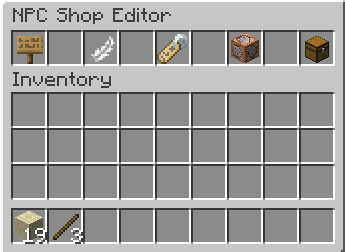</a>

可以设置查看商店所需的权限、商店物品、商店标题、是否右键打开商店，以及商店类型，后文会进一步说明。

例如，点击编辑商店按钮后，会看到以下界面。在铁砧菜单中编辑商店标题，再点击纸即可修改标题！

<a href="https://wiki.citizensnpcs.co/File:Edit_Shop_Screen.png">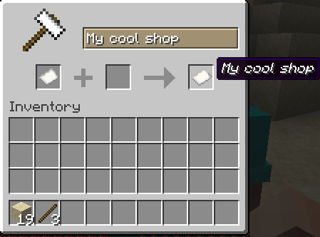</a>

<h2 id="Getting_Started">编辑页面</h2>

点击羽毛图标，开始编辑商店的各个页面。

在此界面中，将物品拖入页面槽位，就能将其放入商店。

<a href="https://wiki.citizensnpcs.co/File:Edit_Shop_Items.png">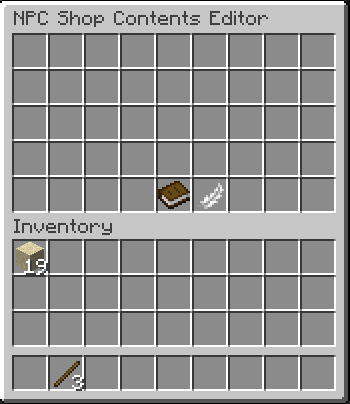</a>

这就是商店中展示的物品。使用 Shift 点击还可以编辑下一页槽位。

<h2 id="Editing_pages">编辑物品</h2>

进入物品编辑界面后，可以设置左上角的<strong>费用</strong>和右上角的<strong>交易结果</strong>。必须设置结果物品，否则该物品只会在商店中用于展示。

<a href="https://wiki.citizensnpcs.co/File:Edit_Item_Screen.png">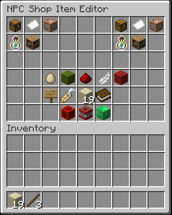</a>

底部按钮可以编辑购买消息、点击确认、最大购买次数等设置。
请注意：编辑完成后，必须点击绿色的绿宝石块保存该物品。

接下来设置费用和交易结果。原文示例使用沙子，设置用 1 个沙子兑换 3 根木棍的交易。

先点击左上角用于设置物品费用的箱子按钮。

<a href="https://wiki.citizensnpcs.co/File:Item_Cost_.png">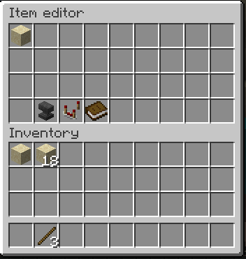</a>

将物品拖到上方界面的任意位置，即可将其设为费用。对交易结果也执行同样操作，放入 3 根木棍。将鼠标移到图标上，可以预览费用和交易结果。

<a href="https://wiki.citizensnpcs.co/File:Item_Result_preview.png">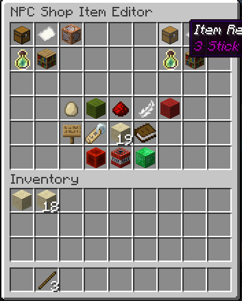</a>
<a href="https://wiki.citizensnpcs.co/File:Item_Display_Preview.png">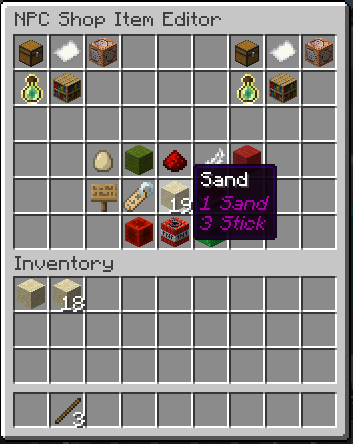</a>

示例还通过以下选项，将商店设置为右键打开。

<a href="https://wiki.citizensnpcs.co/File:Shop_Show_on_right_click.png">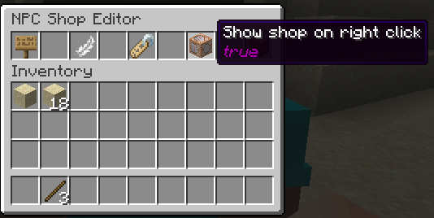</a>

最终商店如下，现在可以兑换木棍了。

<a href="https://wiki.citizensnpcs.co/File:Shop_Result_1.png">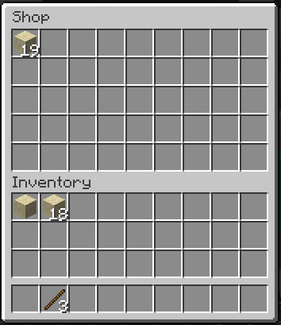</a>
<a href="https://wiki.citizensnpcs.co/File:Shop_Result_2.png">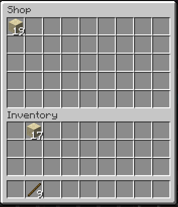</a>

<h2 id="Editing_items">更改商店类型</h2>

可以在商店设置中更改商店类型。目前可以调整商店显示的箱子行数，也可以改为使用村民交易 GUI 的商店。

继续使用上面的示例，先将商店类型设为村民交易商店：

<a href="https://wiki.citizensnpcs.co/File:Shop_type_set.png">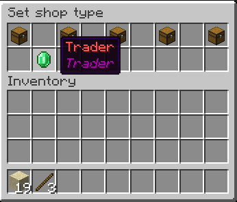</a>

最终效果如下：

<a href="https://wiki.citizensnpcs.co/File:Trader_shop.png">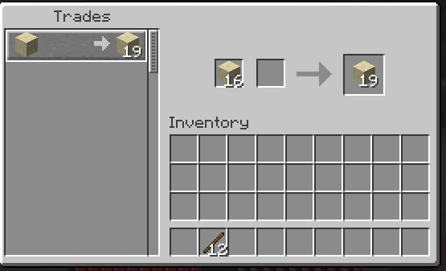</a>

请注意，交易界面中的结果显示为展示物品，而不是实际作为交易结果的木棍。

<h2 id="Changing_the_shop_type">进阶内容</h2>

可以在展示物品的描述中使用 Citizens 的 &lt;cost&gt; 和 &lt;result&gt; 占位符，自动显示费用和交易结果。

<h3 id="Advanced_topics">组件比较过滤器</h3>

默认情况下，Citizens 要求用于支付费用的物品除数量外<strong>完全相同</strong>，包括 NBT 和组件标签。可以添加组件比较过滤器来更改比较方式。例如，'enchantments' 过滤器只检查两个物品的附魔是否相同，忽略其他不同的组件。手持物品时执行 /npc debug -i，可以输出该物品的组件列表。

<h3 id="Component_Comparison_Filter">条件费用与结果</h3>

此功能支持通过占位符等内容设置动态费用。相关文档见<a href="behaviors.md" title="Behaviors">行为</a>，具体内容可能调整。

例如，可以使用 <code>papi('player_leaderboard_placeholder') &lt; 5</code>。

<h3 id="Condition_cost_/_result">补充说明请求</h3>

如需了解某项商店功能的更多信息，可以在 Discord 提问。

