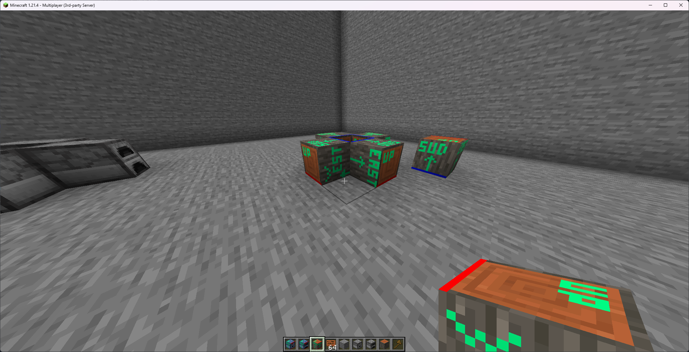
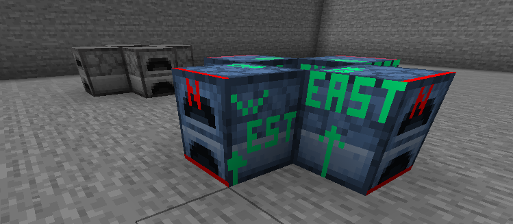
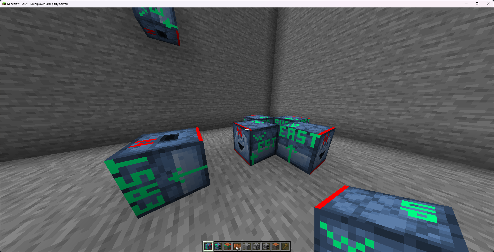

# 方向性方块

**需要 ItemsAdder 4.0.10 或更高版本**

### 警告

每种方向性方块会占用 4 或 6 个方块槽位。\
这是因为每个方向都算作不同的方块。

这是游戏本身的限制，无法绕过；其他内容制作插件也同样受到此限制。\
不要过量使用方向性方块，否则会很快耗尽自定义方块可用数量。

`FURNACE` 和 `DROPPER` 不会具备原版机械的功能。这些名称只是为了方便理解方块的旋转方式。

### 方向模式

### `ALL` 模式

同时采用原版原木和投掷器的朝向方式。



```yaml
  directional_block_all:
    name: directional_block_all
    resource:
      material: PAPER
      generate: true
      textures:
      - block/furnace/directional_block_test_down.png
      - block/furnace/directional_block_test_east.png
      - block/furnace/directional_block_test_north.png
      - block/furnace/directional_block_test_south.png
      - block/furnace/directional_block_test_up.png
      - block/furnace/directional_block_test_west.png
    behaviours:
      block:
        placed_model:
          type: REAL_NOTE
          directional_mode: ALL
```

### `FURNACE` 模式

采用原版熔炉的朝向方式。



```yaml
  directional_block_furnace:
    name: directional_block_furnace
    resource:
      material: PAPER
      generate: true
      textures:
      - block/furnace/directional_block_test_down.png
      - block/furnace/directional_block_test_east.png
      - block/furnace/directional_block_test_north.png
      - block/furnace/directional_block_test_south.png
      - block/furnace/directional_block_test_up.png
      - block/furnace/directional_block_test_west.png
    behaviours:
      block:
        placed_model:
          type: REAL_NOTE
          directional_mode: FURNACE
```

### `LOG` 模式

采用原版原木的朝向方式。


```yaml
  directional_block_log:
    name: directional_block_log
    resource:
      material: PAPER
      generate: true
      textures:
      - block/log/directional_block_test_down.png
      - block/log/directional_block_test_east.png
      - block/log/directional_block_test_north.png
      - block/log/directional_block_test_south.png
      - block/log/directional_block_test_up.png
      - block/log/directional_block_test_west.png
    behaviours:
      block:
        placed_model:
          type: REAL_NOTE
          directional_mode: LOG
```

### `DROPPER` 模式

采用原版投掷器的朝向方式。



本例覆盖自动生成的方向性方块 `up` 和 `down`，以自定义这两种情况下的外观，为 `north` 面（正面）设置不同纹理。\
截图中可以看到正面纹理有所不同。

```yaml
  directional_block_dropper:
    name: directional_block_dropper
    resource:
      material: PAPER
      generate: true
      textures:
      - block/dropper/directional_block_test_down.png
      - block/dropper/directional_block_test_east.png
      - block/dropper/directional_block_test_north.png
      - block/dropper/directional_block_test_south.png
      - block/dropper/directional_block_test_up.png
      - block/dropper/directional_block_test_west.png
    behaviours:
      block:
        placed_model:
          type: REAL_NOTE
          directional_mode: DROPPER
  directional_block_dropper_up:
    name: directional_block_dropper_up
    resource:
      material: PAPER
      generate: true
      textures:
      - block/dropper/directional_block_test_down.png
      - block/dropper/directional_block_test_east.png
      - block/dropper/directional_block_test_north_variant.png
      - block/dropper/directional_block_test_south.png
      - block/dropper/directional_block_test_up.png
      - block/dropper/directional_block_test_west.png
    behaviours:
      block:
        placed_model:
          type: REAL_NOTE
  directional_block_dropper_down:
    name: directional_block_dropper_down
    resource:
      material: PAPER
      generate: true
      textures:
      - block/dropper/directional_block_test_down.png
      - block/dropper/directional_block_test_east.png
      - block/dropper/directional_block_test_north_variant.png
      - block/dropper/directional_block_test_south.png
      - block/dropper/directional_block_test_up.png
      - block/dropper/directional_block_test_west.png
    behaviours:
      block:
        placed_model:
          type: REAL_NOTE
```

## 手动创建模型

ItemsAdder 会自动旋转基础方块模型；也可以为每个旋转方向提供自定义模型变体，以进一步调整外观。

本例为 `DROPPER` 在 `down` 或 `up` 方向放置时自定义模型。

在自定义方块 ID 后追加 `_<face>` 即可。

可用的面如下：

* `north`
* `east`
* `south`
* `west`
* `up`
* `down`

本例为方块 `directional_block_dropper` 使用 `directional_block_dropper_up`（`_up`）和 `directional_block_dropper_down`（`_down`）。
