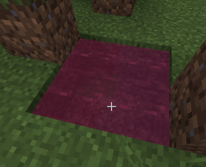

# 液体

有关此功能的限制，请参阅[常见问题](../../faq/liquids-issues.md)。

创建自定义液体时，需要将配置添加到新的 `.yml` 文件中。\
本例在新的 `my_liquids` 命名空间中创建名为 `red_water` 的液体。

```yaml
info:
  namespace: my_liquids
liquids:
  red_water:
    color: RED
```

需要创建自定义桶来放置液体。\
本例创建了 `red_water_bucket`。

```yaml
  red_water_bucket:
    display_name: display-name-red_water_bucket
    permission: red_water_bucket
    resource:
      material: POTION
      generate: true
      texture: "item/red_water_bucket"
    behaviours:
      liquid_bucket:
        name: "my_liquids:red_water"
```

执行 `/iazip` 重新生成资源包。

使用桶放置自定义水。

<div><figure><figcaption></figcaption></figure></div>

### 功能

目前液体仅能用作装饰，没有其他功能。\
以后可能会加入一些自定义功能。
