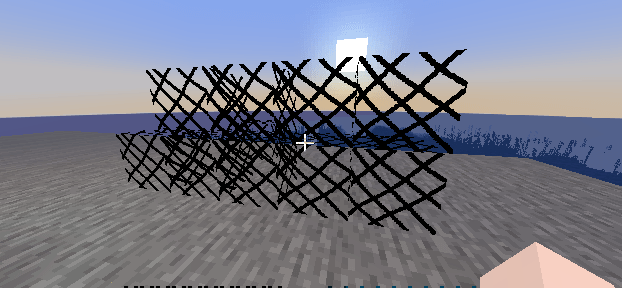

# 透明方块

<div><figure><figcaption></figcaption></figure></div>

要创建一个透明方块，你需要使用 `REAL_TRANSPARENT` 方块模型类型。

```yaml
info:
  namespace: test_transparent
items:
  test_block_transparent:
    enabled: true
    display_name: test_block_transparent
    resource:
      generate: true
      textures:
        - test
      material: PAPER
    behaviours:
      block:
        placed_model:
          type: REAL_TRANSPARENT
        cancel_drop: false
```

