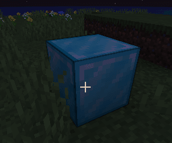
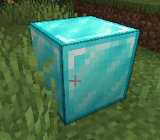

# 切换方块的开关状态

可以通过交互切换方块的开关状态。

先创建方块模板，作为生成开启和关闭两种状态方块的基础。

本例使用 Minecraft 内置模型，避免仅为此示例创建新模型。

```yaml
info:
  namespace: test
items:
  my_light_block_template:
    name: Test Change State Block Interact
    template: true
    resource:
      generate: false
      model_path: minecraft:block/diamond_block
      material: PAPER
    behaviours:
      block:
        placed_model:
          type: REAL_NOTE
        cancel_drop: false
```

然后创建关闭状态的方块。它监听交互事件，并在交互时将自身替换为接下来创建的开启状态方块。

```yaml
  my_light_block_off:
    variant_of: my_light_block_template
    events:
      placed_block:
        interact:
          replace_block:
            from: my_light_block_off
            to: my_light_block_on
            decrement_durability: 0
```

<figure><figcaption></figcaption></figure>

接着创建开启状态的方块。它同样监听交互事件，并在交互时将自身替换为前面创建的关闭状态方块。

如示例所示，指定 `light_level: 15` 属性即可使其发光。

```yaml
  my_light_block_on:
    variant_of: my_light_block_template
    behaviours:
      block:
        placed_model:
          type: REAL_NOTE
        cancel_drop: false
        light_level: 15
    events:
      placed_block:
        interact:
          replace_block:
            from: my_light_block_on
            to: my_light_block_off
            decrement_durability: 0
```

<figure><figcaption></figcaption></figure>

```yaml
info:
  namespace: test
items:
  my_light_block_off:
    name: Test Change State Block Interact
    resource:
      generate: false
      model_path: minecraft:block/diamond_block
      material: PAPER
    behaviours:
      block:
        placed_model:
          type: REAL_NOTE
        cancel_drop: false
    events:
      placed_block:
        interact:
          replace_block:
            from: my_light_block_off
            to: my_light_block_on
            decrement_durability: 0
  my_light_block_on:
    name: Test Change State Block Interact ON
    resource:
      generate: false
      model_path: minecraft:block/emerald_block
      material: PAPER
    behaviours:
      block:
        placed_model:
          type: REAL_NOTE
        cancel_drop: false
        light_level: 15
    events:
      placed_block:
        interact:
          replace_block:
            from: my_light_block_on
            to: my_light_block_off
            decrement_durability: 0
```
