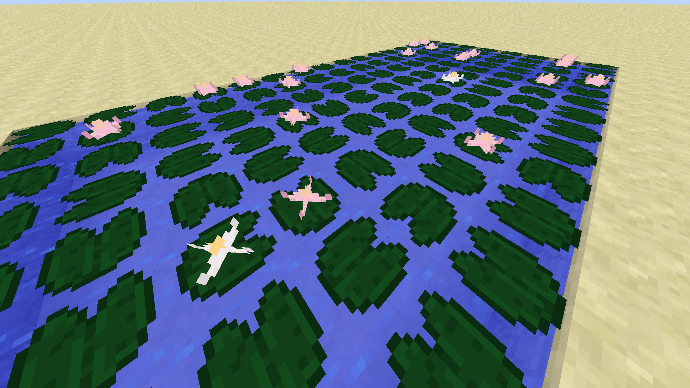

# 变体

此特殊属性可为方块指定自定义变体。\
可用属性与 Minecraft Wiki 的[模型页面](https://minecraft.fandom.com/wiki/Tutorials/Models)所列相同。

游戏会随机为特定方块选择模型变体，可让外观更有变化。

原版的花和**睡莲**就是例子：它们是同一种方块，但旋转方向不同。

<div><figure><figcaption></figcaption></figure></div>

例如：

```yaml
behaviours:
  block:
    custom_variants:
      variant1:
        model: "minecraft:block/end_stone_bricks"
        y: 90
      variant2:
        model: "minecraft:block/end_stone_bricks"
        y: 180
        x: 90
      variant3:
        model: "minecraft:block/diamond_block"
        uvlock: true
        weight: 1
      variant4:
        model: "minecraft:block/cobblestone"
```

## 属性

#### `weight`

设置游戏使用此模型的概率，默认为 1（=100%）。同一变体使用多个模型时，概率等于单个模型的权重除以全部模型的权重之和。例如，三个模型的权重为 1、1、2，总权重为 4（1+1+2）；再将每项权重除以 4，得到 1/4、1/4、2/4，即 25%、25%、50%。

#### `x`

模型沿 x 轴旋转，以 90 度为增量。

#### `y`

模型沿 y 轴旋转，以 90 度为增量。

#### `uvlock`

可设为 `true` 或 `false`（默认）。设为 `true` 时锁定方块纹理的旋转，使纹理不会随上面的 x、y 设置一起旋转。
