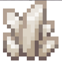
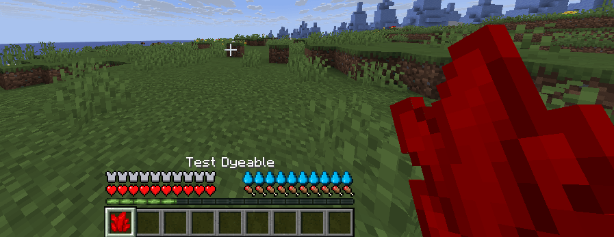

# 染色物品

需要 ItemsAdder 4.0.13，且 Minecraft 客户端和服务端均为 1.21.4+。

创建染色物品时，需要使用基础纹理，例如石英纹理 `minecraft:item/quartz`。\
可以使用任意纹理。本例使用石英纹理，因为它是白色的，而且游戏文件中已经包含。

<figure><figcaption></figcaption></figure>

然后在 `graphics` 属性中指定 `color`。本例使用 `RED`。

支持以下格式：

* `RED`（Bukkit `Color` 枚举）
* `#FFFFF`（十六进制；`#` 可省略）
* `13083194`（十进制）
* `255, 255, 255`（RGB）

```yaml
info:
  namespace: test
items:
  test_dyeable:
    name: Test Dyeable
    graphics:
      texture: minecraft:item/quartz
      color: RED
      hand_animation_on_swap: true
```

<div><figure><figcaption></figcaption></figure></div>

### 在游戏中更改颜色

可用命令 `/iacolor <color>` 更改颜色。

### 模板与变体

可以为基础物品创建变体，得到外观相同但颜色不同的多种物品。

将基础物品标记为 `template: true`，然后在其他物品中用 `variant_of: xxx` 引用它。

#### 示例

```yaml
  test_dyeable_template:
    name: Test Dyeable
    template: true
    graphics:
      texture: minecraft:item/quartz
      color: RED
      hand_animation_on_swap: true
  test_dyeable2:
    name: Test Dyeable 2
    variant_of: test_dyeable_template
    graphics:
      color: BLUE
  test_dyeable3:
    name: Test Dyeable 3
    variant_of: test_dyeable_template
    graphics:
      color: "#326da8"
  test_dyeable4:
    name: Test Dyeable 4
    variant_of: test_dyeable_template
    graphics:
      color: 255,0,0
```
