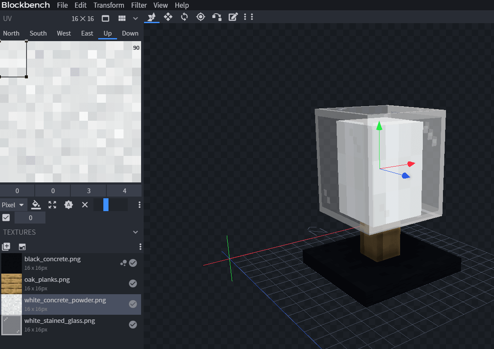
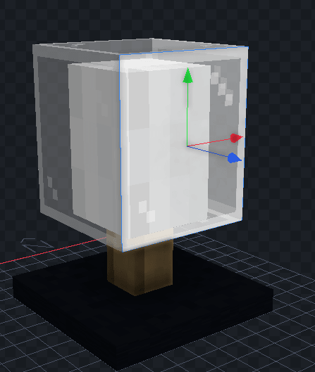
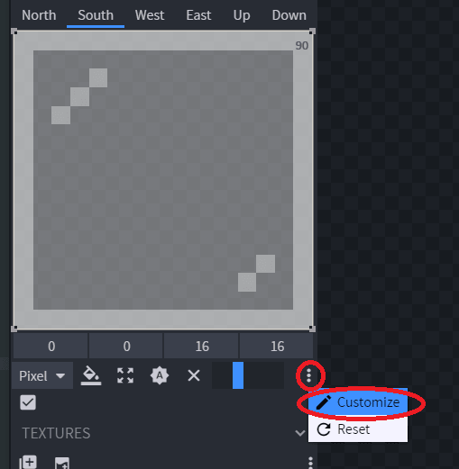
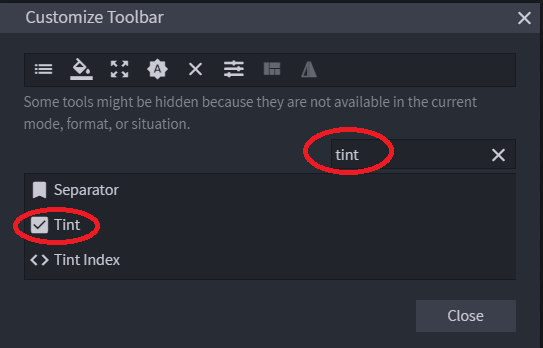
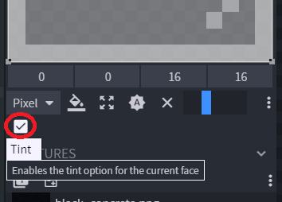
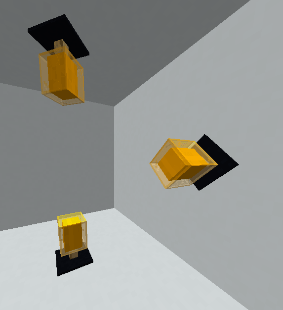

# 彩色模型

**为什么这样做？**

制作染色部件或载具时，无需为每种颜色分别制作模型。

例如自定义染色家具。

## 我该怎么做？

### 1. 用 Blockbench 打开你的模型



### 2. 选择你想要上色的面



### 3. 使用白色/灰色纹理，以便更好地上色

### 4. 启用隐藏的“Tint”功能





### 5. 为每个你想要上色的面启用上色功能



### 6. 在你的 .yml 文件中设置特定的颜色属性。

<details>

<summary>点击查看旧方法</summary>

本例使用 `leather_horse_armor`，也可以使用 `potion`。

```yaml
  orange_modern_lamp:
    display_name: "Orange Modern Lamp"
    specific_properties:
      leather_horse_armor:
        color: ORANGE
    resource:
      material: LEATHER_HORSE_ARMOR
      generate: false
      model_path: item/template_modern_lamp
```

**获取颜色**

* 使用[此工具](https://www.mathsisfun.com/hexadecimal-decimal-colors.html)获取**十进制**颜色
* 从此列表获取颜色
  * `WHITE`
  * `SILVER`
  * `GRAY`
  * `BLACK`
  * `RED`
  * `MAROON`
  * `YELLOW`
  * `OLIVE`
  * `LIME`
  * `GREEN`
  * `AQUA`
  * `TEAL`
  * `BLUE`
  * `NAVY`
  * `FUCHSIA`
  * `PURPLE`
  * `ORANGE`

</details>

<details>

<summary>点击查看新方法（1.21.4+）</summary>

需要 ItemsAdder 4.0.13，且 Minecraft 客户端和服务端均为 1.21.4+。

```yaml
  orange_modern_lamp:
    name: Orange Modern Lamp
    graphics:
      color: ORANGE
      model: item/template_modern_lamp
```

详情见[新版染色教程](colored-items.md)。

</details>

### 7. 现在可以创建任意数量的模型，只需更改颜色，游戏就会自动为其染色


