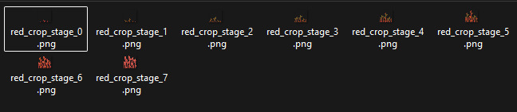
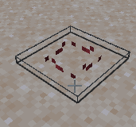
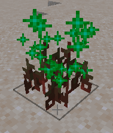
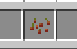
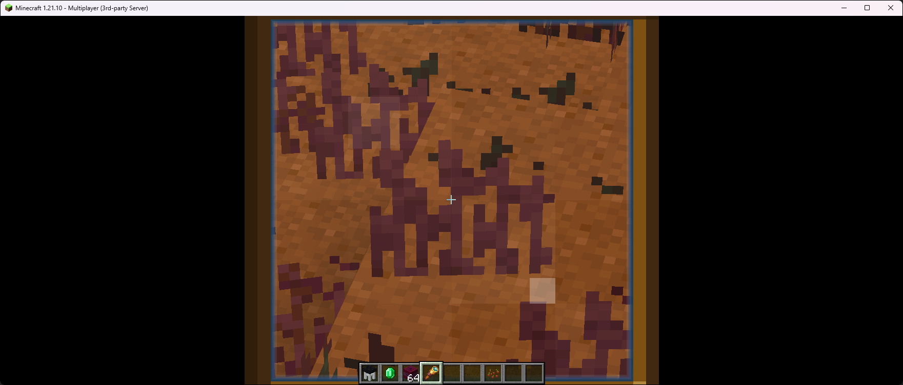

# 作物

## 作物

此功能需要 ItemsAdder 4.0.15+ 和 Minecraft 1.21.4+（客户端与服务端均须满足）。

**性能**

Minecraft 1.21.10 客户端修复了自定义实体的性能问题，因此建议使用该版本；不过此功能在 1.21.4+ 上也可正常工作。

**此页面仍在编写中……**

### 种子

为作物创建新的 `yml` 文件。

这是一个简单的种子物品。

```yaml
info:
  namespace: my_crops
items:
  red_crop_seed:
    name: Crop Seed
    graphics:
      texture: item/red_crop_seed
```

将纹理放入 `ItemsAdder/contents/my_crops/textures/item/red_crop_seed.png`。

### 模型

ItemsAdder 可以自动生成模型。本例使用原版作物模型作为基础，并替换为自定义纹理。

```yaml
crops:
  red_crop:
    models_by_textures:
      parent: minecraft:block/crop
      textures_prefix: block/red_crop_stage_
      model_texture_key: crop
    max_age: 7
    seed: red_crop_seed
```

将 `seed` 设为种子物品 ID（`red_crop_seed`）。

将 `parent` 设为 `minecraft:block/crop`，以此作为基础模型。

将 `textures_prefix` 设为 `block/red_crop_stage_`，查找所有以该文字开头的纹理，再根据 `max_age`（`7`）自动获取。

`model_texture_key` 用于替换 JSON 模型中的纹理键，本例为 `crop`。

<details>

<summary>有关 <code>model_texture_key</code> 的更多信息</summary>

下图是原始父模型预览，其中的 `#crop` 会被 `model_texture_key` 替换。

<p class="code-title"><code>minecraft:block/crop</code></p>

```jsonc
{
  "ambientocclusion": false,
  "textures": {
    "particle": "#crop"
  }
  // ... remaining model properties ...
}
```


</details>

将所有纹理放入 `ItemsAdder/contents/my_crops/textures/block/`。

<figure><figcaption></figcaption></figure>

### 设置

使用 `hitbox_auto_height_step` 属性，可以根据作物年龄自动增大碰撞箱。

`hitbox_auto_height_step`：默认值为 `0`。

这会让作物碰撞箱与模型按比例一起增大。

```yaml
crops:
  red_crop:
    models_by_textures:
      parent: minecraft:block/crop
      textures_prefix: block/red_crop_stage_
      model_texture_key: crop
    max_age: 7
    hitbox_auto_height_step: 0.1
```

也可以指定初始碰撞箱尺寸。

* `width` 的默认值为 `1.0`
* `length` 的默认值为 `1.0`
* `height` 的默认值为 `1.0`

```yaml
    default_hitbox:
      width: 1.0
      length: 1.0
      height: 0.1
```

还可以进一步按作物年龄分别设置碰撞箱尺寸。\
所有选项均为可选，可以只覆盖其中一项，也可以全部覆盖。

```yaml
  hitboxes:
    0:
      height: 0.5
      width: 0.5
      length: 0.1
    1:
      height: 0.8
      width: 0.8
      length: 0.2
```

### 生长设置

#### `avg_seconds_per_stage`

默认使用 `config.yml` 中设置的值。\
植物在最佳条件下长大一个阶段的平均时间，单位为秒。\
用于计算每次检查时的生长概率（p = checkInterval / avgSecondsPerStage）。\
值越小，作物生长越快；值越大，生长越慢。

#### `min_light`

作物能够生长时，其上方所需的最低亮度。

#### 声音

声音设置。

* `place_sound`
* `break_sound`
* `interact_sound`

#### `multipliers`

用于决定特定条件下作物生长的快慢。

* `bonemeal`：使用骨粉交互时
* `max_moisture`：湿润度达到最高等级（`7`）时生效。值为 `0.5` 时，植物在最高湿润度下的生长速度为 2x。
* `rain`：下雨时
* `thunderstorm`：雷暴时
* `snow`：下雪时

```yaml
crops:
  red_crop:
    models_by_textures:
      parent: minecraft:block/crop
      textures_prefix: block/red_crop_stage_
      model_texture_key: crop
    max_age: 7
    hitbox_auto_height_step: 0.1
    avg_seconds_per_stage: 240
    min_light: 9
    place_sound: minecraft:item.crop.plant
    break_sound: minecraft:block.crop.break
    multipliers:
      bonemeal: 0.2
      max_moisture: 0.5
      rain: 0.7
      thunderstorm: -0.5
      snow: -0.7
```

### 战利品

#### `drop_seed_if_immature`

（默认：`true`）玩家破坏尚未达到最高生长阶段、且未掉落任何物品的作物时，掉落 `1` 作物种子，以避免重复掉落。

#### `loots`

在此属性中列出该作物的所有战利品。

#### `trigger`

默认：`BREAK`。

* `BREAK`：正常破坏方块
* `INTERACT`：玩家点击或使用作物
* `TRAMPLE`：被踩踏
* `WATER`：被流动的水移除
* `LAVA`：被熔岩移除
* `FARMLAND_DRY`：土壤失去湿润度并变成泥土

#### `triggers`

可替代 trigger，用于设置多个触发条件。

### 示例

```yaml
crops:
  red_crop:
    # ..... previous properties
    loots:
      red_crop_1:
        triggers:
         - INTERACT
         - BREAK
```

#### `decrease_age`

让作物降低生长阶段，而不是直接被破坏。

#### `age`

满足此战利品条件的作物年龄。

#### `age_range`

可替代 `age`，进一步自定义战利品掉落时的作物年龄范围。

```yaml
crops:
  red_crop:
    # ..... previous properties
    loots:
      red_crop_1:
        ## ... other properties
        age_range:
          min: 1
          max: 3
```

#### `biomes`

允许掉落该战利品的生物群系列表。

#### `worlds`

允许掉落该战利品的世界列表。

#### `tools`

可触发该战利品的工具列表。\
支持通配符 `*`；使用 `hand` 可允许空手触发战利品。

默认使用 `hand`。

#### `stop_on_first_success`

某项战利品满足条件并掉落后，停止其他战利品继续掉落。

#### `commands`

需要触发的命令列表。

每条命令具有以下属性：

* `command`：要执行的命令
* `as_console`（默认：`true`）：是否以控制台身份执行
* `silent`（默认：`false`）：静默执行，还是在控制台显示消息

### 示例

```yaml
      red_crop_1:
        trigger: INTERACT
        decrease_age: 3
        age: 2
        commands:
          my_group_1:
            chance: 100
            my_command_1:
              command: tell {player} hello!
```

#### `exp_drop`

掉落一些经验。

<pre class="language-yaml"><code class="lang-yaml"><strong>        exp_drop:
</strong>          min_amount: 1
          max_amount: 1
          chance: 100
</code></pre>

#### `exp_drops`

可替代 `exp_drop`，允许设置多于 `1` 个条目。

### 示例

<pre class="language-yaml"><code class="lang-yaml"><strong>        exp_drops:
</strong>          exp1:
            min_amount: 1
            max_amount: 1
            chance: 100
</code></pre>

#### `item_drop`

掉落物品。

```yaml
        item_drop:
          item: DIAMOND
          min_amount: 1
          max_amount: 1
          chance: 100
          ignore_fortune: false
```

#### `item_drops`

可替代 `item_drop`，用于掉落多于 `1` 件物品。

```yaml
        item_drops:
          change_me:
            item: DIAMOND
            min_amount: 1
            max_amount: 1
            chance: 100
            ignore_fortune: false
```

### `bottom_block`

只允许将此种方块作为作物的有效放置基础，通常设为 `farmland`。

### 完成！

自定义作物已完成。

执行 `/iazip` 生成资源包即可。

<div><figure><figcaption></figcaption></figure> <figure><figcaption></figcaption></figure> <figure><figcaption></figcaption></figure></div>

### 性能优化

<div><figure><figcaption></figcaption></figure></div>

插件使用名为 `billboard` 的方法优化作物渲染。\
billboard 本质上是一个更简单的模型，用于显示远处的作物。

默认情况下，插件已为模型创建 billboard；如果想使用不同模型，可以通过相应属性设置。\
默认的 billboard 模型只是一个平面，许多游戏都使用相同方法。

#### 根据自定义父模型和自定义纹理自动生成 billboard

```yaml
crops:
  red_crop:
    models_by_textures:
      # Let it auto generate the models
      parent: minecraft:block/crop
      textures_prefix: block/red_crop_stage_
      model_texture_key: crop
      billboard_parent: minecraft:block/crop_billboard
      billboard_textures_prefix: block/red_crop_stage_
```

#### 根据自定义模型自动生成 billboard

```yaml
crops:
  red_crop:
    models_by_textures:
      # Let it auto generate the models
      parent: minecraft:block/crop
      textures_prefix: block/red_crop_stage_
      model_texture_key: crop
      billboard_textures_prefix: block/red_crop_stage_
```

### 其他作物模型（`cross`）

```yaml
crops:
  blue_berry_bush:
    models_by_textures:
      parent: minecraft:block/cross
      textures_prefix: block/blue_berry_bush_stage_
      model_texture_key: cross
```

可以使用 `cross` 作为替代模型，类似原版的 `sweet_berries`。

### 自定义作物模型

不要为作物使用过于精细的模型，否则会出现性能问题！

自定义植物使用 2-4 个立方体就已足够。

可以为作物使用自定义模型。

此时应使用 `models_by_items`，而不是 `models_by_textures`。

需要为每个生长阶段以及 billboard 分别创建模型。

<details>

<summary>创建物品</summary>

需要为每个生长阶段以及 billboard 分别创建模型。

```yaml
info:
  namespace: my_crops
items:
  blue_crop_stage_template:
    template: true
    graphics:
      parent: minecraft:block/crop
  blue_crop_stage_0:
    variant_of: blue_crop_stage_template
    graphics:
      textures:
        crop: block/blue_crop_stage_0
  blue_crop_stage_1:
    variant_of: blue_crop_stage_template
    graphics:
      textures:
        crop: block/blue_crop_stage_1
  blue_crop_stage_2:
    variant_of: blue_crop_stage_template
    graphics:
      textures:
        crop: block/blue_crop_stage_2
  blue_crop_stage_3:
    variant_of: blue_crop_stage_template
    graphics:
      textures:
        crop: block/blue_crop_stage_3
  blue_crop_stage_4:
    variant_of: blue_crop_stage_template
    graphics:
      textures:
        crop: block/blue_crop_stage_4
  blue_crop_stage_5:
    variant_of: blue_crop_stage_template
    graphics:
      textures:
        crop: block/blue_crop_stage_5
  blue_crop_stage_6:
    variant_of: blue_crop_stage_template
    graphics:
      textures:
        crop: block/blue_crop_stage_6
  blue_crop_stage_7:
    variant_of: blue_crop_stage_template
    graphics:
      textures:
        crop: block/blue_crop_stage_7

  # Billboard model is used when far from crops, to get higher FPS
  blue_crop_stage_template_billboard:
    template: true
    graphics:
      parent: minecraft:block/crop_billboard
  blue_crop_stage_0_billboard:
    variant_of: blue_crop_stage_template_billboard
    graphics:
      textures:
        crop: block/blue_crop_stage_0
  blue_crop_stage_1_billboard:
    variant_of: blue_crop_stage_template_billboard
    graphics:
      textures:
        crop: block/blue_crop_stage_1
  blue_crop_stage_2_billboard:
    variant_of: blue_crop_stage_template_billboard
    graphics:
      textures:
        crop: block/blue_crop_stage_2
  blue_crop_stage_3_billboard:
    variant_of: blue_crop_stage_template_billboard
    graphics:
      textures:
        crop: block/blue_crop_stage_3
  blue_crop_stage_4_billboard:
    variant_of: blue_crop_stage_template_billboard
    graphics:
      textures:
        crop: block/blue_crop_stage_4
  blue_crop_stage_5_billboard:
    variant_of: blue_crop_stage_template_billboard
    graphics:
      textures:
        crop: block/blue_crop_stage_5
  blue_crop_stage_6_billboard:
    variant_of: blue_crop_stage_template_billboard
    graphics:
      textures:
        crop: block/blue_crop_stage_6
  blue_crop_stage_7_billboard:
    variant_of: blue_crop_stage_template_billboard
    graphics:
      textures:
        crop: block/blue_crop_stage_7
```

</details>

`blue_crop_stage_`：用于查找各生长阶段及 billboard 所用物品的前缀。

```yaml
crops:
  blue_crop:
    models_by_items:
      items_id_prefix: blue_crop_stage_
```

# 作物示例包

指南

## 简单方法

此方法适用于任意 ItemsAdder 版本。

此方法存在限制，无法创建使用自定义模型的作物。\
它是一种向游戏中添加简单作物的轻量方法。

可以选择复用某种原版模型来显示自定义作物，例如 `SWEET_BERRY_BUSH`、`CARROTS` 等。

```yaml
info:
  namespace: iasurvival
items:
  tomato_seeds:
    enabled: true
    display_name: display-name-tomato_seeds
    permission: iasurvival.crops.tomato_seeds
    resource:
      material: WHEAT_SEEDS
      generate: true
      textures:
        - item/crops/tomato_seeds
    specific_properties:
      seed:
        crop_block: SWEET_BERRY_BUSH
        results: 
          result_1: 
            item: iasurvival:tomato
            min_amount: 1
            max_amount: 2
            chance: 100
  garlic_seeds:
    enabled: true
    display_name: display-name-garlic_seeds
    permission: iasurvival.crops.garlic_seeds
    resource:
      material: WHEAT_SEEDS
      generate: true
      textures:
        - item/crops/garlic_seeds
    specific_properties:
      seed:
        crop_block: CARROTS
        results:
          result_1:
            item: iasurvival:garlic
            min_amount: 1
            max_amount: 2
            chance: 100
  chili_pepper_seeds:
    enabled: true
    display_name: display-name-chili_pepper_seeds
    permission: iasurvival.crops.chili_pepper_seeds
    resource:
      material: WHEAT_SEEDS
      generate: true
      textures:
        - item/crops/chili_pepper_seeds
    specific_properties:
      seed:
        crop_block: BEETROOTS
        results:
          result_1:
            item: iasurvival:chili_pepper
            min_amount: 1
            max_amount: 2
            chance: 100
  rice_seeds:
    enabled: true
    display_name: display-name-rice_seeds
    permission: iasurvival.crops.rice_seeds
    resource:
      material: WHEAT_SEEDS
      generate: true
      textures:
        - item/crops/rice_seeds
    specific_properties:
      seed:
        crop_block: WHEAT
        results:
          result_1:
            item: iasurvival:rice
            min_amount: 1
            max_amount: 2
            chance: 100
```
