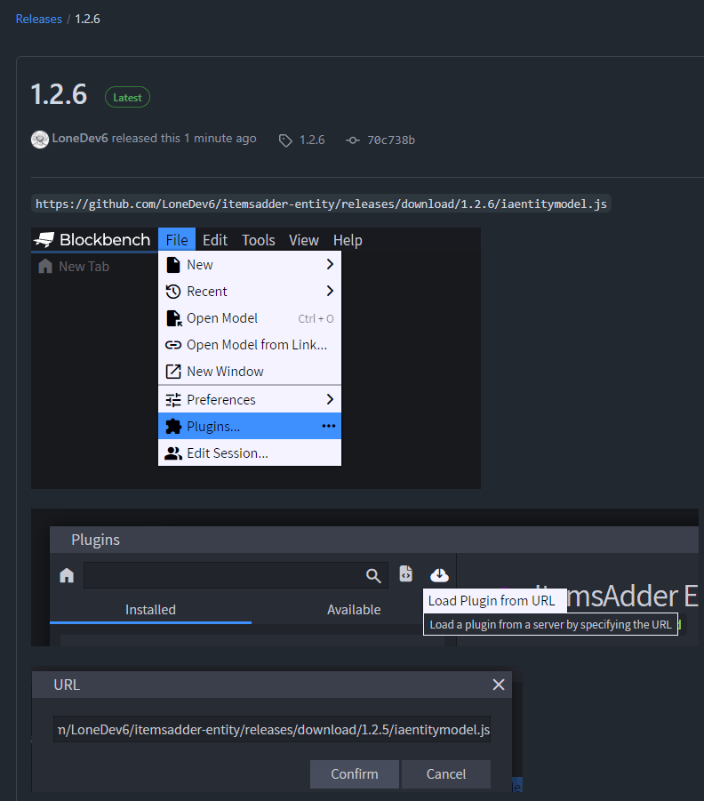

# 介绍

### 主要功能

* 用于转换模型的 [Blockbench](https://www.blockbench.net/) 扩展
* 资源保护
  * 在线分享资源时无需公开 Blockbench 工程文件，因此他人无法编辑资源包后转售
* 完全异步，不会降低 TPS
* 针对大型服务器优化
* 受伤动画
* 实体着火时显示火焰动画
* 为骨骼大小制作动画
* 为骨骼旋转制作动画，不限制角度
* 多个乘坐座位
* 在动画中播放声音和粒子
* 显示实体手持装备
* 自定义碰撞箱
* 平滑移动
* 在事件触发时执行动作
* 兼容 [MythicMobs](entities/mythicmobs.md)
* 兼容 [Citizens](entities/citizens.md)

### 限制

* 目前无法更改 Citizens NPC 的碰撞箱，这是 Citizens 的限制

v3 的限制

* 只有生物头部距离身体中心不太远时，头部骨骼旋转才会生效
* 骑乘飞行生物时，按 SHIFT 下降仅在 1.15、1.17 和 1.18 客户端上生效，因为 1.16 客户端存在此错误：[https://bugs.mojang.com/browse/MC-202202](https://bugs.mojang.com/browse/MC-202202) 。\
  1.16 客户端在骑乘飞行实体时按 SHIFT，会看到玩家像在飞行，而不是继续骑在实体上。
* 此插件使用多个实体创建动画。\
  网络延迟可能造成轻微的动画显示异常。\
  如果玩家周围生成的实体过多，且模型骨骼也过多，可能造成一些服务端卡顿。\
  （注意：插件已经高度优化，只要服务器配置不是过低，通常不会造成卡顿。）

## 安装 Blockbench 扩展

**继续之前：**

* 确认使用 **Blockbench 4.1.5** 或**更高版本**
* 确认使用最新版 ItemsAdder 和最新版 ItemsAdder Blockbench 扩展

[下载 Blockbench](https://www.blockbench.net/)（不要使用网页版）。

下载[官方扩展](https://github.com/LoneDev6/itemsadder-entity/releases)。

<figure><figcaption></figcaption></figure>

高级动画功能

