# 创建实体

## 创建新模型

创建新的 ItemsAdder 实体模型。

<figure>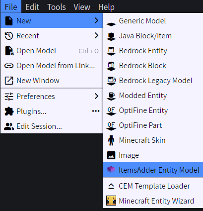<figcaption></figcaption></figure>

将项目类型设为 `Custom Entity`，并指定 `namespace` 和 `id`。

<figure>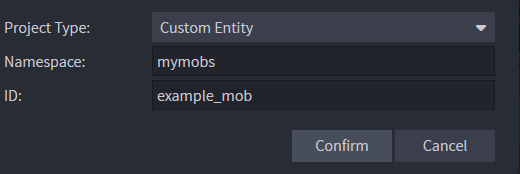<figcaption></figcaption></figure>

立即将工程保存到 **ItemsAdder** 的 `contents` 文件夹内，放在**命名空间**文件夹下（本例为 `mymobs`）。

<figure>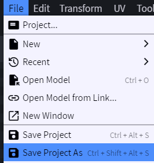<figcaption></figcaption></figure>

<figure>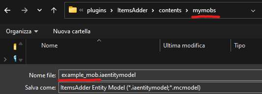<figcaption></figcaption></figure>

开始制作模型！

<figure>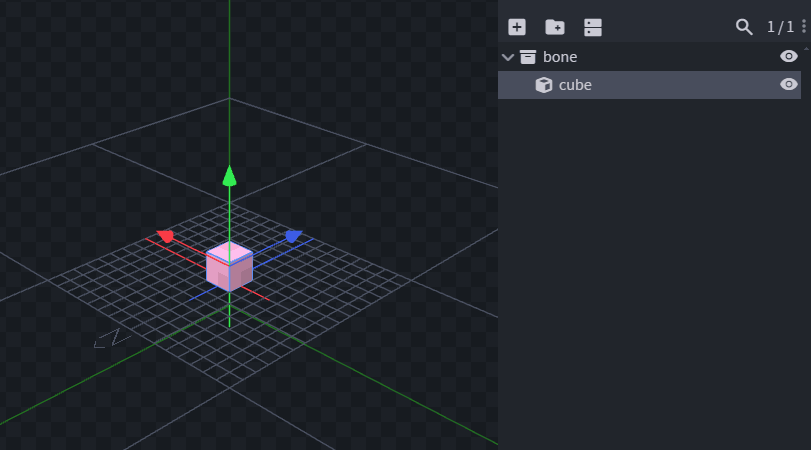<figcaption></figcaption></figure>

创建一些动画。\
可以通过教程学习 Blockbench 动画制作，[YouTube 上有许多教程](https://www.youtube.com/results?search_query=blockbench+animation+tutorial)。

<div><figure>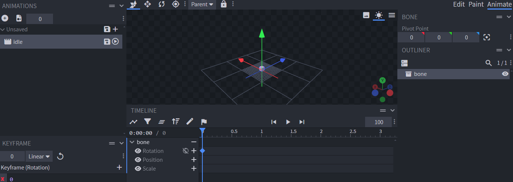<figcaption></figcaption></figure></div>

导出前，确认设置正确。

<figure>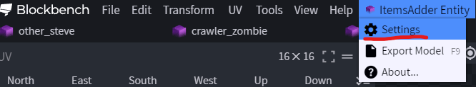<figcaption></figcaption></figure>

<figure>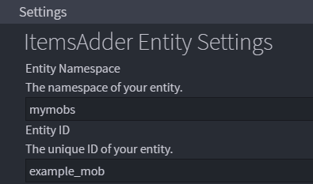<figcaption></figcaption></figure>

导出模型。

<figure>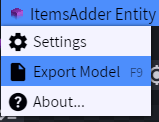<figcaption></figcaption></figure>

## 转换已有模型

使用此工具前，记得为 `.bbmodel` 文件制作<mark style="color:red;">**备份**</mark>！

用 Blockbench 打开 `.bbmodel` 工程，然后点击 File -> Convert Project

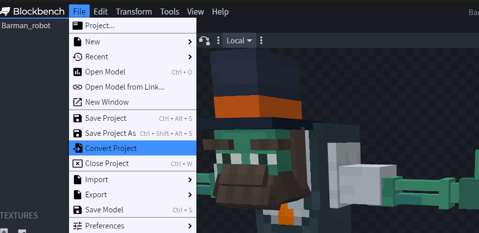

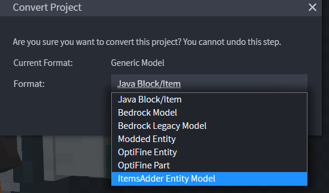

在 **Format** 中选择 **`ItemsAdder Entity Model`**，再点击 **Confirm**。

将转换后的新模型文件保存到新的文件夹中，该文件夹只存放这个文件。

结果类似下图：

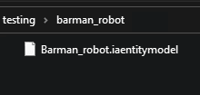

### 保存工程

在 `ItemsAdder/contents/` 中新建命名空间文件夹。例如本例为 `custom`，因此路径是 `ItemsAdder/contents/custom/`。

将工程文件 `.iaentitymodel` 保存到 ItemsAdder 命名空间文件夹中，本例为 `ItemsAdder/contents/custom/`。

### 配置模型 <a id="configuring-the-model"></a>

现在可按需配置模型。ItemsAdder 扩展会自动设置部分选项，但有时仍需调整。\
点击 **ItemsAdder** 标签页，再点击 **Settings**。

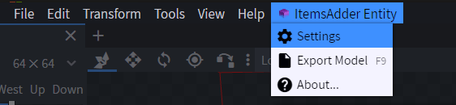

在此为自定义实体选择命名空间。\
默认命名空间为 `custom`，但应自行选择，例如 `my_entities`、`hell_mobs`、`npcs` 等。

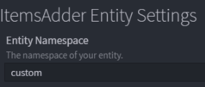

另一项可能需要修改的设置是“**Model Scaling Mode**”：

* Max Model size 支持 7x7x7 格大小的模型，但只允许缩小。
* Max Scaling range 支持缩小及放大到 3.125x，但模型最大尺寸限于 3x3x3 格。

只有为某些骨骼制作了大小变化动画时，才修改“**Max Model Size**”。

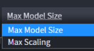

### 导出模型

点击 **ItemsAdder** 标签页，再点击 **Export**。

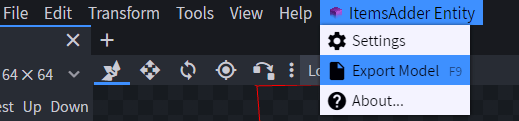

应当看到成功提示。


### 创建游戏内实体配置

扩展会自动创建名为 `custom_entity_NAME.yml` 的文件，仅在首次导出时创建。

如有需要，可以添加更多属性进行自定义。

```yaml
info:
  namespace: custom
entities:
  barman_robot:
    display_name: "Barman Robot"
    type: ZOMBIE
    model_folder: entity/barman_robot
    silent: true
    can_sun_burn: false
    speed:
      movement: 1
      flying: 0
    max_health: 20
      
```

本例的自定义实体使用 ZOMBIE 作为基础实体，提供 AI。\
可按需使用任意有生命的实体作为基础实体。

### 召唤实体

使用召唤命令：`/iaentity summon <entity>`

## 注意事项

不要创建过多骨骼，保持模型简单。这是一款方块像素风格的游戏，应遵循[其风格](https://www.blockbench.net/wiki/guides/minecraft-style-guide/)。
