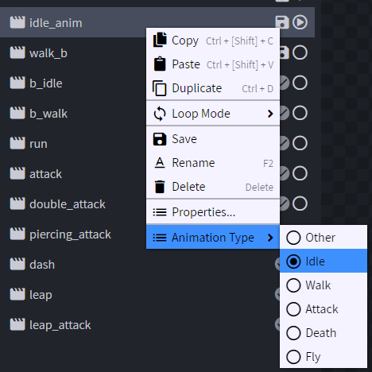

# 动画

## 创建动画

像制作普通 Blockbench 模型动画一样，为模型制作动画即可。\
YouTube 上有许多教程。

## 配置动画类型

需要指定动画类型，ItemsAdder 才能根据实体状态播放动画。\
ItemsAdder Blockbench 扩展在转换时会自动处理，但如果动画名称较为特殊，就可能无法自动识别。

右键点击动画，确认动画类型正确。

有些新功能尚未加入下拉菜单，可以通过更改动画名称来设置这些特殊动画。

将动画重命名为以下名称。

* `idle`
* `idle_angry`
* `walk`
* `walk_angry`
* `jump`（例如史莱姆使用此类型）
* `attack`
* `death`
* `fly`（游泳实体也使用此类型）

## 注意事项

* 此扩展支持骨骼缩放动画。不需要缩放时应避免添加缩放，请检查关键帧。
* 避免添加过多旋转、细节和动作。这是一款方块像素风格的游戏，应遵循[其风格](https://www.blockbench.net/wiki/guides/minecraft-style-guide/)。
