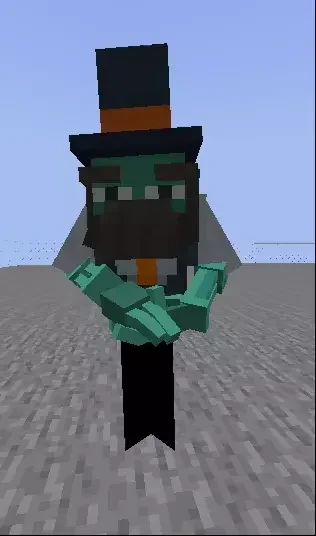
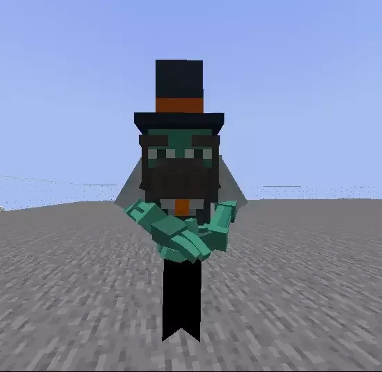

# Citizens

## 为 Citizens NPC 更换外观

可以将自定义模型用作任意 Citizens NPC 的外观。

此插件本身不依赖 Citizens，不过有些服务器需要使用 Citizens 创建 NPC。

### 更换模型

生成新 NPC，或使用已有 NPC（`/npc create test`）。

然后使用 **ItemsAdder** 命令更换外观：\
`/iaentity citizens <id|selected> model <model>`\
本例为：`/iaentity citizens <id|selected> model custom:barman_robot`

### 静音

可使用此命令将 NPC 静音，详情见 [Citizens Wiki](https://wiki.citizensnpcs.co/Commands)。\
`/npc sound -n`

### 让头部转动

可使用此命令让 NPC 看向附近玩家，详情见 [Citizens Wiki](https://wiki.citizensnpcs.co/Commands)。\
`/npc look`

### 完成

## 播放动画

可以使用此命令播放动画：`/iaentity citizens <id|selected> anim play <animation>`

