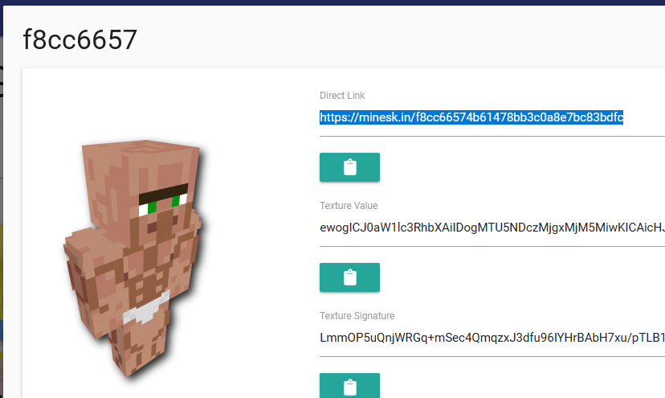

# 自定义玩家动画

## 获取自定义皮肤

可以查看可用皮肤的[列表](https://mineskin.org/gallery)，也可以上传[自己的皮肤](https://mineskin.org/)！

你不需要运行 `/iazip`！这些皮肤在运行时加载，无需下载资源包。

## 生成实体

使用命令 `/iaentity summonplayer <skin>`。

### 示例

`/iaentity summonplayer https://minesk.in/5f1e7ff6409e428bb500cc9315bf7ffb`
