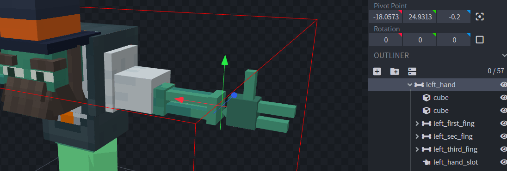
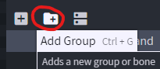
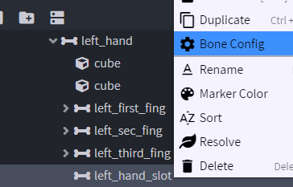
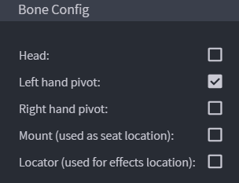
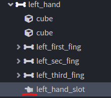
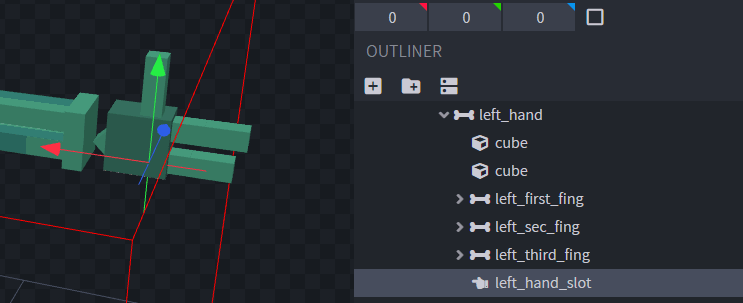

# 手持装备

## 显示自定义实体的手持装备

## 如何配置手部位置

使用 **Blockbench** 打开你的 `.iaentitymodel` 模型文件。

选择实体手部的基础骨骼。

创建一个新的组，该组将成为手部骨骼的子组。

右键点击骨骼并选择“**Bone Config**”，本例中的骨骼是 `left_hand_slot`

勾选 "**Left hand pivot**" 选项并按 "**Confirm**"。

如你所见，手部枢轴骨骼现在有了一个新图标。

按相同步骤设置右手，然后照常导出模型。

[advanced-method.md](advanced-method.md)
