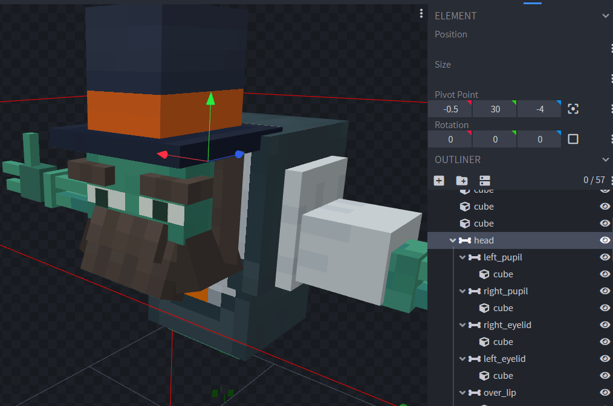
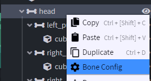
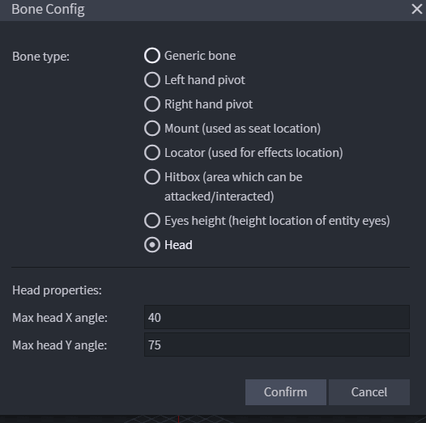
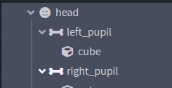

# 头部


你可以指定一个骨骼作为头部，并在基础实体AI旋转头部时自动旋转。

## 设置

### 配置头部骨骼

使用 **Blockbench** 打开你的 `.iaentitymodel` 模型文件。

选择头部的基础骨骼。



右键点击骨骼，选择“**Bone Config**”



勾选“**Head**”选项，再点击“**Confirm**”。\
还可以设置 X、Y 旋转的最大角度。



头部骨骼现已标记为头部，如图所示（笑脸图标表示头部骨骼）。



### 眼睛高度

实体眼睛的高度，用于计算头部朝向。默认：`1.62`。\
导出后，可在实体的 `.yml` 配置文件中设置。

例如：

```yaml
info:
  namespace: vanillaex
entities:
  happy_creeper:
    model_folder: entity/happy_creeper
    type: WOLF
    can_sun_burn: false
    eyes_height: 0.25
```

### 完成

然后照常导出模型。

[advanced-method.md](advanced-method.md)

