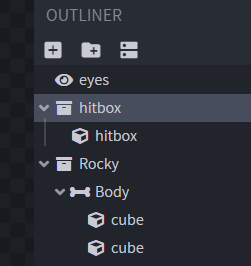
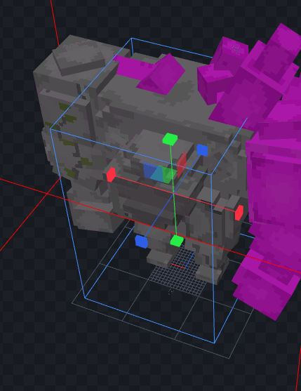
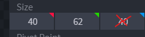
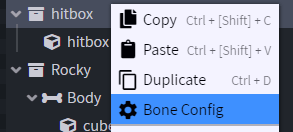
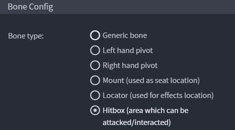

# 碰撞箱

## 设置

### 配置头部骨骼

用 **Blockbench** 打开 `.iaentitymodel` 模型文件。\
新建一个骨骼，名称不限。

调整碰撞箱大小。

* XYZ 位置无关紧要。
* 只有 XY 尺寸重要，Z 尺寸不重要。这是 Minecraft 的限制，是游戏中碰撞箱的工作方式。

右键点击骨骼并选择“**Bone Config**”

勾选“**Hitbox**”选项并按“**Confirm**”。

