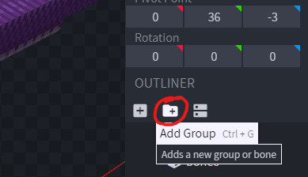
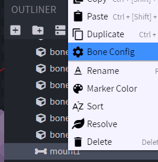
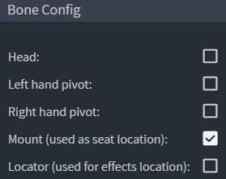
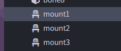
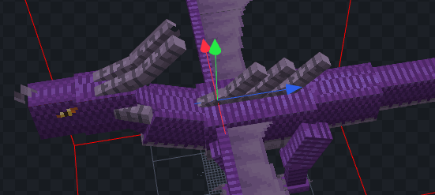
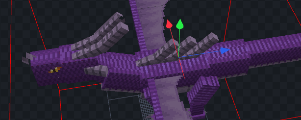
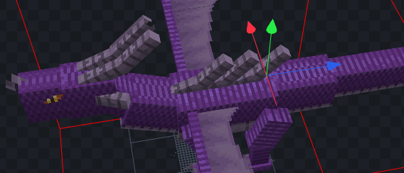

# 骑乘

## 示例

## 设置乘坐位置

使用 **Blockbench** 打开你的 `.iaentitymodel` 模型文件。

新建骨骼。

右键点击骨骼，选择“**Bone Config**”

勾选“**Mount**”选项，再点击“**Confirm**”。

为需要创建的每个座位重复此操作。

然后照常导出模型。

[advanced-method.md](advanced-method.md)

## 如何骑乘

只需右键点击实体并驾驶它。

只有第一个坐上实体的玩家可以控制它。
