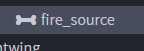
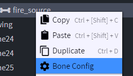
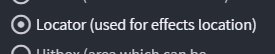
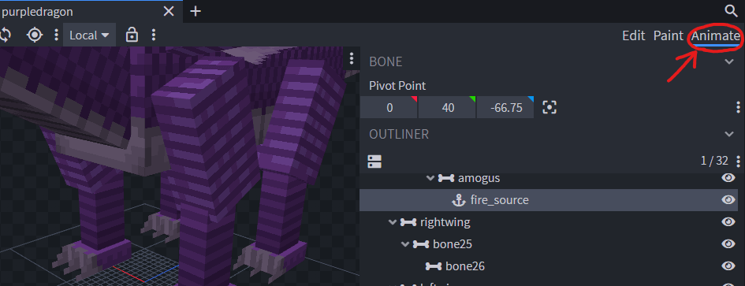
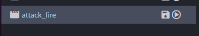
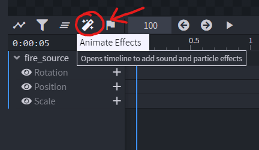
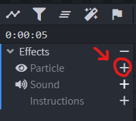
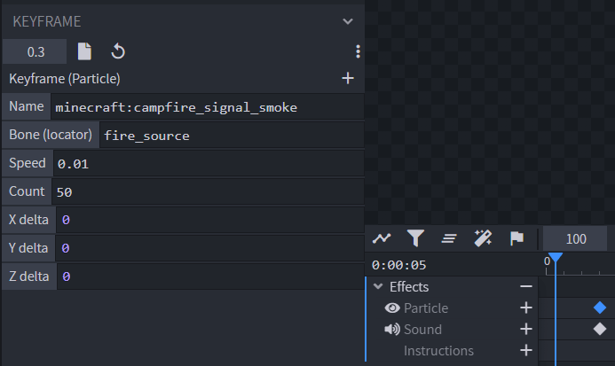

# 粒子

## 设置

### 配置用于指定粒子位置的特殊骨骼

用 **Blockbench** 打开 `.iaentitymodel` 模型文件。\
新建一个骨骼，名称不限。

右键点击骨骼，选择“**Bone Config**”

勾选“**Locator**”选项，再点击“**Confirm**”。

切换到“**Animate**”视图。

选择一个动画。

选择魔杖图标“**Animate Effects**”

点击“**Particle**”效果类型旁的 **+** 图标，创建粒子关键帧。

在“**Keyframe**”面板中编辑数值。

* Name：粒子名称，使用 Minecraft 游戏内粒子名称。
* Bone (locator)：本教程第一部分创建的骨骼名称，作为粒子的位置。
* Speed：粒子发射速度。
* Count：发射的粒子数量。
* XYZ delta：指定粒子效果在各轴方向的范围，单位为方块，以 **x y z** 为中心。各坐标表示粒子距离中心的生成范围，可以使用小数。 

## 完成

