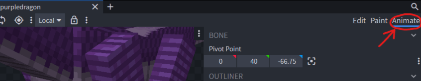
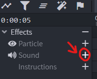
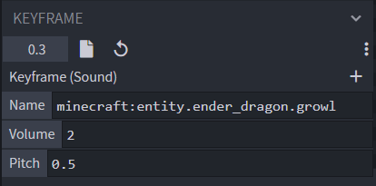

# 声音

## 播放声音

切换到“**Animate**”视图。

选择一个动画。

选择魔杖图标“**Animate Effects**”

点击“**Sound**”效果类型旁的 **+** 图标，创建粒子关键帧。

在“**Keyframe**”面板中编辑数值。

* Name：声音名称，使用 Minecraft 游戏内声音名称，也可以使用资源包中的自定义声音。
* Volume：声音音量。
* Pitch：声音音高。 

## 完成

