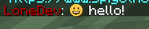
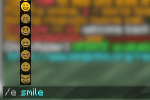
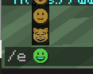
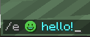
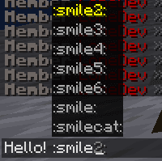
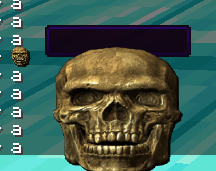
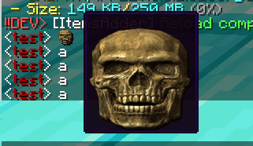
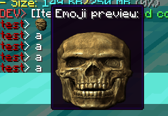

# 表情

### 文件夹设置

创建文件夹 `contents/myemojis/textures/font/emoji/`

### 图片

将表情图片放入此文件夹。建议使用 `72x72`，以免图片过大或出现明显像素感。

尺寸可自行选择，但高度和宽度不要超过 `256`。

本例放入一张名为 `contents/myemojis/textures/font/emoji/smile.png` 的图片。

### 配置

创建配置文件，例如 `contents/myemojis/myconfig.yml`（文件名可自行决定）

```yaml
info:
  namespace: "myemojis"
```

将表情添加到 `font_images` 列表中（本例创建 **`smile`** 表情），文件内容如下：

```yaml
info:
  namespace: "myemojis"
font_images:
  smile:
    permission: 0
    show_in_gui: true
    path: "font/emoji/smile.png"
    scale_ratio: 9
    y_position: 8
```

**`scale_ratio`** 是表情符号的最终高度（以像素为单位），因为 72x72 像素太大了，你需要缩放它，但你可以设置为 9，这样 Minecraft 会自动处理它。\
&#xNAN;**`y_position`** 是以像素为单位的 y 位置。表情尺寸为 72x72、`scale_ratio` 为 9 时，8 通常合适。尺寸不同时，需要通过测试调整 y_position。

`scale_ratio` 必须始终大于 `y_position`。\
这是 **Minecraft** 本身的限制，插件侧无从修复。

## 游戏内视图



### 使用 /e 的补全提示

在聊天中输入 `/e`，按 **空格** 并按 **TAB** 开始自动补全。







### 在聊天中使用 TAB 自动补全

在聊天中输入 `:` 并按 **TAB** 开始自动补全。

<figure><figcaption></figcaption></figure>

### 下载示例：


## 悬停时显示大图预览

为大表情创建新的字体图片（可以使用相同的 `.png` 图片），并为 `scale_ratio` 设置较大的值，通常 64 合适。

```yaml
info:
  namespace: myemojis
font_images:
  test_hover_new_big:
    path: font/test_hover_new.png
    suggest_in_command: false
    show_in_gui: false
    scale_ratio: 64
```

编辑小表情，添加 `chat` 的 `hover` 属性，并指定自定义 `override_text`。\
`override_text` 用于在悬停描述中显示大表情。

```yaml
info:
  namespace: myemojis
font_images:
  test_hover_new:
    path: font/test_hover_new.png
    chat:
      hover:
        enabled: true
        override_text: ":test_hover_new_big:\n\n\n\n\n\n"
    suggest_in_command: true
    show_in_gui: true
    scale_ratio: 9
    y_position: 8
```

注意：`\n` 部分必须与大表情的图像高度相符，否则提示框会过矮。



<figure><figcaption></figcaption></figure>

### 添加标题

可以添加标题：输入文本，并用 `\n` 字符换行。

`override_text: "Emoji preview:\n:test_hover_new_big:\n\n\n\n\n\n"`

<figure><figcaption></figcaption></figure>
