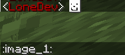
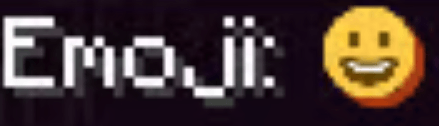

# 字体图片

字体图片是使用自定义纹理的自定义字符。\
可以用字体图片制作表情、称号、GUI 等。

#### 创建通用字体图片

本例的命名空间为 `my_content`（也可以自行选择）。

* 创建 `.png` 文件 `contents/my_content/textures/font/image_1.png`。
* 创建 `.yml` 文件 `contents/my_content/my_config.yml`。

```yaml
info:
  namespace: my_content
font_images:
  image_1:
    path: font/image_1.png
    scale_ratio: 9
    y_position: 8
```

<figure><figcaption></figcaption></figure>

在游戏中使用 `:image_1:` 占位符访问图片。安装 **PlaceholderAPI** 后，还可以在各类位置及其他插件中使用 `%img_image_1%`。

#### 属性

**`scale_ratio`**

将图片缩放到指定高度和宽度。默认值为 PNG 文件的高度。

**`y_position`**

沿 Y 轴移动图片，支持正值和负值。

`y_position` 必须小于或等于 `scale_ratio`。\
这是游戏本身的限制，插件侧无从修复。

要绕过此限制，需要增大图片高度，例如在图片顶部或底部添加透明像素。

#### 内置占位符

这些特殊占位符可用于**聊天**、**告示牌**、**书本**及 **GUI** 名称。

### 示例配置

要在游戏中显示图片，用 `:` 字符包住图片名称。

```
:my_gui:
:blank_menu:
:my_emoji:
```

**偏移**

此特殊占位符允许指定像素数，将字体图片向前或向后移动。

```
:offset_-1:
:offset_-2:
:offset_-30:
:offset_25:
```

写法为 `:offset_`**`AMOUNT`**`:`（不含空格）。\
要改变图片高度，需要调整其“y”值。\
此值位于图片配置中。

例如：

* 输入 `:offset_-16::smile:`，可将_字体图片_向后移动 16 像素。
* 输入 `:offset_-16:hello`，可将_文本_向后移动 16 像素。
* 输入 `:offset_16::smile:`，可将_字体图片_向前移动 16 像素。
* 输入 `:offset_16:hello`，可将_文本_向前移动 16 像素。

#### PlaceholderAPI 占位符

**字体图片**

写法为 `%img_NAME%`，将 `NAME` 替换为字体图片名称。\
如: `%img_smile%`

**偏移**

可以将文本或字体图片向前、向后移动。\
例如

* 输入 `%img_offset_-16%`，可向后移动 16 像素。
* 输入 `%img_offset_16%`，可向前移动 16 像素。

### 字体图片进阶

**本教程面向熟悉相关配置的用户**

#### 指定字符

未填写 `symbol` 属性时，ItemsAdder 会自动选择自定义字符。

通常无需为每个 `emoji`/`font_image` 单独设置；如果确实需要为自定义 `font_image` 指定字符，可以使用特殊属性 `symbol`。

### 示例

```yaml
smile:
  permission: smile
  show_in_gui: true
  path: "font/emoji/smile.png"
  symbol: "鄿"
  scale_ratio: 9
  y_position: 8
```

每次在聊天中输入 `鄿` 时，Minecraft 都会显示微笑表情。

#### 手动创建字体图片

创建 `default.json` 文件并自行管理。

部分服务器可能因为以下原因，需要手动创建字体图片：

* 不希望由 ItemsAdder 管理字体。
* 想为部分自定义字符使用自定义命名空间和字体名称。
* 想自行管理这些内容。

#### 创建自定义字符

```json
{
   "file":"image_test.png",
   "chars":[
      "\uE250"
   ],
   "height":8,
   "ascent":9,
   "type":"bitmap"
}
```

在资源包中创建或编辑 `assets/minecraft/font/default.json` 文件。

```json
{
   "providers":[
      {
         "file":"image_test.png",
         "chars":[
            "\uE250"
         ],
         "height":8,
         "ascent":9,
         "type":"bitmap"
      }
   ]
}
```

如果有多个条目，需要在前一个条目后添加 `,`，例如：

```json
{
   "providers":[
      {
         "file":"image1.png",
         "chars":[
            "\uE233"
         ],
         "height":8,
         "ascent":9,
         "type":"bitmap"
      },
      {
         "file":"image_test.png",
         "chars":[
            "\uE250"
         ],
         "height":8,
         "ascent":9,
         "type":"bitmap"
      }
   ]
}
```

**使用自定义 JSON 文件名**

通过自定义 JSON 字体文件，可以将默认字体字符与自定义字符分开。

新建 JSON 文件，名称可自行决定，例如 `my_font.json`。\
完整路径为：`assets/minecraft/font/my_font.json`。

**使用自定义 JSON 命名空间**

还可以为字体文件使用自定义命名空间，进一步整理资源包。\
在 `assets` 文件夹中创建新文件夹，用它替代 `minecraft` 文件夹。\
完整路径例如：`assets/your_namespace/font/my_font.json`。

**在游戏中显示自定义命名空间或字体名称**

如果自定义了字体命名空间和/或字体名称，需要使用特殊语法在游戏中显示图片。

同时自定义命名空间和字体名称的示例：

`/tellraw @a [{"text":"Test message!","font":"your_namespace:my_font"}]`

只自定义字体名称的示例：

`/tellraw @a [{"text":"Test message!","font":"my_font"}]`

#### 自定义或移除阴影

需要 ItemsAdder 4.0.12 和 Minecraft 1.21.4 或更新版本的客户端

（无需重新生成资源包）

### 示例

自定义阴影颜色

<figure><figcaption></figcaption></figure>

```yaml
  smile:
    permission: twitteremojis.smile
    show_in_gui: true
    path: font/emoji/smile
    scale_ratio: 9
    y_position: 8
    shadow: # new property
      enabled: true
      color: AA4A44
```

### 示例

完全移除阴影

<figure><figcaption></figcaption></figure>

```yaml
  smile:
    permission: twitteremojis.smile
    show_in_gui: true
    path: font/emoji/smile
    scale_ratio: 9
    y_position: 8
    shadow: # new property
      enabled: false
```

### 更多教程

[ranks-prefixes.md](ranks-prefixes.md)

[emojis.md](emojis.md)

### 常见错误

#### 只看到白色方块

如果只看到**白色方块**，请确认图片**高度不大于**设置的 `y_position` 值。\
要**绕过**此限制，需要创建**高度更大**的**图片**。

图片文件名和文件夹名中也不得包含**大写字母**或**不合法字符**（例如 `*`、`à`、`ù`、`=`、`$`、空格等）。

字体图片的**最大尺寸**为 **256x256**。\
这是 Minecraft 的限制。\
如果要制作 GUI 或 HUD，可以将图片拆成多张字体图片，再通过偏移将它们拼接起来，以绕过此限制。

#### HUD 偏移不准确

确认每张图片的尺寸均为 2 的倍数（2x2、4x4、6x6、8x8、10x10 等）。

如果仍有问题，尝试每次将尺寸增大或缩小 2，直到偏移异常消失。\
这是精度近似造成的问题，插件侧无从修复。

#### GUI 图片被染色

需要在 GUI 名称中指定 **GUI 图片名称**\
`title: :myimage: My Custom GUI` 可能被自定义菜单插件自动染色。在 GUI 中的 :myimage: 前添加 `&f`。
